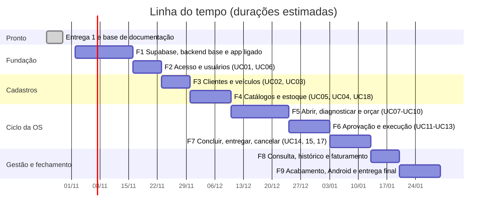
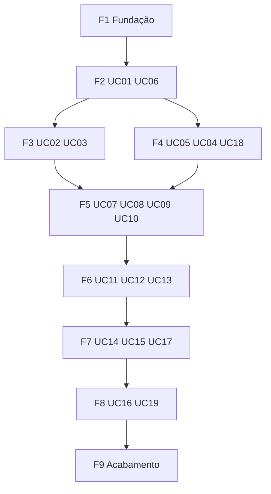

# Linha do tempo de desenvolvimento — OficinaFácil

Ordem de criação das funcionalidades, do que já existe até a entrega final. Cada fase só depende das
anteriores. Stack: Flutter + backend Node/TypeScript + Supabase ([[Arquitetura]]).

> **Premissas.** (1) As durações abaixo são **estimativas** para ordenar o trabalho, a partir de
> 02/11/2026; ajustar às datas do professor e às provas (decisão D5). (2) UC18, UC19 e as histórias
> valem até a conferência com o enunciado oficial (D4). (3) Decisões em [[00 - Índice de decisões]].

## 1. Visão geral

Soma: 89 dias (cerca de 13 semanas), terminando por volta de **30/01/2027** se tudo correr em sequência. Natal e Ano-Novo caem na F5 e na F6, e provas das outras disciplinas não estão descontadas: tratar como o melhor caso.

## 2. Dependências

Por que essa ordem:
- **Fundação antes de tudo:** sem Supabase, backend, JWT e migration inicial, nenhuma feature tem onde rodar.
- **Login antes dos cadastros:** RN09 diz que cada perfil só faz o que pode.
- **Clientes, veículos, serviços e peças antes da OS:** a OS referencia os quatro.
- **Estoque antes de peças usadas:** UC13 baixa saldo, que nasce em UC04 e UC18.
- **Cancelar (UC17) depois de entregar:** o estorno de peças depende de UC13.
- **Faturamento por último:** soma pagamentos de OS entregues.

## 3. Como cada feature é construída

Toda feature (UC) segue as mesmas 9 tarefas, nesta ordem (lista marcável no `CHECKLIST` do vault):

1. **Modelo:** tabelas e migration Prisma; RLS.
2. **API:** rota (Zod + perfil), serviço (regra, transação), repositório.
3. **Testes da API:** Vitest, um teste por critério de aceitação e por permissão.
4. **Contrato:** `npm run openapi:gerar`.
5. **App: domínio e dados:** entidades, contrato e implementação com `dio`.
6. **App: telas:** widgets e providers Riverpod.
7. **Testes do app:** domínio e widget.
8. **Verificação:** lint, typecheck, testes, smoke e build.
9. **Documentação:** CAs em ✅, devtrack, documentos e PDFs.

Fatia vertical: **cada fase termina com algo testável de ponta a ponta** (do app ao banco), nunca um backend inteiro sem tela.

## 4. Fases

### F0 — Entrega 1 e base de documentação (concluída)
Tela inicial, logo, nome, repositório, diagramas, `StatusOrdemServico` com testes, casos de uso, histórias, requisitos, modelo de dados, arquitetura, decisões, README e PDFs.

### F1 — Fundação técnica (feature 000)
| Item | Detalhe |
|---|---|
| Supabase | Projetos de desenvolvimento e de teste; chaves fora do git |
| Backend | Express 5, TypeScript, env com Zod, Pino, Helmet, rate limit, erros padronizados, `/health` |
| Segurança | JWT por JWKS, middleware de perfil, teste de arquitetura dos módulos |
| Banco | Prisma, migration inicial do [[Modelo de dados|modelo de dados]], RLS em todas as tabelas, seed do gerente |
| Contrato | OpenAPI + Swagger |
| App | `supabase_flutter`, `dio`, `--dart-define`, `redirect` por perfil |
| Entrega | Dockerfile, `smoke.sh` inicial, CI |

**Pronto quando:** o app autentica no Supabase, chama `/health` e `/me` no backend e a migration está aplicada com RLS.

### F2 — Acesso e usuários (001, 006)
Login, sessão, sair; gestão de usuários pelo gerente (cria conta no Supabase Auth). **Marco M1.**

### F3 — Clientes e veículos (002, 003)
Cadastros, busca, inativação, transferência de veículo.

### F4 — Catálogos e estoque (005, 004, 018)
Serviços, peças com alerta de estoque mínimo, entrada no estoque, razão de movimentações. **Marco M2.**

### F5 — Abrir, diagnosticar e orçar (007, 008, 009, 010)
OS em `ABERTA` → `DIAGNOSTICADA` → `AGUARDANDO_APROVACAO`; desconto acima de 10% por solicitação do atendente e decisão do gerente (decisão 007). Inclui a lista e o detalhe simples de OS, que o mecânico e o atendente já usam. **Marco M3.**

### F6 — Aprovação e execução (011, 012, 013)
Aprovação e recusa do cliente, execução, peças usadas com baixa de estoque atômica, avisos gravados e entregues por Realtime (decisão 010). Ajuste de orçamento e serviço extra ficam fora até a D3.

### F7 — Concluir, entregar e cancelar (014, 015, 017)
Conclusão, entrega com pagamentos numa transação (decisão 009), cancelamento com estorno (decisão 008). **Marco M4: ciclo completo da OS.**

### F8 — Consulta, histórico e faturamento (016, 019)
Filtros completos, fila do mecânico, histórico de transições, faturamento agregado no servidor.

### F9 — Acabamento e entrega final (020)
Teste em Android, layout responsivo, `smoke.sh` do fluxo completo, imagem Docker e API de demonstração no ar, APK, documentos e PDFs atualizados, tag de versão. **Marco M5.**

## 5. Marcos

| Marco | Fase | O que o professor consegue ver |
|---|---|---|
| M1 | F2 | Login com 4 perfis e gestão de usuários |
| M2 | F4 | Cadastros e estoque completos |
| M3 | F5 | OS aberta, diagnosticada e orçada |
| M4 | F7 | **Ciclo completo** da OS até a entrega |
| M5 | F9 | Sistema completo, testado em web e Android, API no ar |

## 6. Decisões e riscos

Decisões em [[00 - Índice de decisões]]. Abertas que afetam o plano: **D4** (enunciado oficial, afeta UC18, UC19 e histórias), **D3** (ajuste de orçamento), **D5** (recorte de entrega).

| Risco | Mitigação |
|---|---|
| Enunciado oficial diferente do que deduzimos | Resolver D4 antes da F1; specs e telas são ajustadas no gerador e regeneradas (com `--force`, antes de começar a implementar) |
| Dois projetos (app e backend) e TypeScript novo | Backend em camadas simples, testes junto da regra, sem geração de código |
| Dependência de internet e de plano gratuito do Supabase e da hospedagem | Confirmar limites e pausa por inatividade antes da demonstração; projeto de demonstração separado |
| Prazo apertado | Fatias verticais; cortar UC18 e UC19 se o professor não os pedir |

## 7. Regras de cada fase

- Camada `domain` do app não importa Flutter, `data` nem `presentation`; módulos do backend só se falam por `index.ts`.
- Cada fase termina com as verificações do backend e do app verdes (lista em [[Arquitetura]], seção 9).
- Cada fase atualiza o devtrack e move os itens no quadro do GitHub.
