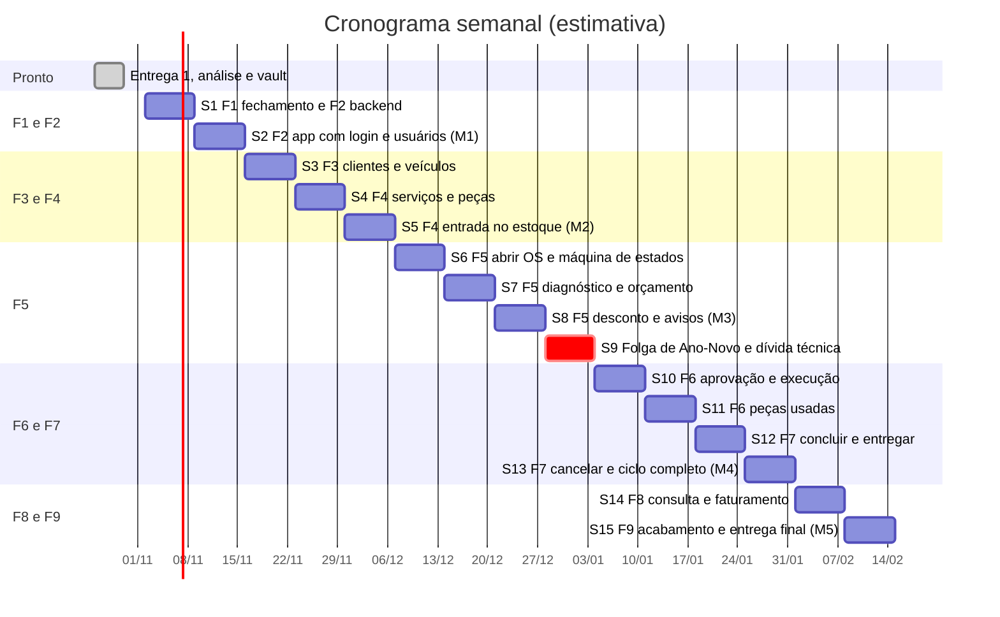
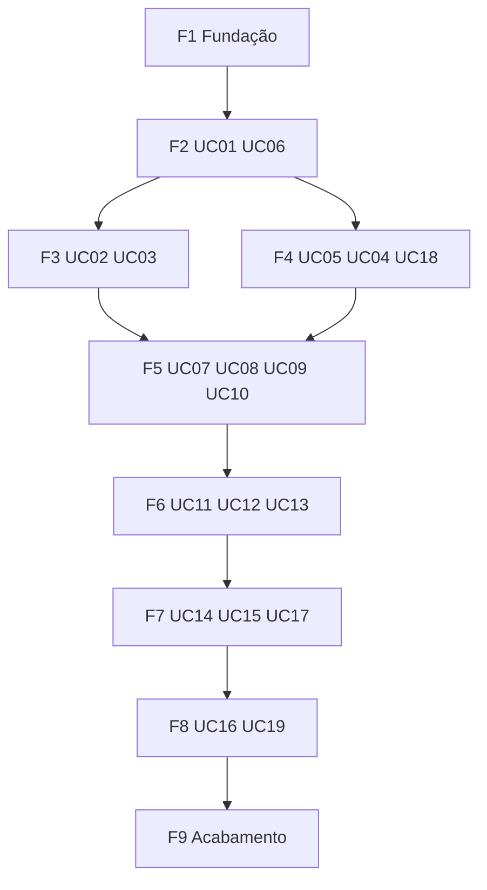

# Linha do tempo de desenvolvimento — OficinaFácil

Cronograma **semana a semana** até a entrega final. O que construir em cada fase (telas, componentes, módulos) está em [[Plano de construção]]; aqui ficam **quando** e **em que ordem**. Stack em [[Arquitetura]].

> **Premissas.** (1) Semanas de segunda a domingo, a partir de **02/11/2026**; são estimativas e devem ser ajustadas às datas do professor e às provas (decisão 005). (2) UC18, UC19 e as histórias valem como especificação, pois o professor não entregou documento (decisão 004). (3) Natal e Ano-Novo caem nas semanas 8 e 9; por isso a semana 9 é de folga. (4) Decisões em [[00 - Índice de decisões]].

## 1. Visão geral

**15 semanas: de 02/11/2026 a 14/02/2027.** A semana 9 é folga proposital: se uma semana anterior estourar, ela absorve o atraso sem empurrar o resto.

## 2. Plano semanal

| Sem | Período | Fase | Entrega da semana | Marco |
|---|---|---|---|---|
| S1 | 02/11 a 08/11 | F1 e F2 | Fecha a fundação e constrói o backend de usuários | |
| S2 | 09/11 a 15/11 | F2 | Login, sessão, menu por perfil e gestão de usuários no app | **M1** |
| S3 | 16/11 a 22/11 | F3 | Clientes e veículos, do banco à tela | |
| S4 | 23/11 a 29/11 | F4 | Serviços e peças | |
| S5 | 30/11 a 06/12 | F4 | Entrada no estoque, baixa e estorno atômicos | **M2** |
| S6 | 07/12 a 13/12 | F5 | Abrir OS, lista, detalhe e máquina de estados | |
| S7 | 14/12 a 20/12 | F5 | Diagnóstico e orçamento | |
| S8 | 21/12 a 27/12 | F5 | Desconto, avisos e notificações | **M3** |
| S9 | 28/12 a 03/01 | folga | Folga, dívida técnica, revisão e PDFs | |
| S10 | 04/01 a 10/01 | F6 | Aprovação do cliente e execução | |
| S11 | 11/01 a 17/01 | F6 | Peças usadas, com testes de concorrência | |
| S12 | 18/01 a 24/01 | F7 | Concluir e entregar com pagamento | |
| S13 | 25/01 a 31/01 | F7 | Cancelar com estorno e ciclo completo | **M4** |
| S14 | 01/02 a 07/02 | F8 | Consulta com filtros, histórico e faturamento | |
| S15 | 08/02 a 14/02 | F9 | Android real, deploy, APK, documentos e tag | **M5** |

### S1 (02/11 a 08/11): fechar a F1 e backend da F2
- **F1:** fechada em 2026-10-30; o seed do gerente inicial foi feito (CA10 da feature 000). Só resta rotacionar as credenciais coladas no chat. Não haverá projeto de teste separado (decisão do usuário em 2026-10-30): os testes de integração rodam no projeto único, que ainda não tem dados reais; os 26 passaram e os CAs 01 e 05 foram marcados. A chave de serviço e as strings de conexão já estão configuradas. O primeiro push já foi feito e o CI passou.
- **Backend da F2 (feature 006):** cliente administrativo do Supabase; listar, criar, detalhar, alterar, redefinir senha, inativar e ativar usuário; compensação ao falhar; banir no Auth ao inativar; último gerente protegido; seed do gerente rodando.
- **Testes:** permissões por perfil, e-mail duplicado, último gerente, integração no projeto de teste.
- **Demonstração:** criar e inativar usuários pela API (Swagger) com o JWT de um gerente real.
- **Commits:** um para fechar a 000, um para a 006 (backend).

### S2 (09/11 a 15/11): app da F2 (features 001 e 006)
- **Componentes:** `AppShell` responsivo, `EstadoVazio`, `EstadoErro`, `Carregando`, `ConfirmarDialog`, `ListaPaginada`, mapeador de erro da API em texto pt-BR.
- **Sessão:** `SessaoNotifier` (login do Supabase, `GET /me`, renovação do token), guarda de rotas por perfil, logout.
- **Telas:** T01 Login, T02 Início por perfil, T03 Lista de usuários, T04 Formulário de usuário.
- **Demonstração (M1):** o gerente entra no web e no Android, cria um usuário de cada perfil, cada um entra vendo só o seu menu; usuário inativado não entra.
- **Commits:** 001 e 006 (app).

### S3 (16/11 a 22/11): clientes e veículos (features 002 e 003)
- **Backend:** validadores de CPF/CNPJ e placa; log sem query string; módulos `clientes` e `veiculos`; duplicados com 409 apontando o existente; transferir veículo.
- **App:** máscaras, `SeletorCliente`, T05, T06 e T07.
- **Demonstração:** cadastrar cliente e veículo, ver o duplicado recusado, transferir o veículo.
- **Commits:** um por feature.

### S4 (23/11 a 29/11): serviços e peças (features 005 e 004)
- **Backend:** módulos `servicos` e `pecas` (CRUD, alerta de estoque mínimo, saldo só leitura).
- **App:** `CampoDinheiro`, T08 e T09 (serviços), T10 e T11 (peças).
- **Demonstração:** gerente mantém serviços; almoxarife mantém peças e vê o alerta.
- **Decisão a confirmar até aqui:** propostas 007 a 010.

### S5 (30/11 a 06/12): entrada no estoque (feature 018) e base do estoque
- **Backend:** entrada com razão; `baixar(tx)` e `estornar(tx)` no `index.ts` de `pecas` com `UPDATE ... WHERE saldo >= q`; **teste de concorrência** no projeto de teste.
- **App:** T12 Entrada no estoque com histórico de movimentações.
- **Demonstração (M2):** cadastros e estoque completos, saldo batendo com o razão.
- **Commits:** 018. Fecha a F4.

### S6 (07/12 a 13/12): abrir OS e máquina de estados (feature 007)
- **Backend:** módulo `ordens`; `transicoes.ts` (toda a tabela de estados, histórico, proteção contra clique duplo); criar OS; lista e detalhe (mecânico sem documento e telefone do cliente).
- **App:** `ChipStatusOs`, `CardOs`, `AcoesDaOs`; T13 Abrir OS, T14 lista, T15 detalhe.
- **Demonstração:** abrir uma OS, ver na lista e no detalhe; veículo com OS ativa é recusado.

### S7 (14/12 a 20/12): diagnóstico e orçamento (features 008 e 009)
- **Backend:** diagnóstico com rascunho; orçamento (gravar, recalcular, confirmar); fronteira de 10% testada.
- **App:** `SeletorPeca` e de serviço; T16 Diagnóstico e T17 Orçamento.
- **Demonstração:** mecânico diagnostica, atendente monta o orçamento e confirma (sem desconto acima de 10%).

### S8 (21/12 a 27/12): desconto e avisos (feature 010)
- **Backend:** migration do tipo `DESCONTO_DECIDIDO`; solicitação e decisão de desconto pelo JWT do gerente; módulo `avisos`.
- **App:** T18 Solicitações de desconto e T24 Notificações (com Realtime).
- **Demonstração (M3):** OS aberta, diagnosticada e orçada, com desconto acima de 10% passando pelo gerente e avisos nos dois sentidos.
- **Risco:** semana de Natal. Se estourar, termina na S9.

### S9 (28/12 a 03/01): folga e dívida técnica
- Concluir o que sobrou da F5 (se sobrou).
- Revisão geral (um agente revisor, como foi feito em 30/10), PDFs de `entregas/` regerados, quadro do GitHub atualizado, atualizar o Plano de construção com o que aprendemos.
- **Decisão 003 precisa estar tomada até o fim desta semana** (ela bloqueia a S10).
- Nenhuma feature nova.

### S10 (04/01 a 10/01): aprovação e execução (features 011 e 012)
- **Backend:** aprovar e recusar (recusa exige motivo e cancela); orçamento imutável; iniciar execução; observações.
- **App:** T19 Aprovação e T20 Execução (sem peças ainda).
- **Demonstração:** o cliente decide e o mecânico inicia a execução.

### S11 (11/01 a 17/01): peças usadas (feature 013)
- **Backend:** lançar peça com `baixar(tx)`; saldo insuficiente gera aviso ao almoxarife fora da transação desfeita; peça fora do orçamento pede confirmação; remover lançamento estorna.
- **App:** lançar e remover peça na T20; T15 mostra peças e observações.
- **Teste:** concorrência na mesma peça no projeto de teste.
- **Demonstração:** o saldo cai e volta corretamente.

### S12 (18/01 a 24/01): concluir e entregar (features 014 e 015)
- **Backend:** concluir e avisar; `POST /os/:id/entregar` com pagamentos, soma igual ao total, numa transação.
- **App:** botão Concluir; T21 Pagamento e entrega com "faltam R$ X".
- **Demonstração:** uma OS vai até `ENTREGUE` pagando em duas formas.

### S13 (25/01 a 31/01): cancelar e ciclo completo (feature 017)
- **Backend:** cancelar com motivo e estorno na mesma transação, com "não devolver".
- **App:** T22 Cancelar OS.
- **`smoke.sh` estendido** para o ciclo completo com um usuário de cada perfil.
- **Demonstração (M4):** ciclo `ABERTA` até `ENTREGUE` pelo app, e outra OS cancelada devolvendo as peças.

### S14 (01/02 a 07/02): consulta e faturamento (features 016 e 019)
- **Backend:** filtros combinados, paginação, histórico; faturamento agregado no servidor (fuso de São Paulo).
- **App:** T14 completa, linha do tempo na T15, T23 Faturamento.
- **Demonstração:** achar qualquer OS por qualquer filtro; faturamento batendo com os pagamentos.

### S15 (08/02 a 14/02): acabamento e entrega final (feature 020)
- Teste de todas as telas no Android real e layout responsivo no web; acessibilidade.
- Imagem Docker publicada, API de demonstração com a string do pooler, projeto Supabase de produção, web hospedado, APK de release assinado.
- Documentos e PDFs regerados, changelog no vault, versão e tag.
- **Demonstração (M5):** sistema completo, no ar, em web e Android.

## 3. Ritmo de toda semana

| Dia | O que acontece |
|---|---|
| Segunda | Ler memória, último devtrack, `prioridade/atual` e o CHECKLIST; abrir as features da semana e confirmar que as dependências estão ✅; resolver o que depende de você |
| Terça a quinta | Construir uma feature por vez em fatia vertical: migration se preciso, backend, contrato, app; testes junto; commit ao fechar cada feature (regra R8) |
| Sexta | Rodar **toda** a verificação (backend e app), `smoke.sh`, conferir CAs e CHECKLIST, escrever o devtrack e atualizar `prioridade/atual`; PDFs só no fechamento de fase ou antes de uma entrega |

**Definição de pronto da semana:** a demonstração da semana funciona de ponta a ponta, as verificações estão verdes, o devtrack e o CHECKLIST estão atualizados e o trabalho está commitado (push só quando o usuário pedir).

## 4. Dependências

- **Login antes dos cadastros:** RN09 diz que cada perfil só faz o que pode.
- **Clientes, veículos, serviços e peças antes da OS:** a OS referencia os quatro.
- **Estoque antes de peças usadas:** UC13 baixa saldo, que nasce em UC04 e UC18.
- **Cancelar depois de entregar:** o estorno de peças depende de UC13.
- **Faturamento por último:** soma pagamentos de OS entregues.

## 5. Como cada feature é construída

Toda feature segue as mesmas 9 tarefas, lista marcável no [[CHECKLIST]]: modelo, API, testes da API, contrato, app (domínio e dados), app (telas), testes do app, verificação e documentação. Cada fase termina com algo testável de ponta a ponta, nunca um backend inteiro sem tela.

## 6. Marcos

| Marco | Semana | Data | O que o professor consegue ver |
|---|---|---|---|
| M1 | S2 | 15/11 | Login com 4 perfis e gestão de usuários |
| M2 | S5 | 06/12 | Cadastros e estoque completos |
| M3 | S8 | 27/12 | OS aberta, diagnosticada e orçada, com desconto aprovado pelo gerente |
| M4 | S13 | 31/01 | **Ciclo completo** da OS até a entrega |
| M5 | S15 | 14/02 | Sistema completo, testado em web e Android, API no ar |

## 7. Decisões e riscos

| Decisão | Precisa estar fechada até |
|---|---|
| Criar projeto Supabase de **teste**, `SUPABASE_SERVICE_ROLE_KEY` e string do pooler | S1 |
| Confirmar as propostas 007 a 010 (desconto, estoque, pagamento, avisos) | S5 |
| **003** (ajuste do orçamento e serviço extra) | fim da S9 |
| 005 (recorte de entrega) e 011 (UML formal) | conforme o professor pedir |

| Risco | Mitigação |
|---|---|
| Semana estoura | S9 é folga; se necessário, cortar UC18 e UC19 (deduzidos) e os itens ⚠️ |
| Natal e Ano-Novo nas S8 e S9 | S8 é a mais sensível; o que sobrar termina na S9 |
| Provas e entregas das outras disciplinas | Ajustar as semanas; o plano é por semana justamente para isso |
| Dois projetos (app e backend) e TypeScript novo | Backend em camadas simples, testes junto da regra |
| Plano gratuito do Supabase e da hospedagem (pausa por inatividade, IPv6) | Confirmar limites antes de S15; pooler em produção |
| Enunciado oficial aparecer depois | Specs e telas são regeneráveis (com `--force`) e conferidas contra o enunciado |
