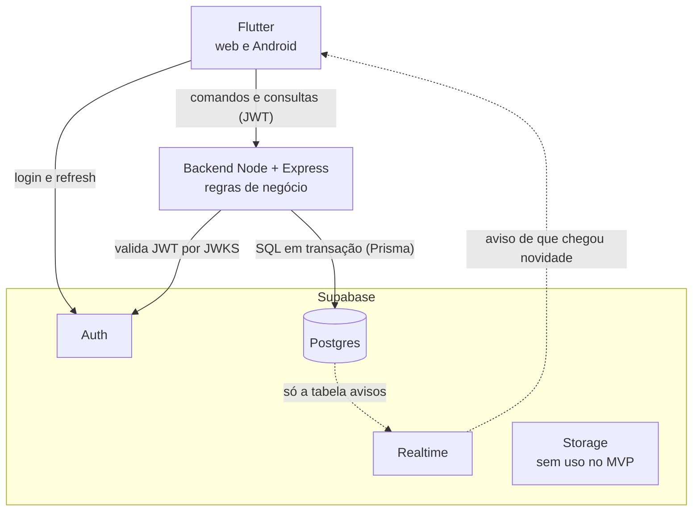
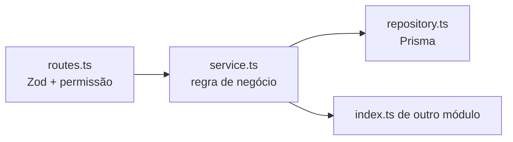
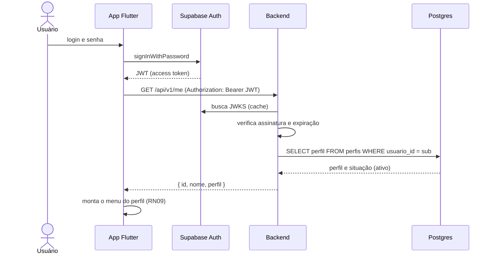
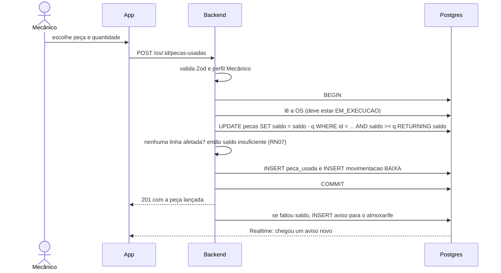

# Arquitetura — OficinaFácil

Stack: **Flutter** (web e Android) + **backend Node.js/TypeScript** + **Supabase** (Postgres, Auth, Realtime, Storage).
Decisões em [[00 - Índice de decisões]] (001, 002, 006, 012).

## 1. Visão geral



Regra central: **toda escrita passa pelo backend**, e **toda leitura de dados de negócio também** (RLS bloqueia o resto). O Realtime só publica a tabela `avisos`, filtrada pelo destinatário. O Storage fica disponível no Supabase, mas nenhum caso de uso usa anexos no MVP.

## 2. Responsabilidades

| Responsabilidade | Onde |
|---|---|
| Login, sessão, refresh de token | Supabase Auth, no app (`supabase_flutter`) |
| Quem está chamando e com qual perfil (RN09) | Backend: valida o JWT e lê `perfis` |
| Estados da OS, desconto acima de 10%, baixa de estoque, pagamento, cancelamento (RN01 a RN08) | Backend, uma transação por caso de uso |
| Criar e inativar usuário (UC06) | Backend, com a API admin do Supabase (chave de serviço só no servidor); ao inativar, também bane a conta no Auth (`ban_duration`) além de `perfis.ativo = false` |
| Dados | Postgres do Supabase, tabelas em [[Modelo de dados]] |
| Bloquear leitura e escrita fora do backend | RLS ligada em todas as tabelas; sem política de escrita e, exceto `avisos` do próprio usuário, sem política de leitura |
| Avisos entre perfis (decisão 010) | Tabela `avisos` gravada pelo backend; Supabase Realtime só notifica o app, que busca `GET /avisos` |
| Validação de entrada e contrato | Zod em toda rota; OpenAPI gerado a partir dos schemas |

## 3. Backend

Monólito modular. Cada módulo tem `index.ts` como **única porta pública**; módulos só se falam por ela (um teste de arquitetura impede importar o interior de outro módulo).

```
backend/
├── src/
│   ├── app.ts · server.ts
│   ├── config/                # env validado com Zod
│   ├── shared/                # auth (JWT/JWKS), db (Prisma), errors, http, openapi, logger, supabase
│   └── modules/
│       ├── usuarios/          # UC01 (perfil), UC06
│       ├── clientes/          # UC02
│       ├── veiculos/          # UC03
│       ├── servicos/          # UC05
│       ├── pecas/             # UC04, UC18 e a movimentação de estoque
│       ├── ordens/            # UC07 a UC17: OS, diagnóstico, orçamento, aprovação, execução, pagamento, histórico
│       └── faturamento/       # UC19
├── prisma/                    # schema e migrations (RLS, gatilhos e índices extras vão dentro delas)
├── scripts/smoke.sh           # fluxo ponta a ponta
├── test/                      # vitest (regras, rotas, arquitetura)
├── Dockerfile
└── openapi.json
```

Camadas dentro de cada módulo:



- `routes.ts`: valida a entrada com Zod, checa o perfil e chama o serviço.
- `service.ts`: aplica as regras (RN01 a RN09) e abre a transação.
- **Transação entre módulos:** o módulo `pecas` exporta no `index.ts` as funções `baixar(tx, ...)` e `estornar(tx, ...)`, que recebem o cliente de transação do Prisma. O módulo `ordens` abre a transação e as chama, sem importar nada do interior de `pecas`.
- `repository.ts`: único lugar que fala com o Prisma.

### Pacotes

| Uso | Pacote |
|---|---|
| Servidor | `express` 5, `helmet`, `cors`, `express-rate-limit` |
| Validação e OpenAPI | `zod`, `@asteasolutions/zod-to-openapi`, `swagger-ui-express` |
| Banco | `prisma`, `@prisma/client`, `@prisma/adapter-pg`, `pg` |
| Auth | `jose` (JWKS), `@supabase/supabase-js` (API admin) |
| Logs | `pino`, `pino-http` |
| Qualidade | `typescript`, `eslint`, `prettier`, `vitest`, `tsx` |

Fora de propósito: `bullmq`, `ioredis` (sem tarefas em segundo plano nos casos de uso).

## 4. App Flutter

Clean Architecture por feature, como hoje: `mobile/lib/features/<feature>/{domain,data,presentation}`.

| Camada | Papel |
|---|---|
| `domain` | Entidades e contratos. Sem Flutter, sem `data`, sem `presentation`. Valida só o que ajuda a UI (campos obrigatórios); a regra definitiva é do backend |
| `data` | Repositórios que chamam a API com `dio` e mapeiam JSON → entidade |
| `presentation` | Telas e providers Riverpod |
| `core/` | Tema, rotas (`go_router` com `redirect` por perfil), cliente HTTP, sessão Supabase, configuração por `--dart-define` |

Pacotes novos no app: `supabase_flutter`, `dio`.

## 5. Autenticação e autorização



- O JWT identifica a pessoa. O **perfil vem da tabela `perfis`**, não de um campo editável pelo usuário.
- Cada rota declara os perfis permitidos. Perfil sem permissão recebe `403`.
- Usuário inativo recebe `403` mesmo com token válido.

## 6. Exemplo de fluxo: lançar peça usada (UC13)



Duas pessoas lançando a mesma peça ao mesmo tempo não deixam o saldo negativo: o `UPDATE` condicional é atômico (a segunda requisição não encontra saldo e falha), com `CHECK (saldo >= 0)` como segunda barreira.

## 7. Segurança (padrões do projeto)

- **RLS em toda tabela**, inclusive `_prisma_migrations`; `anon` e `authenticated` sem `INSERT`, `UPDATE` nem `DELETE`, e sem `SELECT` fora de `avisos` do próprio usuário.
- Chave de serviço (`service_role`) **só no backend**. No app, apenas a chave publicável.
- JWT: aceitar só os algoritmos do JWKS do projeto; conferir `iss`, `aud` (`authenticated`) e `exp`.
- Senha só trafega pelo backend em UC06 (criar e redefinir usuário) e **nunca é logada**; o Pino redige `authorization`, `senha` e `password`.
- CORS restrito às origens do web do projeto.
- Zod em toda entrada. `helmet`, rate limit nas rotas de escrita e de autenticação.
- Dinheiro em **centavos inteiros**, nunca ponto flutuante.
- Comparação de segredos com `crypto.timingSafeEqual`.
- Segredos em `backend/.env` e `mobile/env.json`, **ignorados pelo git**; no CI e na hospedagem, em *secrets* do provedor. `backend/.env.example` e `mobile/env.example.json` (sem valores reais) são versionados. Nada de chave em arquivo versionado nem em log.
- Dados pessoais (CPF/CNPJ, telefone, endereço): ver RNF de LGPD em [[Requisitos]].

## 8. Ambientes

| Ambiente | App | Backend | Banco |
|---|---|---|---|
| Desenvolvimento | `flutter run` | `npm run dev` (porta 3000, Swagger em `/docs`) | Projeto Supabase de **desenvolvimento** |
| Teste automatizado e CI | — | `npm test` | Não há projeto de teste (decisão do usuário em 2026-10-30; a branch do Supabase é recurso pago). Os testes de integração rodam no projeto único enquanto ele não tiver dados reais; `prisma migrate reset` **não** é permitido |
| Produção (demonstração) | Web estática + APK | Container Docker em Railway ou Render (a confirmar) | Projeto Supabase separado |

**Conexão com o banco (achado na F1):** a conexão *direta* do Supabase (`db.<projeto>.supabase.co`) só tem endereço IPv6. Funciona na máquina de desenvolvimento, mas **não** em ambientes só IPv4: a rede padrão do Docker e vários provedores de hospedagem. Por isso `DIRECT_URL` (migrations) pode ser a direta, mas `DATABASE_URL` da API em produção e no CI deve ser a string do **pooler** (Supavisor), que tem IPv4. Verificado: o contêiner na rede padrão marcou o banco como indisponível; com a rede do host (IPv6) respondeu `ok`.

Nunca usar o projeto de produção sem liberação explícita. Banco **não** roda em container: Auth e Realtime só existem no Supabase. Testes de integração (concorrência, falha injetada, RLS com a chave publicável) rodam hoje no projeto único, por exceção à regra R19 autorizada pelo usuário em 2026-10-30, e só enquanto o banco não tiver dados reais; o teste do último gerente desativa temporariamente todos os gerentes ativos. Antes de haver dados reais é preciso criar um projeto de teste ou reescrever a R19.

## 9. Qualidade e verificação

Antes de cada commit, na máquina de quem desenvolve (e no CI, se criado):

| Parte | Comandos |
|---|---|
| Backend | `npm run lint && npm run format:check && npm run typecheck && npm test` e `bash scripts/smoke.sh` |
| App (em `mobile/`) | `dart format --output=none --set-exit-if-changed lib test`, `flutter analyze`, `flutter test`, `flutter build apk --debug` |

## 10. Camadas do app (referência)

Diagrama de camadas e estrutura de pastas do app em [[Diagramas]], seções 3 e 4.
