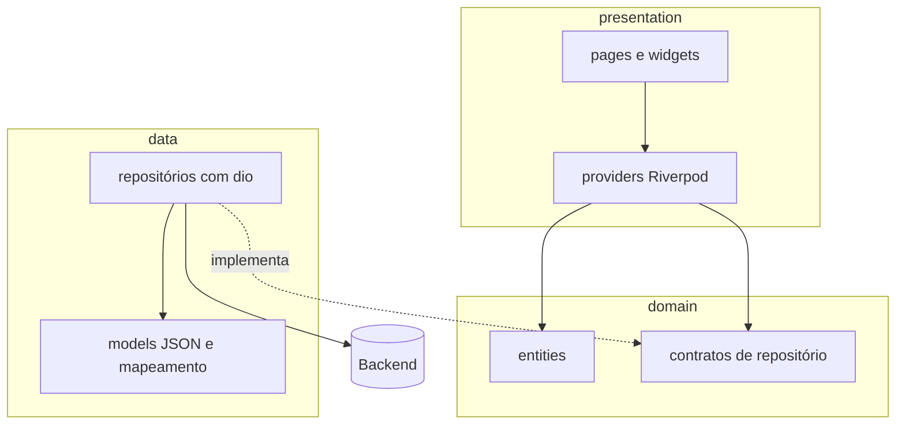
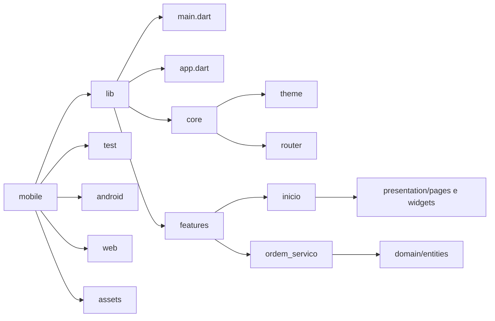

# Diagramas — OficinaFácil

Diagramas do **app Flutter**. Para não duplicar:
- Diagramas de casos de uso (geral e por módulo) e o diagrama de estados da OS: [[Casos de uso]], seções 3, 4 e 5.
- Visão de sistema (app, backend, Supabase), autenticação e fluxo de transação: [[Arquitetura]].
- Modelo de dados: [[Modelo de dados]].

## 1. Camadas do app

Clean Architecture por feature. A dependência aponta sempre para dentro: `presentation → domain ← data`.
A regra de negócio é do backend, então `domain` guarda entidades e contratos, e `data` conversa com a API.

`usecases` só existem no app quando houver regra de interface reutilizada; a regra de negócio nunca entra aqui.

## 2. Estrutura de pastas do app (`mobile/`)

Novas features seguem `mobile/lib/features/<nome>/{domain,data,presentation}`. O `data` existe em toda feature que chama a API.
