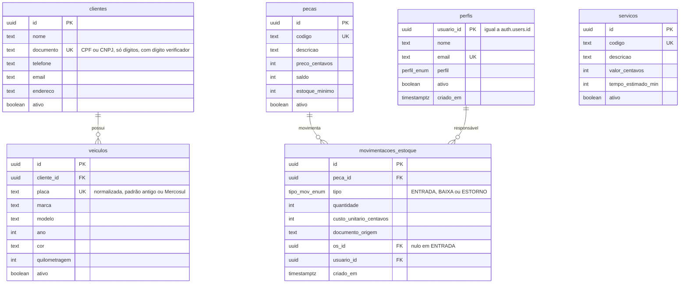
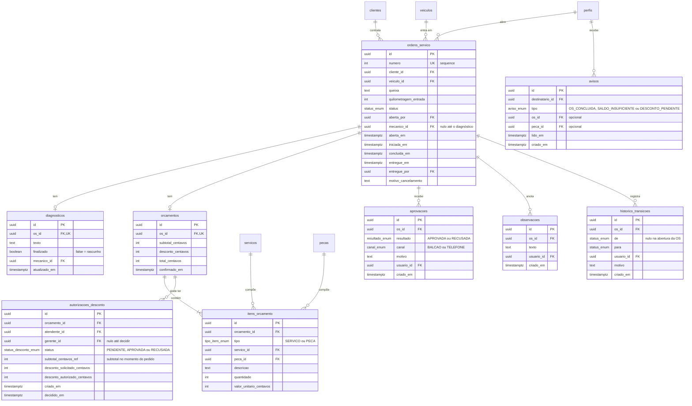
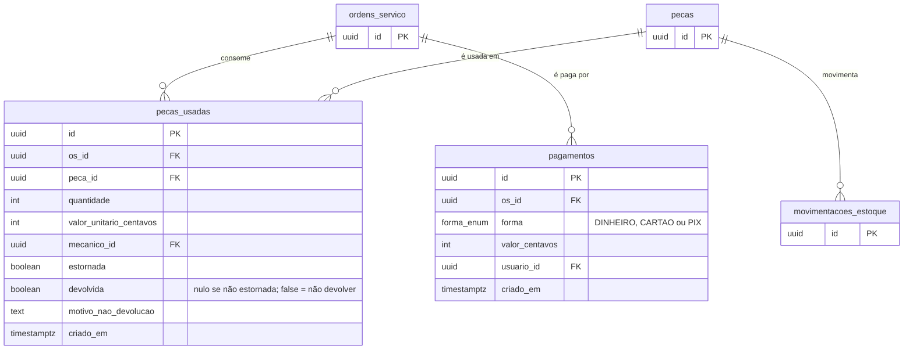

# Modelo de dados — OficinaFácil

Banco: Postgres do Supabase, acessado pelo backend via Prisma. Arquitetura em [[Arquitetura]].

Convenções:
- Chaves primárias `uuid` (`id`), exceto `ordens_servico.numero`, que é sequencial e legível.
- **Dinheiro em centavos** (`inteiro`). Datas em `timestamptz`; relatórios por período usam o fuso **America/Sao_Paulo**.
- Nomes de tabela em `snake_case` e no plural. Colunas em `snake_case`.
- Nada é apagado de verdade: cadastros usam `ativo`; movimentação, histórico e pagamentos são **só de inserção**.
- `ordens_servico.numero` vem de uma sequence do Postgres; **lacunas na numeração são aceitas** (rollback consome número).

## 1. Diagramas entidade-relacionamento

O modelo é dividido em três diagramas, por assunto, para ficar legível. Tabelas que aparecem só com a chave primária são detalhadas no diagrama onde pertencem.

### 1.1 Cadastros e estoque

### 1.2 Ordem de serviço, orçamento e histórico

### 1.3 Execução e pagamento

## 2. Enumerações

| Enum | Valores |
|---|---|
| `perfil_enum` | `ATENDENTE`, `MECANICO`, `ALMOXARIFE`, `GERENTE` |
| `status_enum` | `ABERTA`, `DIAGNOSTICADA`, `AGUARDANDO_APROVACAO`, `APROVADA`, `EM_EXECUCAO`, `CONCLUIDA`, `ENTREGUE`, `CANCELADA` |
| `tipo_mov_enum` | `ENTRADA`, `BAIXA`, `ESTORNO` |
| `tipo_item_enum` | `SERVICO`, `PECA` |
| `resultado_enum` | `APROVADA`, `RECUSADA` |
| `status_desconto_enum` | `PENDENTE`, `APROVADA`, `RECUSADA` |
| `canal_enum` | `BALCAO`, `TELEFONE` |
| `forma_enum` | `DINHEIRO`, `CARTAO`, `PIX` |
| `aviso_enum` | `OS_CONCLUIDA`, `SALDO_INSUFICIENTE`, `DESCONTO_PENDENTE` |

**Mapeamento do estado da OS.** No banco e na API o estado é `AGUARDANDO_APROVACAO` (igual às notas). No Dart, o enum `StatusOrdemServico` usa `aguardandoAprovacao`. A conversão é explícita, num único lugar (`fromApi`/`toApi`), e tem teste.

## 3. Dicionário das tabelas

| Tabela | Finalidade | UC |
|---|---|---|
| `perfis` | Perfil e situação de cada usuário; `usuario_id` aponta para `auth.users` do Supabase | UC01, UC06 |
| `clientes` | Cadastro de clientes | UC02 |
| `veiculos` | Veículos de um cliente | UC03 |
| `servicos` | Catálogo de serviços e valor da mão de obra | UC05 |
| `pecas` | Catálogo de peças e saldo atual | UC04 |
| `movimentacoes_estoque` | Razão do estoque: toda entrada, baixa e estorno. O `saldo` em `pecas` é consequência | UC13, UC17, UC18 |
| `ordens_servico` | A OS e seu estado atual | UC07 a UC17 |
| `diagnosticos` | Parecer do mecânico (um por OS); `finalizado = false` é rascunho | UC08 |
| `orcamentos` e `itens_orcamento` | Valores da OS; itens guardam o preço do momento | UC09 |
| `autorizacoes_desconto` | Pedido e decisão de desconto acima de 10%; perde a validade se o subtotal ou o desconto mudar | UC10 |
| `aprovacoes` | Resposta do cliente (aprova ou recusa) | UC11 |
| `observacoes` | Anotações de andamento do mecânico durante a execução | UC12 |
| `pecas_usadas` | Peças efetivamente consumidas; guarda estorno e "não devolver" | UC13, UC17 |
| `pagamentos` | Pagamentos gravados no ato da entrega | UC15, UC19 |
| `historico_transicoes` | Toda mudança de estado, com autor e data | UC16 |
| `avisos` | Avisos entre perfis (OS concluída, saldo insuficiente, desconto pendente) | UC13, UC14, UC10 |

## 4. Restrições e índices

| Regra | Como o banco garante |
|---|---|
| Documento, placa, e-mail do perfil, código de peça e de serviço únicos | `UNIQUE` |
| Uma OS ativa por veículo (UC07) | Índice único parcial em `ordens_servico(veiculo_id)` onde `status` não é `ENTREGUE` nem `CANCELADA` |
| Saldo nunca negativo (RN07) | `CHECK (saldo >= 0)` em `pecas`, além do `UPDATE ... WHERE saldo >= q` no serviço |
| Desconto coerente | `CHECK (desconto_centavos >= 0 AND desconto_centavos <= subtotal_centavos)` em `orcamentos` |
| Preços e valores positivos; quantidades positivas | `CHECK (... > 0)` |
| Movimentação, histórico e pagamentos só de inserção | Gatilho que rejeita `UPDATE` e `DELETE` (dentro da migration) |
| Um diagnóstico e um orçamento por OS | `UNIQUE (os_id)` |
| Consultas de OS, faturamento e estoque | Índices em `ordens_servico(status)`, `(veiculo_id)`, `(cliente_id)`, `(aberta_em)`, `(entregue_em)`; `pagamentos(os_id)`; `historico_transicoes(os_id)`; `pecas_usadas(os_id)`; `movimentacoes_estoque(peca_id, criado_em)` |
| `perfis.usuario_id` aponta para `auth.users` | FK escrita em SQL na migration (o Prisma não gerencia o schema `auth`) |

Tudo que o Prisma não expressa (RLS, gatilhos, índice parcial, FK para `auth.users`) vai **dentro da migration**, criada com `prisma migrate dev --create-only` e editada antes de aplicar.

## 5. Regras de cálculo

- `subtotal = Σ quantidade × valor_unitario` dos itens.
- `desconto` em centavos. A regra "acima de 10%" (RN02) é aritmética inteira: **`desconto * 100 > subtotal * 10`** exige autorização aprovada.
- O desconto vale para o orçamento inteiro, não por item.
- `total = subtotal − desconto`.
- A autorização só vale enquanto `subtotal_centavos_ref` e o desconto autorizado continuam iguais ao orçamento; se mudar, volta a ser necessária.
- A OS só vai a `ENTREGUE` quando a soma dos pagamentos enviados na entrega é igual ao `total` (decisão 009).
- Faturamento (UC19) soma pagamentos das OS entregues, no período pela **data de entrega** (`entregue_em`), em America/Sao_Paulo.

## 6. Acesso do app (RLS)

Todas as tabelas têm RLS ligada. Para `anon` e `authenticated`:

| Operação | Política |
|---|---|
| `SELECT` | **Somente em `avisos`**, e só a linha cujo `destinatario_id` é o próprio usuário (`auth.uid()`). Realtime publica só essa tabela |
| `SELECT` nas demais tabelas | **Nenhuma política**: inacessíveis pelo PostgREST e pelo Realtime. O app lê pela API |
| `INSERT`, `UPDATE`, `DELETE` | **Nenhuma política**: bloqueado. Só o backend, com a conexão direta, escreve |

Assim, mesmo com a chave publicável, um usuário não lê OS, clientes nem estoque fora da API (que aplica o perfil). Políticas, gatilhos e índices vivem nas migrations do Prisma. Teste de aceitação: com a chave publicável, qualquer `SELECT` fora de `avisos` retorna zero linhas e qualquer escrita falha.

## 7. Dados pessoais (LGPD)

Cliente guarda nome, documento, telefone, e-mail e endereço. Diretrizes (RNF09 em [[Requisitos]]):
- O mecânico não recebe documento nem telefone do cliente.
- Busca por documento não vai em query string (evita PII nos logs).
- Seed e testes usam só dados fictícios; nenhum CPF real.
- Projeto Supabase na região `sa-east-1` (São Paulo).
- Anonimização de cliente a pedido do titular ainda **não tem caso de uso nem coluna**; depende de aprovação de escopo (fica como pendência no [[CHECKLIST]]).

## 8. Dados iniciais (seed)

- Um usuário **Gerente** para o primeiro acesso, criado pelo script de seed com e-mail e senha vindos de variável de ambiente (nunca no repositório).
- Catálogo fictício (alguns serviços e peças) apenas no ambiente de desenvolvimento.
