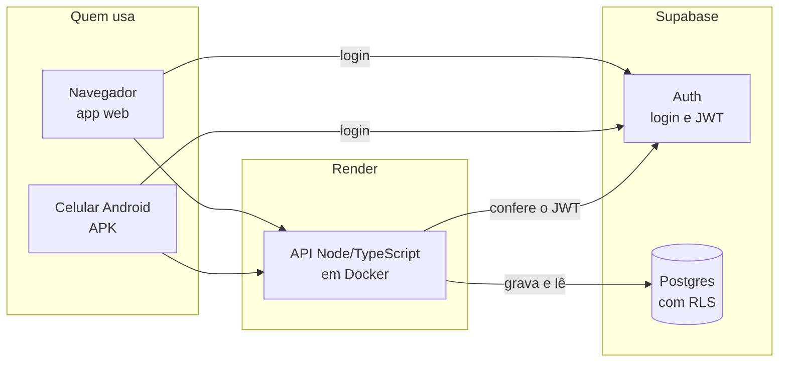

# S1 · Implementação (onde cada parte roda)

Mostra onde o sistema roda de verdade. Decisão: [[014 - Hospedagem da API no Render]]. Visão geral em [[Arquitetura]].

## Como ler

- O **app** (navegador ou celular) tem duas conversas: faz o **login** direto no Supabase e manda **todo o resto** para a API.
- A **API** roda no Render, dentro de um container Docker. Ela confere o JWT e é a única que escreve no banco.
- O **banco** fica só no Supabase, com segurança por linha (RLS). Nunca roda em container.

## Por que é assim

O app não escreve no banco. Mesmo um app adulterado não consegue pular as regras, porque elas vivem na API. No plano grátis do Render a API dorme: a primeira chamada leva cerca de um minuto.
