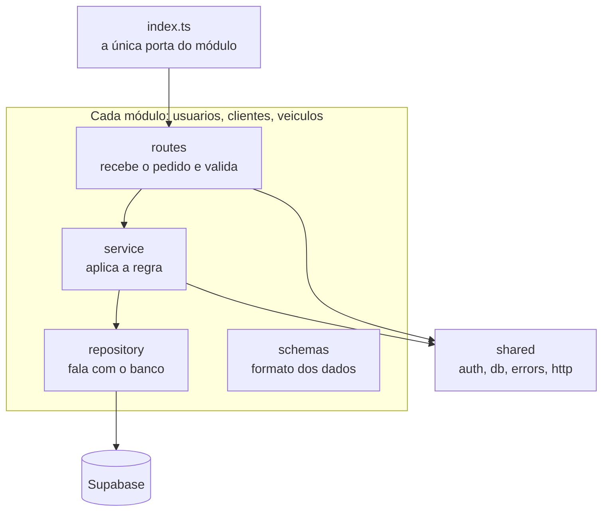

# S1 · Pacotes do backend

Semana 1 (02/11 a 08/11): fundação e backend de usuários. Features: [[000 - Fundação técnica]] e [[006 - Gerir usuários]].

## Como ler

- Cada módulo tem **quatro arquivos com um papel só**: `routes` recebe, `service` decide, `repository` grava, `schemas` descreve os dados.
- **Um módulo só usa outro pelo `index.ts`.** É como a porta da frente: ninguém entra pela janela.
- `shared` guarda o que todos usam: login, banco, formato de erro.

## Por que é assim

A regra de negócio fica no `service`, longe da tela e do banco. Assim dá para testá-la sozinha. Um teste de arquitetura quebra o build se alguém pular a porta `index.ts` (R13 do `CLAUDE.md`).
