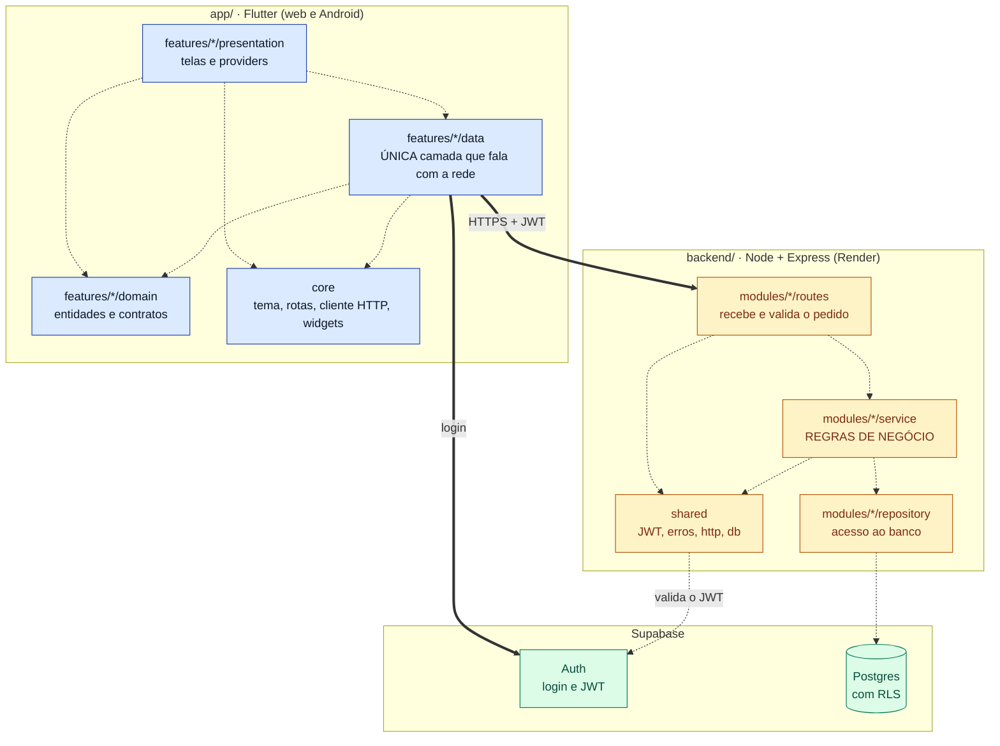

# S1 · Diagrama de pacotes do sistema

Semana 1 (02/11 a 08/11): fundação e backend de usuários. Features: [[000 - Fundação técnica]] e [[006 - Gerir usuários]]. Tipo: **pacotes** (*Engenharia de Software Moderna*, cap. 4).

**Para que serve:** mostrar **onde cada coisa mora** e **quem pode depender de quem**, no sistema inteiro.

## Notação

O Mermaid não tem diagrama de pacotes nativo. Convenção: `flowchart` com `subgraph` no papel do pacote, seta tracejada para dependência (a origem **usa** o destino) e seta grossa para a fronteira de rede.

## Legenda

| Elemento | Significa |
|---|---|
| Caixa grande (`subgraph`) | Um pacote: grupo de código com uma responsabilidade |
| Seta tracejada | Dependência: a origem **usa** o destino |
| Seta grossa | Fronteira de processo: atravessa a rede |
| Azul, âmbar, verde | App no dispositivo, backend no servidor, Supabase |

## O que o diagrama diz

- O app só fala com o mundo por **uma** camada, `data`. A tela nunca chama a API direto.
- Toda regra de negócio está em `service`, no backend. O app só ajuda a pessoa.
- Só o backend escreve no banco. O login é a única conversa direta do app com o Supabase.

## O que **não** aparece (de propósito)

| Seta ausente | Por quê |
|---|---|
| `presentation` → rede | Tela nunca chama HTTP. Sempre via `data` |
| app → Postgres | O app não lê nem escreve no banco (RLS barra) |
| `repository` → `service` | Dependência de mão única: persistência não chama regra |
| `routes` → `repository` | A rota não pula o serviço |

Seta fora deste desenho é erro de arquitetura, não liberdade de implementação.
