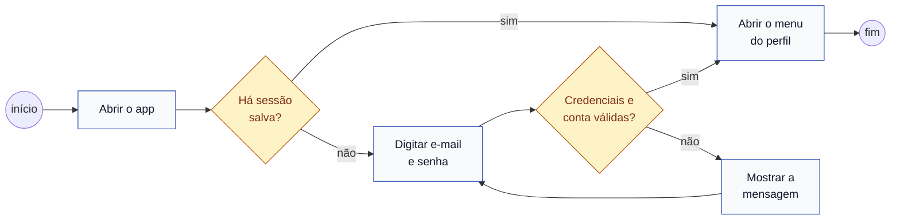

# S2 · Diagrama de atividades do login

Feature [[001 - Autenticar]]. Tipo: **atividades**. Mostra o caminho completo que a pessoa percorre, com as decisões.

## Legenda

| Elemento | Significa |
|---|---|
| Círculo | Início do fluxo |
| Retângulo | Uma ação |
| Losango | Uma decisão, com os caminhos nomeados |

## O que o diagrama diz

Quem já tem sessão vai direto ao menu. Quem não tem passa pelo login. Se a senha estiver errada, a mensagem é genérica (não diz se foi o e-mail ou a senha); conta inativa ou sem perfil é recusada com o motivo.
