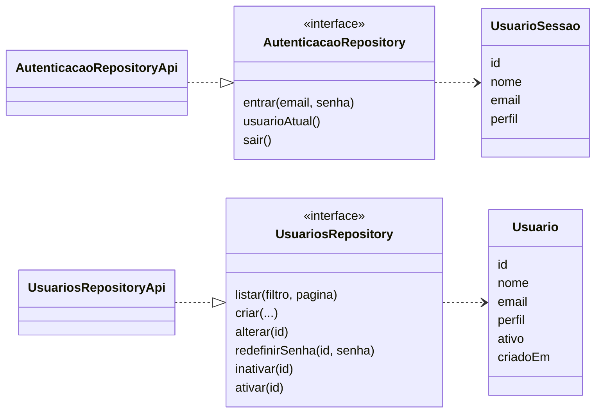

# S2 · Classes de sessão e usuários

Features: [[001 - Autenticar]] e [[006 - Gerir usuários]]. Os nomes são os do código em `mobile/lib/features`.

## Como ler

- `UsuarioSessao` é quem está logado agora: nome, e-mail e **perfil** (gerente, atendente, mecânico ou almoxarife).
- `Usuario` é a pessoa na lista de usuários, com a informação de estar ativa ou não.
- Cada **interface** (`<<interface>>`) é um contrato; a classe `...Api` cumpre o contrato chamando o backend.

## Por que é assim

A tela só conhece o contrato. Nos testes dá para trocar a `...Api` por uma versão falsa, sem internet.
