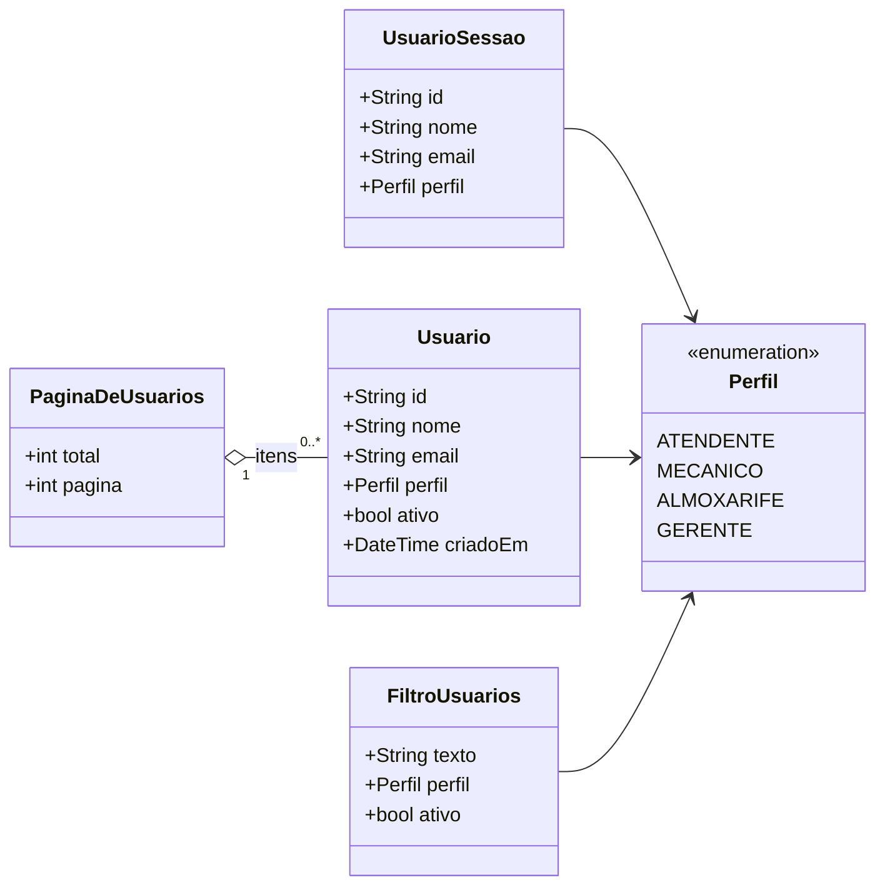

# S2 · Diagrama de classes de sessão e usuários

Features: [[001 - Autenticar]] e [[006 - Gerir usuários]]. Tipo: **classes**. Os nomes e atributos são os do código em `mobile/lib/features/*/domain`.

**Para que serve:** mostrar as classes do domínio, o que cada uma guarda e como se ligam.

## Legenda

| Elemento | Significa |
|---|---|
| Caixa com atributos | Uma classe e o que ela guarda (`+` = público) |
| `<<enumeration>>` | Um conjunto fixo de valores |
| Seta simples | A classe usa a outra |
| Losango vazio | Uma página agrupa vários usuários |

## O que o diagrama diz

- `UsuarioSessao` é **quem está logado agora**. `Usuario` é a pessoa da lista de usuários, com a informação de estar ativa.
- Os dois têm um `Perfil`: atendente, mecânico, almoxarife ou gerente. É o perfil que define o que o menu mostra.
- Os contratos de repositório (`AutenticacaoRepository`, `UsuariosRepository`) são interfaces; as classes `...Api` as cumprem chamando o backend.

## O que **não** aparece

Nenhuma regra de negócio: as classes do app são só dados e contratos. As regras ficam no backend ([[Arquitetura]]).
