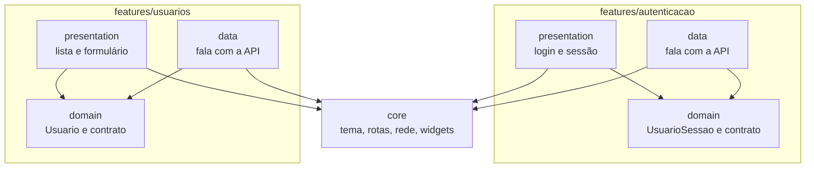

# S2 · Pacotes do app

Semana 2 (09/11 a 15/11): login, sessão e usuários no app. Features: [[001 - Autenticar]] e [[006 - Gerir usuários]]. Camadas gerais em [[Diagramas]].

## Como ler

- Cada feature tem três pastas: **presentation** (telas), **domain** (as coisas e os contratos) e **data** (quem conversa com a API).
- As setas apontam para `domain`: ele não conhece telas nem rede.
- `core` é o que todas usam: tema, rotas por perfil, cliente da API e componentes.

## Por que é assim

O `domain` ficando limpo deixa trocar a tela ou a API sem mexer nas regras. A regra de negócio mesmo fica no backend; o app só ajuda a pessoa.
