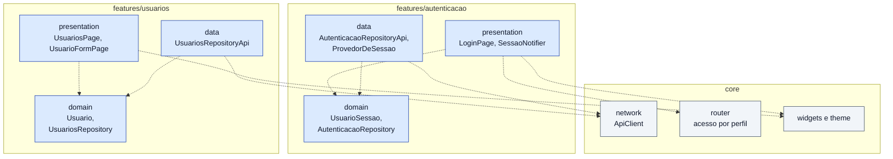

# S2 · Diagrama de pacotes do app

Semana 2 (09/11 a 15/11): login, sessão e usuários no app. Features: [[001 - Autenticar]] e [[006 - Gerir usuários]]. Tipo: **pacotes**. Camadas gerais em [[Diagramas]].

**Para que serve:** mostrar como as duas features do app se organizam e do que dependem.

## Legenda

| Elemento | Significa |
|---|---|
| Caixa grande | Um pacote |
| Seta tracejada | A origem **usa** o destino |
| Azul / cinza | Código da feature / código compartilhado (`core`) |

## O que o diagrama diz

- Cada feature tem três pastas com papéis diferentes: **presentation** (telas), **domain** (as coisas e os contratos) e **data** (a conversa com a API).
- As setas apontam para `domain`, que não conhece tela nem rede.
- Só `data` usa o `ApiClient`.

## O que **não** aparece

`domain` não depende de nada. `presentation` não usa `ApiClient`. Uma feature não usa a pasta `data` da outra.
