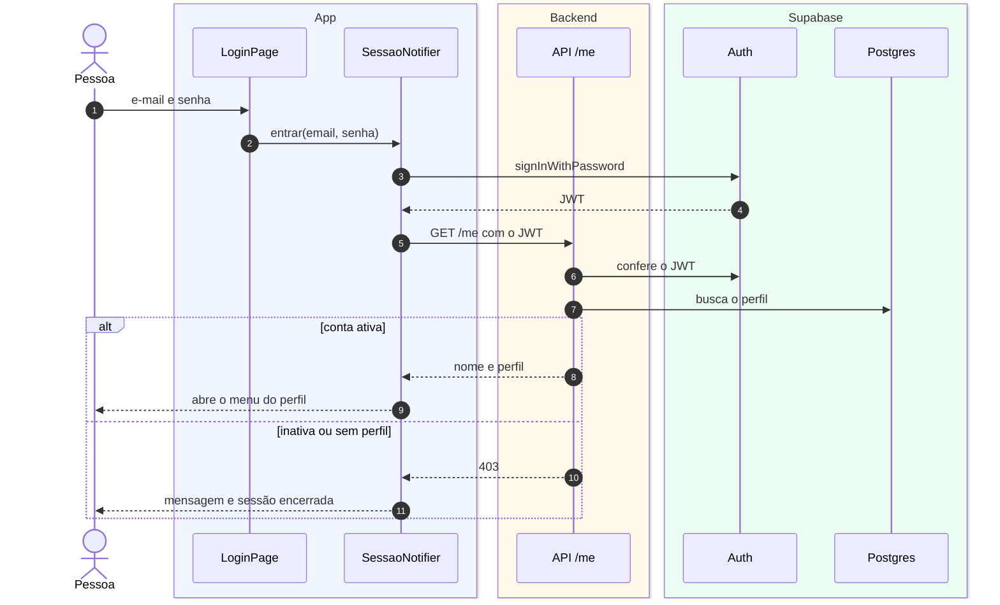

# S2 · Diagrama de sequência do login

Feature [[001 - Autenticar]]. Tipo: **sequência**. Cenário: uma pessoa entra com e-mail e senha. Os participantes são os objetos reais do código.

**Para que serve:** mostrar a ordem das chamadas entre os objetos em **um** cenário.

## Legenda

| Elemento | Significa |
|---|---|
| Caixa no topo | Um objeto (ou a pessoa) |
| Fundo azul, âmbar, verde | O objeto está no app, no backend ou no Supabase |
| Número | A ordem dos passos |
| Linha vertical | A vida do objeto |
| Seta cheia | Chamada |
| Seta tracejada | Retorno |
| `alt` | Dois caminhos possíveis |

## O que o diagrama diz

O Supabase confere a senha e devolve um token. A API confere o token, busca o perfil e só então o app abre o menu. Conta inativa ou sem perfil é negada e a sessão é desfeita.

## O que **não** aparece

A renovação do token e as outras features (o fluxo completo está em [[Atividades login]]).
