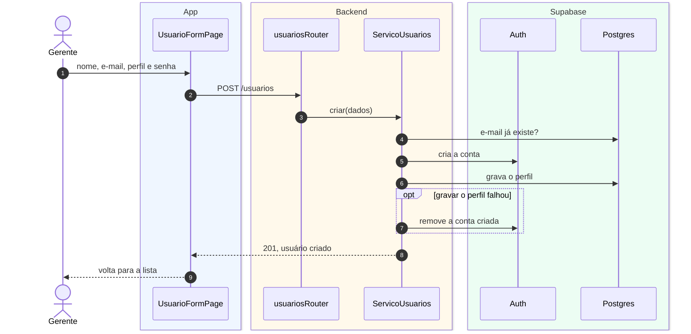

# S2 · Diagrama de sequência de usuários

Feature [[006 - Gerir usuários]]. Tipo: **sequência**. Cenário: o gerente cria um usuário. Os participantes são os objetos reais do código.

## Legenda

| Elemento | Significa |
|---|---|
| Caixa no topo | Um objeto (ou a pessoa) |
| Fundo azul, âmbar, verde | O objeto está no app, no backend ou no Supabase |
| Número | A ordem dos passos |
| Seta cheia / tracejada | Chamada / retorno |
| `opt` | Passo que só acontece em caso de falha |

## O que o diagrama diz

- Criar tem uma **compensação**: se gravar o perfil falhar, a conta criada no Supabase é removida, para não ficar uma conta pela metade.
- O e-mail repetido é recusado logo no começo.

## O que **não** aparece

Inativar, alterar perfil e redefinir senha seguem o mesmo molde. Ao inativar, o serviço confere antes que sobra pelo menos um gerente ativo.
