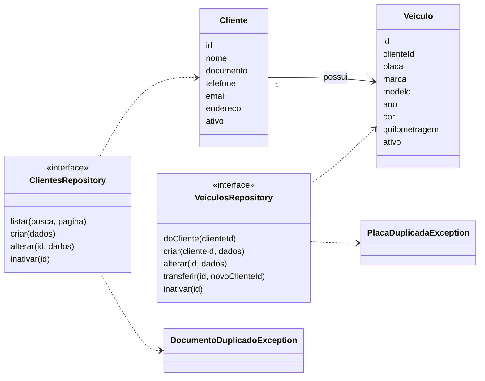

# S3 · Classes de clientes e veículos

Features: [[002 - Gerir clientes]] e [[003 - Gerir veículos]]. Os nomes são os do código em `mobile/lib/features`.

## Como ler

- Um **cliente** possui vários **veículos**. Cada veículo guarda o `clienteId` do dono.
- **Transferir** um veículo troca o dono, mas o histórico de OS fica com o dono anterior.
- Documento e placa repetidos viram um erro próprio (`...DuplicadoException`) que traz o cadastro que já existe.

## Por que é assim

Cliente e veículo nunca são apagados, só **inativados**, para o histórico de ordens de serviço continuar inteiro.
