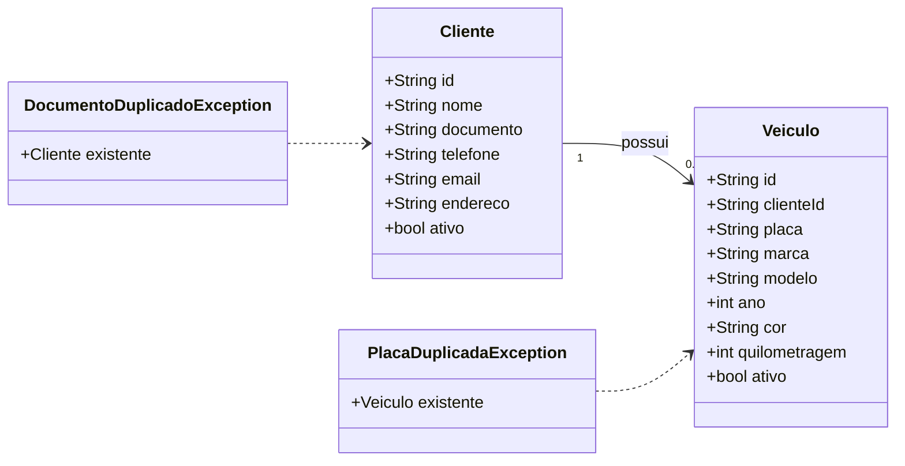

# S3 · Diagrama de classes de clientes e veículos

Features: [[002 - Gerir clientes]] e [[003 - Gerir veículos]]. Tipo: **classes**. Os nomes e atributos são os do código em `mobile/lib/features/*/domain`.

## Legenda

| Elemento | Significa |
|---|---|
| Caixa com atributos | Uma classe e o que ela guarda |
| `1` e `0..*` | Um cliente possui zero ou mais veículos |
| Seta tracejada | A exceção carrega o cadastro que já existe |

## O que o diagrama diz

- Um **cliente** possui vários **veículos**; cada veículo guarda o `clienteId` do dono.
- **Transferir** um veículo troca o `clienteId`, mas o histórico de OS fica com o dono anterior.
- Documento ou placa repetidos viram um erro próprio, que traz o cadastro existente para a pessoa não duplicar.
- Nada é apagado: só `ativo = false`.

## O que **não** aparece

A ordem de serviço, que entra na fase 5.
