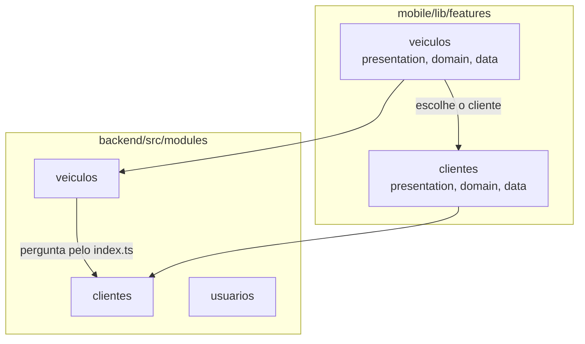

# S3 · Pacotes de clientes e veículos

Semana 3 (16/11 a 22/11): clientes e veículos, do banco à tela. Features: [[002 - Gerir clientes]] e [[003 - Gerir veículos]].

## Como ler

- No **backend**, `veiculos` precisa saber se o cliente existe. Ele pergunta ao módulo `clientes` **pela porta `index.ts`**, nunca pelo interior.
- No **app**, a lista de veículos aparece dentro do cliente, e a transferência de veículo usa o seletor de clientes.
- Cada feature do app segue o mesmo molde da semana 2: `presentation`, `domain` e `data`.

## Por que é assim

Clientes e veículos se ligam por um só ponto, então dá para mexer em um sem quebrar o outro. A regra "não inativar cliente com OS ativa" vive no backend.
