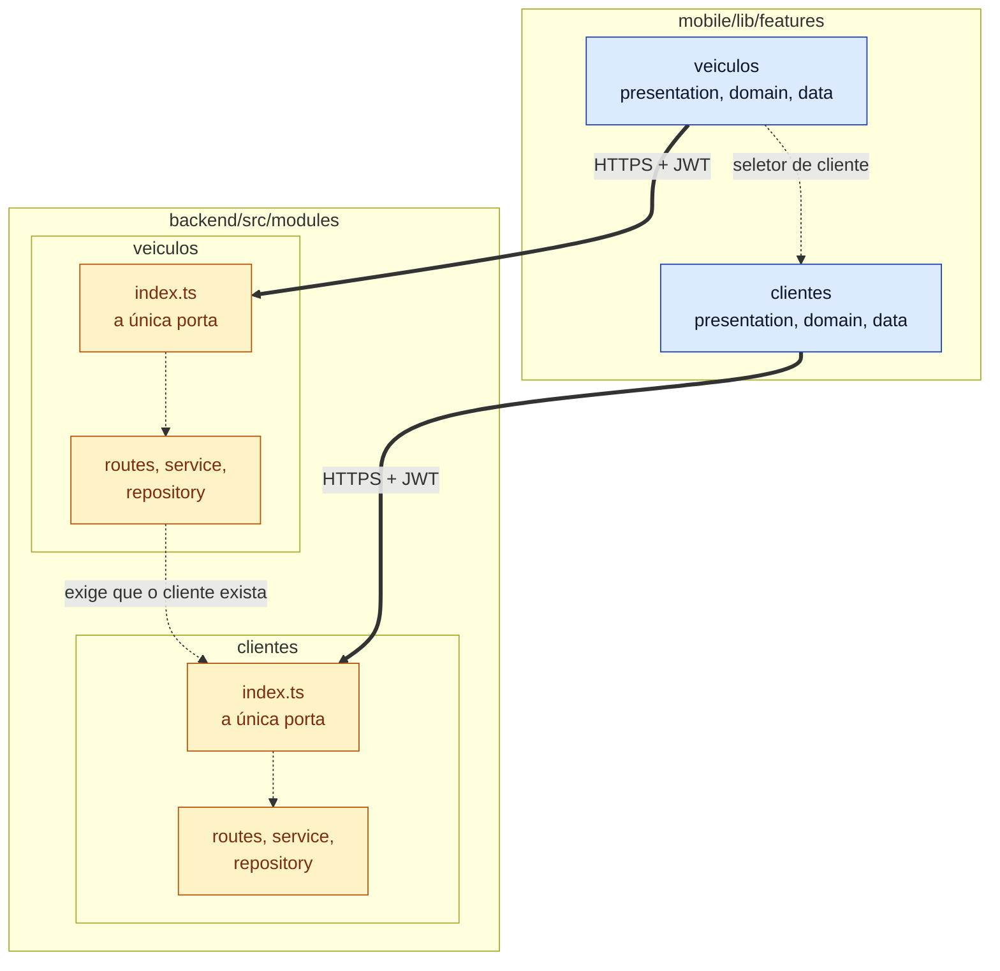

# S3 · Diagrama de pacotes de clientes e veículos

Semana 3 (16/11 a 22/11): clientes e veículos, do banco à tela. Features: [[002 - Gerir clientes]] e [[003 - Gerir veículos]]. Tipo: **pacotes**.

**Para que serve:** mostrar como as duas features se ligam no backend e no app.

## Legenda

| Elemento | Significa |
|---|---|
| Caixa grande | Um pacote |
| Seta tracejada | A origem **usa** o destino |
| Seta grossa | Chamada pela rede |
| Azul / âmbar | App / backend |

## O que o diagrama diz

- No backend, `veiculos` precisa saber se o cliente existe. Ele pergunta ao módulo `clientes` **pela porta `index.ts`**, nunca pelo interior.
- No app, a lista de veículos aparece dentro do cliente, e a transferência de veículo usa o seletor de clientes.

## O que **não** aparece

`veiculos` não importa o `repository` de `clientes`. Um teste de arquitetura quebra o build se isso acontecer.
