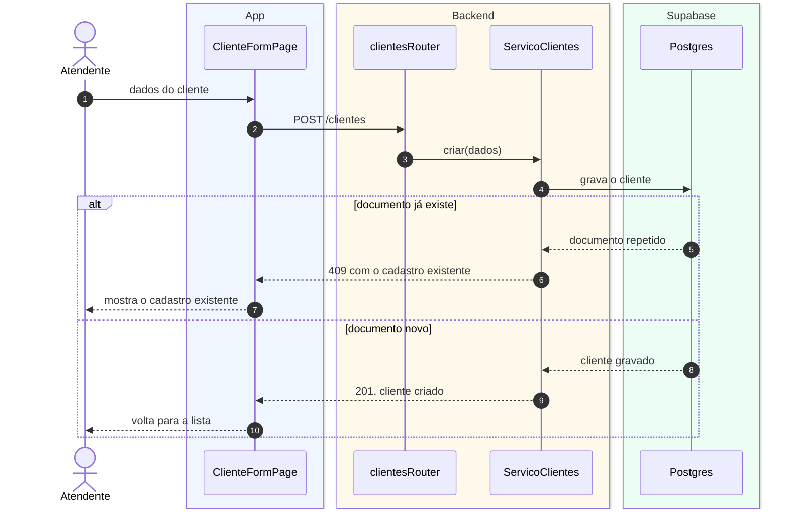

# S3 · Diagrama de sequência de clientes

Feature [[002 - Gerir clientes]]. Tipo: **sequência**. Cenário: o atendente cadastra um cliente, e o documento pode já existir.

## Legenda

| Elemento | Significa |
|---|---|
| Caixa no topo | Um objeto (ou a pessoa) |
| Fundo azul, âmbar, verde | O objeto está no app, no backend ou no Supabase |
| Número | A ordem dos passos |
| Seta cheia / tracejada | Chamada / retorno |
| `alt` | Dois caminhos possíveis |

## O que o diagrama diz

A unicidade do documento é garantida **pelo banco**. Se o documento já existe, o backend devolve 409 junto com o cadastro existente, e a tela o mostra para o atendente não duplicar.

## O que **não** aparece

Inativar: o cliente com OS ativa é recusado (409), regra que só passa a valer com as ordens de serviço da fase 5.
