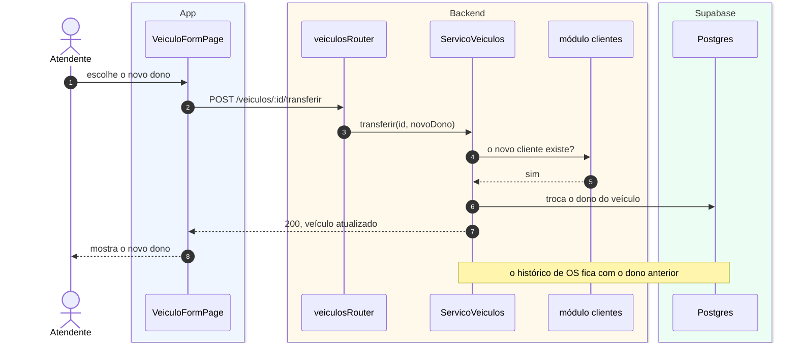

# S3 · Diagrama de sequência de veículos

Feature [[003 - Gerir veículos]]. Tipo: **sequência**. Cenário: o atendente transfere um veículo para outro cliente.

## Legenda

| Elemento | Significa |
|---|---|
| Caixa no topo | Um objeto (ou a pessoa) |
| Fundo azul, âmbar, verde | O objeto está no app, no backend ou no Supabase |
| Número | A ordem dos passos |
| Seta cheia / tracejada | Chamada / retorno |
| `Note` | Observação sobre uma regra |

## O que o diagrama diz

- Para transferir, o serviço confirma que o **novo cliente existe** perguntando ao módulo `clientes` pela porta dele.
- Só o dono do veículo muda. As ordens de serviço antigas continuam ligadas ao dono anterior.

## O que **não** aparece

O cadastro de veículo com placa repetida: a placa é única e o erro 409 traz o veículo existente, no mesmo molde do cliente.
