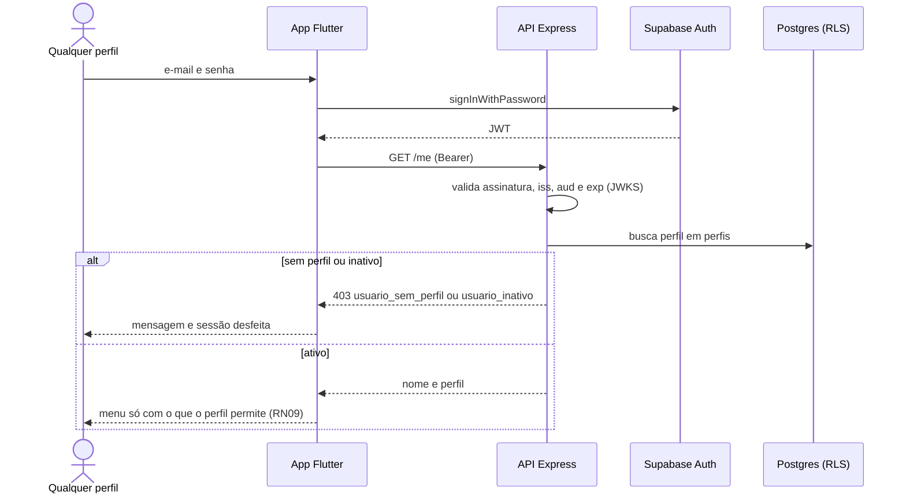

# 001 — Autenticar

## Objetivo

Entregar **UC01 — Autenticar** para o ator **Todos**. Fluxo completo (principal, alternativos e exceções) em [[Casos de uso]], seção UC01.

## Diagrama

Esboço do comportamento (diagrama de sequência), antes de codar. Tudo vem de [[Casos de uso]], [[Modelo de dados]] e [[Endpoints]]; o que é ⚠️ continua a confirmar.

### Impacto no sistema

- **Lê:** `perfis` a cada requisição (o perfil nunca vem do token nem de campo editável).
- **Escreve:** nada.
- **Impacto real:** é o portão de todas as rotas. Trocar o perfil ou inativar um usuário (006) vale na hora por causa desta leitura.
- **Quem depende desta:** [[002 - Gerir clientes]], [[004 - Gerir peças]], [[005 - Gerir serviços]], [[006 - Gerir usuários]].

## Referências

| Item | Valor |
|---|---|
| Fase | F2 — Acesso e usuários |
| Caso de uso | UC01 |
| Histórias | US01, US22 |
| Requisitos | RF01, RF23 |
| Ator | Todos |
| Regras de negócio | RN09 |
| Tabelas | perfis |
| Especificação | [[Casos de uso]], [[Histórias de usuário]], [[Requisitos]], [[Modelo de dados]] |

## Critérios de aceitação

| # | Critério | Status |
|---|---|---|
| CA01 | Login e senha corretos (Supabase Auth) abrem a sessão; `GET /me` devolve nome e perfil e o app monta o menu do perfil | ✅ Concluído. Provado no app web real em 2026-11-10, com a conta do seed e o Supabase de desenvolvimento: o gerente entrou, o menu mostrou o perfil e `GET /me` devolveu `GERENTE` |
| CA02 | Credenciais inválidas negam o acesso com mensagem genérica (sem dizer se o erro foi no login ou na senha) | ✅ Concluído. Provado no app web real em 2026-11-10, com a conta do seed e o Supabase de desenvolvimento: a senha errada mostrou "E-mail ou senha incorretos.", sem dizer qual dos dois errou |
| CA03 | Token expirado é renovado pelo app; refresh inválido volta ao login | ✅ Concluído. Provado no app web real em 2026-11-10, com a conta do seed e o Supabase de desenvolvimento: com o token expirado o app renova (HTTP 200) e continua logado; com o refresh inválido volta ao login; recarregar mantém a sessão. A prova achou e corrigiu um defeito: o primeiro `GET /me` saía com o token velho, recebia 401 e deslogava (`token_da_sessao.dart`, 4 testes) |
| CA04 | Usuário inativo vê a mensagem de que está desativado | ✅ Concluído — backend devolve `usuario_inativo`; o app mostra "desativado" e desfaz a sessão (testes dos dois lados) |
| CA05 | Rota protegida sem sessão redireciona ao login | ✅ Concluído — função `redirecionar` testada e web real abre no login |
| CA06 | O menu mostra só o que o perfil permite (RN09) | ✅ Concluído — menu e atalhos por perfil testados; um teste garante que o menu nunca mostra tela que o perfil não pode abrir |
| CA07 | "Sair" encerra a sessão e volta ao login (US22) ⚠️ | ✅ Concluído — Sair encerra a sessão e volta ao login (widget test) |
| CA08 | Rotas do app protegidas por perfil: sem sessão vai ao login; perfil sem permissão não abre a rota | ✅ Concluído — tabela de acesso comparada linha a linha com o Mapa de telas (27 rotas × 4 perfis) |

Legenda: 🔲 Pendente · 🔄 Em progresso · ✅ Concluído · ❌ Descartado. ⚠️ = fluxo deduzido, conferir com o documento oficial.

## API

| Método | Caminho (`/api/v1`) | Perfis | O que faz |
|---|---|---|---|
| GET | `/me` | Todos | Nome, perfil e situação do usuário autenticado |

Contrato completo em [[Endpoints]].

## Telas

- **T01 Login** — `/login` (Todos (sem sessão))
- **T02 Início (menu por perfil)** — `/` (Todos)
- **T25 Carregando sessão (tela técnica)** — `/carregando` (Todos (sem sessão))
- **T26 Sem conexão (tela técnica)** — `/sem-conexao` (Todos (sem sessão))

Catálogo completo em [[Mapa de telas]].

## Dependências

- [[000 - Fundação técnica]]

## Tarefas

As tarefas desta feature ficam no [[CHECKLIST]], na seção da fase.
