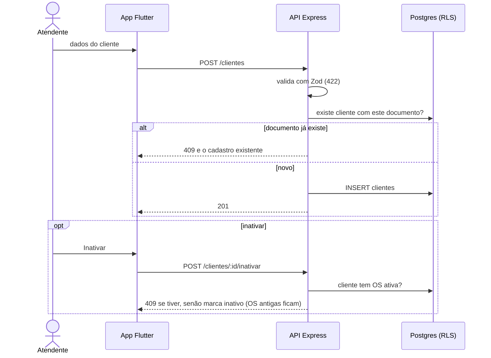

# 002 — Gerir clientes

## Objetivo

Entregar **UC02 — Gerir clientes** para o ator **Atendente**. Fluxo completo (principal, alternativos e exceções) em [[Casos de uso]], seção UC02.

## Diagrama

Esboço do comportamento (diagrama de sequência), antes de codar. Tudo vem de [[Casos de uso]], [[Modelo de dados]] e [[Endpoints]]; o que é ⚠️ continua a confirmar.

### Impacto no sistema

- **Escreve:** `clientes`.
- **Impacto real:** a OS (007) referencia o cliente; inativar com OS ativa é barrado, e o teste dessa regra só existe depois da 007 (CA06 de lá).
- **Cuidado:** documento (CPF/CNPJ) é dado pessoal real em produção: nunca vai para log nem para dado de teste (R28).
- **Quem depende desta:** [[003 - Gerir veículos]], [[007 - Abrir OS]].

## Referências

| Item | Valor |
|---|---|
| Fase | F3 — Clientes e veículos |
| Caso de uso | UC02 |
| Histórias | US02 |
| Requisitos | RF02 |
| Ator | Atendente |
| Regras de negócio | — |
| Tabelas | clientes |
| Especificação | [[Casos de uso]], [[Histórias de usuário]], [[Requisitos]], [[Modelo de dados]] |

## Critérios de aceitação

| # | Critério | Status |
|---|---|---|
| CA01 | Cadastrar cliente com nome, documento, telefone, e-mail e endereço ⚠️ | ✅ Concluído |
| CA02 | Documento duplicado é recusado e mostra o cadastro existente | ✅ Concluído. Provado com o banco real em 2026-11-10 (210 testes do backend, 31 de integração em `backend/test/integracao/cadastros.test.ts`): o documento é único no banco |
| CA03 | Campos obrigatórios ausentes são destacados e o cadastro não é salvo | ✅ Concluído |
| CA04 | Buscar por nome ou documento e alterar os dados | ✅ Concluído |
| CA05 | Inativar cliente mantém o histórico de OS | ✅ Concluído. Provado com o banco real em 2026-11-10 (210 testes do backend, 31 de integração em `backend/test/integracao/cadastros.test.ts`): cliente com OS ativa não é inativado; com OS entregue ou cancelada, é, e as OS ficam |

Legenda: 🔲 Pendente · 🔄 Em progresso · ✅ Concluído · ❌ Descartado. ⚠️ = fluxo deduzido, conferir com o documento oficial.

## API

| Método | Caminho (`/api/v1`) | Perfis | O que faz |
|---|---|---|---|
| GET | `/clientes` | Atendente | Busca por nome ou documento |
| POST | `/clientes` | Atendente | Cadastra |
| GET | `/clientes/:id` | Atendente | Detalha |
| PATCH | `/clientes/:id` | Atendente | Altera |
| POST | `/clientes/:id/inativar` | Atendente | Inativa (sem OS ativa) |

Contrato completo em [[Endpoints]].

## Telas

- **T05 Lista de clientes** — `/clientes` (Atendente)
- **T06 Formulário de cliente** — `/clientes/novo · /clientes/:id` (Atendente)

Catálogo completo em [[Mapa de telas]].

## Dependências

- [[001 - Autenticar]]

## Tarefas

As tarefas desta feature ficam no [[CHECKLIST]], na seção da fase.

## Notas técnicas

A regra "cliente com OS ativa não pode ser inativado" é testada na feature 007, quando a OS existe.
