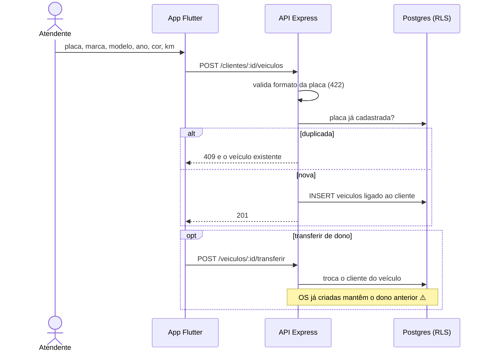

# 003 — Gerir veículos

## Objetivo

Entregar **UC03 — Gerir veículos** para o ator **Atendente**. Fluxo completo (principal, alternativos e exceções) em [[Casos de uso]], seção UC03.

## Diagrama

Esboço do comportamento (diagrama de sequência), antes de codar. Tudo vem de [[Casos de uso]], [[Modelo de dados]] e [[Endpoints]]; o que é ⚠️ continua a confirmar.

### Impacto no sistema

- **Escreve:** `veiculos`.
- **Impacto real:** o índice único parcial de OS ativa é por veículo; é ele que impede duas OS abertas no mesmo carro (007).
- **Cuidado:** a transferência é fluxo deduzido (⚠️) até o usuário confirmar (R3).
- **Quem depende desta:** [[007 - Abrir OS]].

## Referências

| Item | Valor |
|---|---|
| Fase | F3 — Clientes e veículos |
| Caso de uso | UC03 |
| Histórias | US03 |
| Requisitos | RF03 |
| Ator | Atendente |
| Regras de negócio | — |
| Tabelas | veiculos |
| Especificação | [[Casos de uso]], [[Histórias de usuário]], [[Requisitos]], [[Modelo de dados]] |

## Critérios de aceitação

| # | Critério | Status |
|---|---|---|
| CA01 | Cadastrar veículo vinculado a um cliente, com placa, marca, modelo, ano, cor e quilometragem ⚠️ | ✅ Concluído |
| CA02 | Placa duplicada é recusada e exibe o veículo existente | ✅ Concluído. Provado com o banco real em 2026-11-10 (210 testes do backend, 31 de integração em `backend/test/integracao/cadastros.test.ts`): a placa é única no banco |
| CA03 | Placa em formato inválido é recusada | ✅ Concluído |
| CA04 | Buscar por placa ou por cliente e alterar os dados | ✅ Concluído |
| CA05 | Transferir o veículo para outro cliente mantém o histórico de OS com o dono anterior ⚠️ | ✅ Concluído. Provado com o banco real em 2026-11-10 (210 testes do backend, 31 de integração em `backend/test/integracao/cadastros.test.ts`): transferir mantém o cliente das OS já abertas |

Legenda: 🔲 Pendente · 🔄 Em progresso · ✅ Concluído · ❌ Descartado. ⚠️ = fluxo deduzido, conferir com o documento oficial.

## API

| Método | Caminho (`/api/v1`) | Perfis | O que faz |
|---|---|---|---|
| GET | `/clientes/:id/veiculos` | Atendente | Veículos do cliente |
| POST | `/clientes/:id/veiculos` | Atendente | Cadastra |
| GET | `/veiculos` | Atendente | Busca por placa |
| GET | `/veiculos/:id` | Atendente | Detalha |
| PATCH | `/veiculos/:id` | Atendente | Altera |
| POST | `/veiculos/:id/transferir` | Atendente | Muda o dono |
| POST | `/veiculos/:id/inativar` | Atendente | Inativa |

Contrato completo em [[Endpoints]].

## Telas

- **T07 Veículos do cliente e formulário** — `/clientes/:id/veiculos · /clientes/:id/veiculos/novo` (Atendente)

Catálogo completo em [[Mapa de telas]].

## Dependências

- [[002 - Gerir clientes]]

## Tarefas

As tarefas desta feature ficam no [[CHECKLIST]], na seção da fase.
