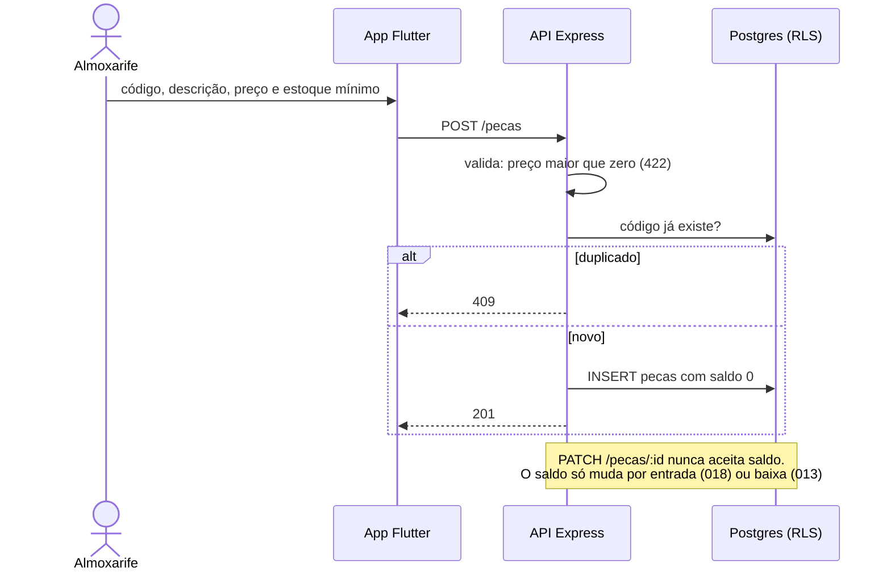

# 004 — Gerir peças

## Objetivo

Entregar **UC04 — Gerir peças** para o ator **Almoxarife**. Fluxo completo (principal, alternativos e exceções) em [[Casos de uso]], seção UC04.

## Diagrama

Esboço do comportamento (diagrama de sequência), antes de codar. Tudo vem de [[Casos de uso]], [[Modelo de dados]] e [[Endpoints]]; o que é ⚠️ continua a confirmar.

### Impacto no sistema

- **Escreve:** `pecas` (saldo nasce 0).
- **Impacto real:** é o catálogo que o orçamento (009), as peças usadas (013) e a entrada (018) consomem; o alerta de estoque baixo (US21) sai daqui.
- **Regra protegida:** RN07 (saldo só por movimentação).
- **Quem depende desta:** [[009 - Montar orçamento]], [[013 - Registrar peças usadas]], [[018 - Dar entrada no estoque]].

## Referências

| Item | Valor |
|---|---|
| Fase | F4 — Catálogos e estoque |
| Caso de uso | UC04 |
| Histórias | US04, US21 |
| Requisitos | RF04, RF22 |
| Ator | Almoxarife |
| Regras de negócio | RN07 |
| Tabelas | pecas |
| Especificação | [[Casos de uso]], [[Histórias de usuário]], [[Requisitos]], [[Modelo de dados]] |

## Critérios de aceitação

| # | Critério | Status |
|---|---|---|
| CA01 | Cadastrar peça com código, descrição, preço e estoque mínimo; nasce com saldo zero ⚠️ | 🔲 Pendente |
| CA02 | Código duplicado é recusado | 🔲 Pendente |
| CA03 | Preço menor ou igual a zero é recusado | 🔲 Pendente |
| CA04 | Buscar por código ou descrição e alterar os dados | 🔲 Pendente |
| CA05 | O saldo só muda por movimentação (entrada UC18 ou baixa UC13), nunca por edição | 🔲 Pendente |
| CA06 | Peças abaixo do estoque mínimo aparecem destacadas na listagem (US21) ⚠️ | 🔲 Pendente |

Legenda: 🔲 Pendente · 🔄 Em progresso · ✅ Concluído · ❌ Descartado. ⚠️ = fluxo deduzido, conferir com o documento oficial.

## API

| Método | Caminho (`/api/v1`) | Perfis | O que faz |
|---|---|---|---|
| GET | `/pecas` | Atendente, Mecânico, Almoxarife | Lista; `?abaixoDoMinimo=true` para o alerta |
| POST | `/pecas` | Almoxarife | Cadastra (saldo 0) |
| GET | `/pecas/:id` | Almoxarife | Detalha |
| PATCH | `/pecas/:id` | Almoxarife | Altera (sem tocar o saldo) |
| POST | `/pecas/:id/inativar` | Almoxarife | Inativa |

Contrato completo em [[Endpoints]].

## Telas

- **T10 Lista de peças (com alerta de estoque baixo)** — `/pecas` (Almoxarife)
- **T11 Formulário de peça** — `/pecas/novo · /pecas/:id` (Almoxarife)

Catálogo completo em [[Mapa de telas]].

## Dependências

- [[001 - Autenticar]]

## Tarefas

As tarefas desta feature ficam no [[CHECKLIST]], na seção da fase.
