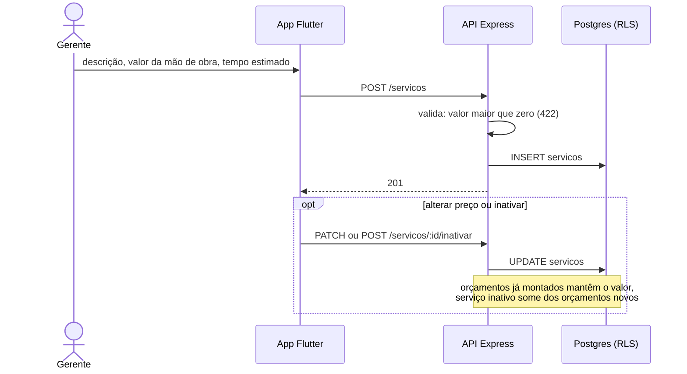

# 005 — Gerir serviços

## Objetivo

Entregar **UC05 — Gerir serviços** para o ator **Gerente**. Fluxo completo (principal, alternativos e exceções) em [[Casos de uso]], seção UC05.

## Diagrama

Esboço do comportamento (diagrama de sequência), antes de codar. Tudo vem de [[Casos de uso]], [[Modelo de dados]] e [[Endpoints]]; o que é ⚠️ continua a confirmar.

### Impacto no sistema

- **Escreve:** `servicos`.
- **Impacto real:** é o preço que o orçamento (009) usa; a regra de congelar o valor nos itens evita que mudar o catálogo reescreva orçamentos antigos.
- **Quem depende desta:** [[009 - Montar orçamento]].

## Referências

| Item | Valor |
|---|---|
| Fase | F4 — Catálogos e estoque |
| Caso de uso | UC05 |
| Histórias | US05 |
| Requisitos | RF05 |
| Ator | Gerente |
| Regras de negócio | — |
| Tabelas | servicos |
| Especificação | [[Casos de uso]], [[Histórias de usuário]], [[Requisitos]], [[Modelo de dados]] |

## Critérios de aceitação

| # | Critério | Status |
|---|---|---|
| CA01 | Cadastrar serviço com descrição, valor da mão de obra e tempo estimado ⚠️ | 🔲 Pendente |
| CA02 | Valor menor ou igual a zero é recusado | 🔲 Pendente |
| CA03 | Alterar o preço não muda orçamentos já montados | 🔲 Pendente |
| CA04 | Serviço inativo não aparece em orçamentos novos | 🔲 Pendente |

Legenda: 🔲 Pendente · 🔄 Em progresso · ✅ Concluído · ❌ Descartado. ⚠️ = fluxo deduzido, conferir com o documento oficial.

## API

| Método | Caminho (`/api/v1`) | Perfis | O que faz |
|---|---|---|---|
| GET | `/servicos` | Atendente, Gerente | Lista (ativos para orçamento) |
| POST | `/servicos` | Gerente | Cadastra |
| PATCH | `/servicos/:id` | Gerente | Altera |
| POST | `/servicos/:id/inativar` | Gerente | Inativa |

Contrato completo em [[Endpoints]].

## Telas

- **T08 Lista de serviços** — `/servicos` (Gerente)
- **T09 Formulário de serviço** — `/servicos/novo · /servicos/:id` (Gerente)

Catálogo completo em [[Mapa de telas]].

## Dependências

- [[001 - Autenticar]]

## Tarefas

As tarefas desta feature ficam no [[CHECKLIST]], na seção da fase.
