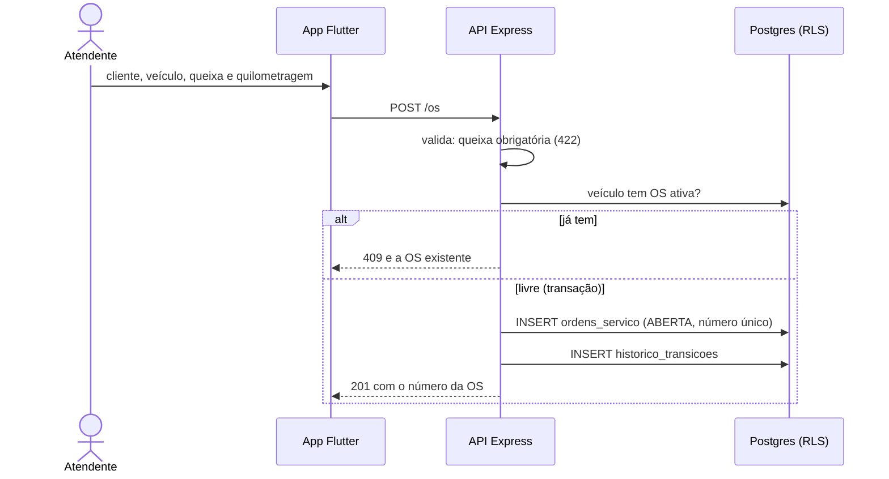

# 007 — Abrir OS

## Objetivo

Entregar **UC07 — Abrir OS** para o ator **Atendente**. Fluxo completo (principal, alternativos e exceções) em [[Casos de uso]], seção UC07.

## Diagrama

Esboço do comportamento (diagrama de sequência), antes de codar. Tudo vem de [[Casos de uso]], [[Modelo de dados]] e [[Endpoints]]; o que é ⚠️ continua a confirmar.

### Impacto no sistema

- **Escreve:** `ordens_servico` e `historico_transicoes`. **Estado:** nasce `ABERTA` (RN01).
- **Impacto real:** é o início de todo o ciclo; sem ela nenhuma feature de 008 em diante tem o que operar.
- **Regra protegida:** uma OS ativa por veículo, garantida pelo índice parcial do banco e não só pelo código.
- **Concorrência:** ao inserir a OS, travar a linha do cliente com `SELECT ... FOR UPDATE`, como a inativação de cliente da [[002 - Gerir clientes]] já faz. Sem isso, a inativação pode passar na contagem de OS ativas enquanto a OS é criada em paralelo. Pede teste de integração de concorrência.
- **Quem depende desta:** [[008 - Registrar diagnóstico]], [[016 - Consultar OS]].

## Referências

| Item | Valor |
|---|---|
| Fase | F5 — Abrir, diagnosticar e orçar |
| Caso de uso | UC07 |
| Histórias | US07 |
| Requisitos | RF07 |
| Ator | Atendente |
| Regras de negócio | RN01 |
| Tabelas | ordens_servico, historico_transicoes |
| Especificação | [[Casos de uso]], [[Histórias de usuário]], [[Requisitos]], [[Modelo de dados]] |

## Critérios de aceitação

| # | Critério | Status |
|---|---|---|
| CA01 | Confirmar a abertura cria a OS em `ABERTA` com número único e data/hora | 🔲 Pendente |
| CA02 | Veículo com OS ativa recusa nova abertura e mostra a OS existente | 🔲 Pendente |
| CA03 | Queixa do cliente é obrigatória | 🔲 Pendente |
| CA04 | Cliente ou veículo não cadastrado leva ao cadastro e volta para a abertura | 🔲 Pendente |
| CA05 | Registra a quilometragem de entrada | 🔲 Pendente |
| CA06 | Inativar um cliente com OS ativa é recusado (409), regra da feature 002 que só se testa aqui | 🔲 Pendente |
| CA07 | `GET /os` lista as OS com número, estado, cliente e veículo; `GET /os/:id` detalha uma OS | 🔲 Pendente |

Legenda: 🔲 Pendente · 🔄 Em progresso · ✅ Concluído · ❌ Descartado. ⚠️ = fluxo deduzido, conferir com o documento oficial.

## API

| Método | Caminho (`/api/v1`) | Perfis | O que faz |
|---|---|---|---|
| POST | `/os` | Atendente | Abre a OS em `ABERTA` |
| GET | `/os` | Atendente, Gerente, Mecânico | Lista simples (número, estado, cliente, veículo); o mecânico vê só a fila da sua etapa |
| GET | `/os/:id` | Atendente, Gerente, Mecânico | Detalhe; para o mecânico, sem documento e telefone do cliente |

Contrato completo em [[Endpoints]].

## Telas

- **T13 Abrir OS** — `/os/nova` (Atendente)
- **T14 Lista e busca de OS** — `/os` (Atendente, Gerente, Mecânico (fila restrita))
- **T15 Detalhe da OS (dados, orçamento, peças, histórico, ações por estado)** — `/os/:id` (Atendente, Gerente, Mecânico (sem documento e telefone do cliente))

Catálogo completo em [[Mapa de telas]].

## Dependências

- [[002 - Gerir clientes]]
- [[003 - Gerir veículos]]

## Tarefas

As tarefas desta feature ficam no [[CHECKLIST]], na seção da fase.
