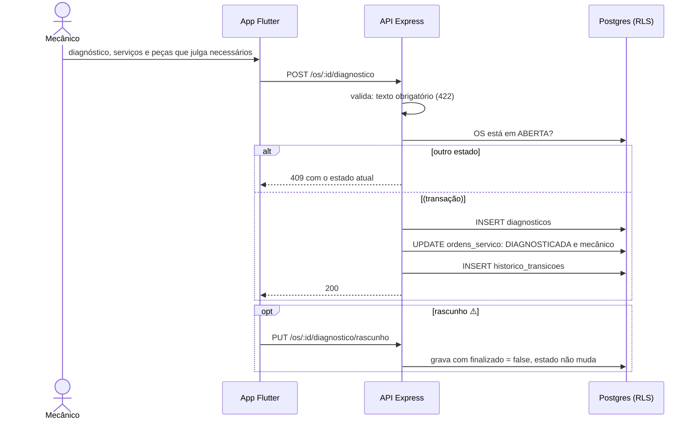

# 008 — Registrar diagnóstico

## Objetivo

Entregar **UC08 — Registrar diagnóstico** para o ator **Mecânico**. Fluxo completo (principal, alternativos e exceções) em [[Casos de uso]], seção UC08.

## Diagrama

Esboço do comportamento (diagrama de sequência), antes de codar. Tudo vem de [[Casos de uso]], [[Modelo de dados]] e [[Endpoints]]; o que é ⚠️ continua a confirmar.

### Impacto no sistema

- **Escreve:** `diagnosticos`, `ordens_servico`, `historico_transicoes`. **Estado:** `ABERTA` → `DIAGNOSTICADA`.
- **Impacto real:** associa o mecânico responsável à OS e libera o orçamento (009).
- **Cuidado:** o rascunho é fluxo deduzido (⚠️).
- **Quem depende desta:** [[009 - Montar orçamento]].

## Referências

| Item | Valor |
|---|---|
| Fase | F5 — Abrir, diagnosticar e orçar |
| Caso de uso | UC08 |
| Histórias | US08 |
| Requisitos | RF08 |
| Ator | Mecânico |
| Regras de negócio | RN01 |
| Tabelas | diagnosticos, ordens_servico, historico_transicoes |
| Especificação | [[Casos de uso]], [[Histórias de usuário]], [[Requisitos]], [[Modelo de dados]] |

## Critérios de aceitação

| # | Critério | Status |
|---|---|---|
| CA01 | Salvar o diagnóstico leva a OS de `ABERTA` para `DIAGNOSTICADA` e associa o mecânico | 🔲 Pendente |
| CA02 | OS fora de `ABERTA` não aceita diagnóstico e mostra o estado atual | 🔲 Pendente |
| CA03 | Diagnóstico vazio é recusado | 🔲 Pendente |
| CA04 | Salvar rascunho sem mudar o estado da OS ⚠️ | 🔲 Pendente |

Legenda: 🔲 Pendente · 🔄 Em progresso · ✅ Concluído · ❌ Descartado. ⚠️ = fluxo deduzido, conferir com o documento oficial.

## API

| Método | Caminho (`/api/v1`) | Perfis | O que faz |
|---|---|---|---|
| POST | `/os/:id/diagnostico` | Mecânico | Registra e leva a `DIAGNOSTICADA` |
| PUT | `/os/:id/diagnostico/rascunho` | Mecânico | Guarda rascunho (`finalizado = false`) |

Contrato completo em [[Endpoints]].

## Telas

- **T14 Lista e busca de OS** — `/os` (Atendente, Gerente, Mecânico (fila restrita))
- **T16 Diagnóstico** — `/os/:id/diagnostico` (Mecânico)

Catálogo completo em [[Mapa de telas]].

## Dependências

- [[007 - Abrir OS]]

## Tarefas

As tarefas desta feature ficam no [[CHECKLIST]], na seção da fase.
