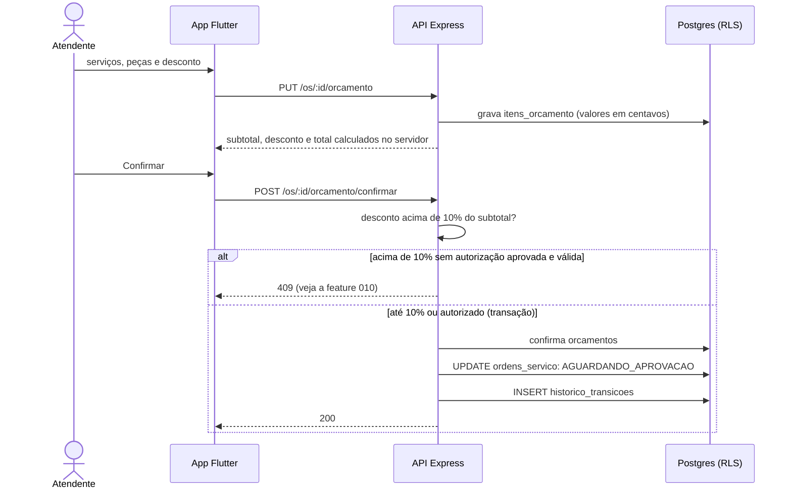

# 009 — Montar orçamento

## Objetivo

Entregar **UC09 — Montar orçamento** para o ator **Atendente**. Fluxo completo (principal, alternativos e exceções) em [[Casos de uso]], seção UC09.

## Diagrama

Esboço do comportamento (diagrama de sequência), antes de codar. Tudo vem de [[Casos de uso]], [[Modelo de dados]] e [[Endpoints]]; o que é ⚠️ continua a confirmar.

### Impacto no sistema

- **Escreve:** `orcamentos`, `itens_orcamento`, `ordens_servico`, `historico_transicoes`. **Estado:** `DIAGNOSTICADA` → `AGUARDANDO_APROVACAO`.
- **Impacto real:** o total daqui é o valor que o pagamento (015) tem de igualar e que o faturamento (019) soma.
- **Regra protegida:** RN02 (10%) é decidida no servidor; o app só ajuda.
- **Quem depende desta:** [[010 - Autorizar desconto]], [[011 - Registrar aprovação do cliente]].

## Referências

| Item | Valor |
|---|---|
| Fase | F5 — Abrir, diagnosticar e orçar |
| Caso de uso | UC09 |
| Histórias | US09 |
| Requisitos | RF09 |
| Ator | Atendente |
| Regras de negócio | RN01, RN02 |
| Tabelas | orcamentos, itens_orcamento, ordens_servico, historico_transicoes |
| Especificação | [[Casos de uso]], [[Histórias de usuário]], [[Requisitos]], [[Modelo de dados]] |

## Critérios de aceitação

| # | Critério | Status |
|---|---|---|
| CA01 | Confirmar leva a OS de `DIAGNOSTICADA` para `AGUARDANDO_APROVACAO` | 🔲 Pendente |
| CA02 | Calcula subtotal, desconto e total | 🔲 Pendente |
| CA03 | Orçamento sem serviço nem peça é recusado | 🔲 Pendente |
| CA04 | Desconto de até 10% é aplicado direto | 🔲 Pendente |
| CA05 | Peça sem saldo avisa, mas permite orçar ⚠️ | 🔲 Pendente |
| CA06 | Confirmar orçamento com desconto acima de 10% e sem autorização aprovada é recusado (409) | 🔲 Pendente |

Legenda: 🔲 Pendente · 🔄 Em progresso · ✅ Concluído · ❌ Descartado. ⚠️ = fluxo deduzido, conferir com o documento oficial.

## API

| Método | Caminho (`/api/v1`) | Perfis | O que faz |
|---|---|---|---|
| PUT | `/os/:id/orcamento` | Atendente | Grava itens e desconto (rascunho) |
| POST | `/os/:id/orcamento/confirmar` | Atendente | Confirma e leva a `AGUARDANDO_APROVACAO` |

Contrato completo em [[Endpoints]].

## Telas

- **T17 Orçamento (inclui pedir autorização de desconto)** — `/os/:id/orcamento` (Atendente)

Catálogo completo em [[Mapa de telas]].

## Dependências

- [[008 - Registrar diagnóstico]]
- [[005 - Gerir serviços]]
- [[004 - Gerir peças]]

## Tarefas

As tarefas desta feature ficam no [[CHECKLIST]], na seção da fase.

## Notas técnicas

Valores em centavos (inteiro). "Acima de 10%" é estritamente maior: `desconto*100 > subtotal*10`. Desconto vale para o orçamento inteiro e não pode passar do subtotal.
