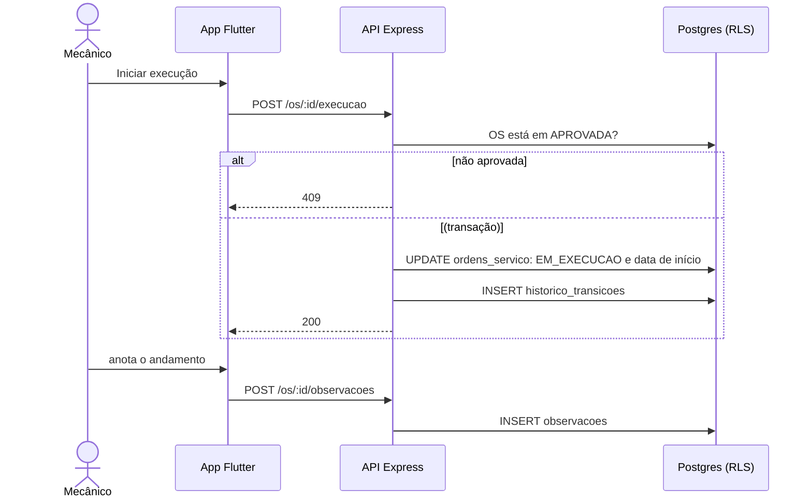

# 012 — Executar serviço

## Objetivo

Entregar **UC12 — Executar serviço** para o ator **Mecânico**. Fluxo completo (principal, alternativos e exceções) em [[Casos de uso]], seção UC12.

## Diagrama

Esboço do comportamento (diagrama de sequência), antes de codar. Tudo vem de [[Casos de uso]], [[Modelo de dados]] e [[Endpoints]]; o que é ⚠️ continua a confirmar.

### Impacto no sistema

- **Escreve:** `ordens_servico`, `historico_transicoes`, `observacoes`. **Estado:** `APROVADA` → `EM_EXECUCAO` (RN03).
- **Impacto real:** só em `EM_EXECUCAO` o mecânico pode lançar peças (013) e concluir (014).
- **Quem depende desta:** [[013 - Registrar peças usadas]], [[014 - Concluir OS]].

## Referências

| Item | Valor |
|---|---|
| Fase | F6 — Aprovação e execução |
| Caso de uso | UC12 |
| Histórias | US13 |
| Requisitos | RF12 |
| Ator | Mecânico |
| Regras de negócio | RN01, RN03 |
| Tabelas | ordens_servico, observacoes, historico_transicoes |
| Especificação | [[Casos de uso]], [[Histórias de usuário]], [[Requisitos]], [[Modelo de dados]] |

## Critérios de aceitação

| # | Critério | Status |
|---|---|---|
| CA01 | Iniciar leva a OS de `APROVADA` para `EM_EXECUCAO` e registra a data/hora de início | 🔲 Pendente |
| CA02 | OS não aprovada não pode ser iniciada | 🔲 Pendente |
| CA03 | O mecânico anota observações do andamento | 🔲 Pendente |
| CA04 | Serviço extra descoberto vira observação (fluxo de novo orçamento FORA DO MVP até a decisão D3) | ❌ Descartado (fora do MVP) |

Legenda: 🔲 Pendente · 🔄 Em progresso · ✅ Concluído · ❌ Descartado. ⚠️ = fluxo deduzido, conferir com o documento oficial.

## API

| Método | Caminho (`/api/v1`) | Perfis | O que faz |
|---|---|---|---|
| POST | `/os/:id/execucao` | Mecânico | Inicia e leva a `EM_EXECUCAO` |
| POST | `/os/:id/observacoes` | Mecânico | Anota andamento |

Contrato completo em [[Endpoints]].

## Telas

- **T14 Lista e busca de OS** — `/os` (Atendente, Gerente, Mecânico (fila restrita))
- **T20 Execução e peças usadas** — `/os/:id/execucao` (Mecânico)

Catálogo completo em [[Mapa de telas]].

## Dependências

- [[011 - Registrar aprovação do cliente]]

## Tarefas

As tarefas desta feature ficam no [[CHECKLIST]], na seção da fase.

## Notas técnicas

UC12 inclui UC13 (`«include»`).
