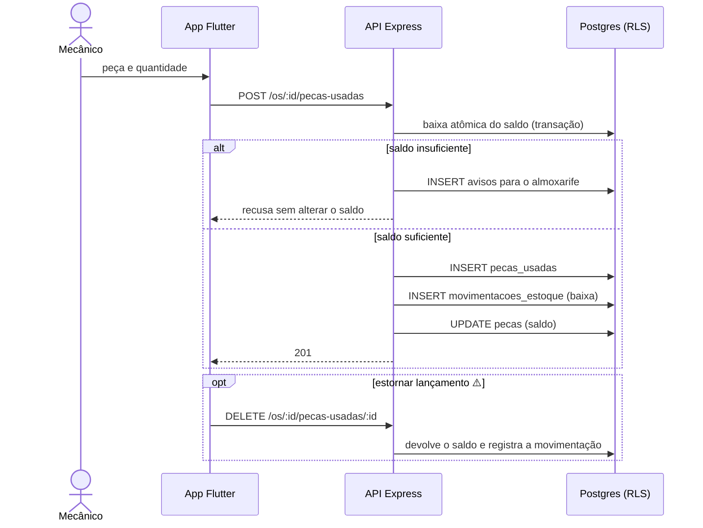

# 013 — Registrar peças usadas

## Objetivo

Entregar **UC13 — Registrar peças usadas** para o ator **Mecânico**. Fluxo completo (principal, alternativos e exceções) em [[Casos de uso]], seção UC13.

## Diagrama

Esboço do comportamento (diagrama de sequência), antes de codar. Tudo vem de [[Casos de uso]], [[Modelo de dados]] e [[Endpoints]]; o que é ⚠️ continua a confirmar.

### Impacto no sistema

- **Escreve:** `pecas_usadas`, `movimentacoes_estoque`, `pecas` e `avisos`.
- **Impacto real:** é onde o estoque realmente diminui, e a única feature com risco de concorrência no saldo (dois mecânicos, mesma peça; CA05 exige teste).
- **Depois:** o cancelamento (017) usa estes lançamentos para devolver o saldo.
- **Quem depende desta:** [[017 - Cancelar OS]].

## Referências

| Item | Valor |
|---|---|
| Fase | F6 — Aprovação e execução |
| Caso de uso | UC13 |
| Histórias | US14 |
| Requisitos | RF13, RF20 |
| Ator | Mecânico |
| Regras de negócio | RN07 |
| Tabelas | pecas_usadas, movimentacoes_estoque, pecas, avisos |
| Especificação | [[Casos de uso]], [[Histórias de usuário]], [[Requisitos]], [[Modelo de dados]] |

## Critérios de aceitação

| # | Critério | Status |
|---|---|---|
| CA01 | Lançar peça vincula à OS e baixa o saldo | 🔲 Pendente |
| CA02 | Saldo insuficiente é recusado e o almoxarife recebe aviso no app (D10) | 🔲 Pendente |
| CA03 | Peça fora do orçamento pede confirmação ⚠️ | 🔲 Pendente |
| CA04 | Remover peça lançada por engano devolve o saldo (estorno) ⚠️ | 🔲 Pendente |
| CA05 | Dois lançamentos simultâneos da mesma peça nunca deixam o saldo negativo (teste de concorrência) | 🔲 Pendente |

Legenda: 🔲 Pendente · 🔄 Em progresso · ✅ Concluído · ❌ Descartado. ⚠️ = fluxo deduzido, conferir com o documento oficial.

## API

| Método | Caminho (`/api/v1`) | Perfis | O que faz |
|---|---|---|---|
| POST | `/os/:id/pecas-usadas` | Mecânico | Lança peça e baixa o saldo |
| DELETE | `/os/:id/pecas-usadas/:pecaUsadaId` | Mecânico | Estorna lançamento |

Contrato completo em [[Endpoints]].

## Telas

- **T20 Execução e peças usadas** — `/os/:id/execucao` (Mecânico)
- **T24 Notificações no app (desconto pendente ou decidido, saldo insuficiente, OS concluída)** — `/notificacoes` (Atendente, Almoxarife, Gerente)

Catálogo completo em [[Mapa de telas]].

## Dependências

- [[012 - Executar serviço]]
- [[004 - Gerir peças]]
- [[018 - Dar entrada no estoque]]

## Tarefas

As tarefas desta feature ficam no [[CHECKLIST]], na seção da fase.
