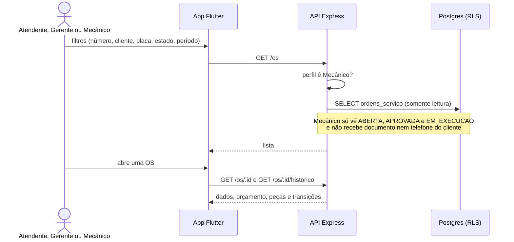

# 016 — Consultar OS

## Objetivo

Entregar **UC16 — Consultar OS** para o ator **Atendente, Gerente, Mecânico (fila)**. Fluxo completo (principal, alternativos e exceções) em [[Casos de uso]], seção UC16.

## Diagrama

Esboço do comportamento (diagrama de sequência), antes de codar. Tudo vem de [[Casos de uso]], [[Modelo de dados]] e [[Endpoints]]; o que é ⚠️ continua a confirmar.

### Impacto no sistema

- **Escreve:** nada (CA06). Estende o `GET /os` criado na 007 com filtros.
- **Impacto real:** é a janela que cada perfil tem sobre o ciclo; a restrição do mecânico é uma regra de privacidade (LGPD) e de RN09, aplicada no servidor.
- **Cuidado:** cliente e placa nos filtros não podem ir para log (dado pessoal).

## Referências

| Item | Valor |
|---|---|
| Fase | F8 — Consulta, histórico e faturamento |
| Caso de uso | UC16 |
| Histórias | US17, US23 |
| Requisitos | RF16, RF21 |
| Ator | Atendente, Gerente, Mecânico (fila) |
| Regras de negócio | — |
| Tabelas | ordens_servico, historico_transicoes |
| Especificação | [[Casos de uso]], [[Histórias de usuário]], [[Requisitos]], [[Modelo de dados]] |

## Critérios de aceitação

| # | Critério | Status |
|---|---|---|
| CA01 | Filtrar por número, cliente, placa, estado e período | 🔲 Pendente |
| CA02 | Mecânico vê só a fila da sua etapa (`ABERTA`, `APROVADA`, `EM_EXECUCAO`) | 🔲 Pendente |
| CA03 | Sem resultado, mostra que nada foi encontrado | 🔲 Pendente |
| CA04 | Abrir a OS mostra dados, estado atual, orçamento e peças | 🔲 Pendente |
| CA05 | Histórico de transições com estado, usuário e data/hora (US23) ⚠️ | 🔲 Pendente |
| CA06 | A consulta não altera dados | 🔲 Pendente |

Legenda: 🔲 Pendente · 🔄 Em progresso · ✅ Concluído · ❌ Descartado. ⚠️ = fluxo deduzido, conferir com o documento oficial.

## API

| Método | Caminho (`/api/v1`) | Perfis | O que faz |
|---|---|---|---|
| GET | `/os` | Atendente, Gerente, Mecânico | Estende a lista da 007 com filtros: numero, cliente, placa, estado, de, ate (cliente e placa vão no corpo de busca ou em parâmetro sem PII nos logs) |
| GET | `/os/:id/historico` | Atendente, Gerente, Mecânico | Transições |

Contrato completo em [[Endpoints]].

## Telas

- **T14 Lista e busca de OS** — `/os` (Atendente, Gerente, Mecânico (fila restrita))
- **T15 Detalhe da OS (dados, orçamento, peças, histórico, ações por estado)** — `/os/:id` (Atendente, Gerente, Mecânico (sem documento e telefone do cliente))

Catálogo completo em [[Mapa de telas]].

## Dependências

- [[007 - Abrir OS]]

## Tarefas

As tarefas desta feature ficam no [[CHECKLIST]], na seção da fase.

## Notas técnicas

A F5 já entrega uma lista simples de OS; esta feature completa filtros, fila do mecânico e histórico.
