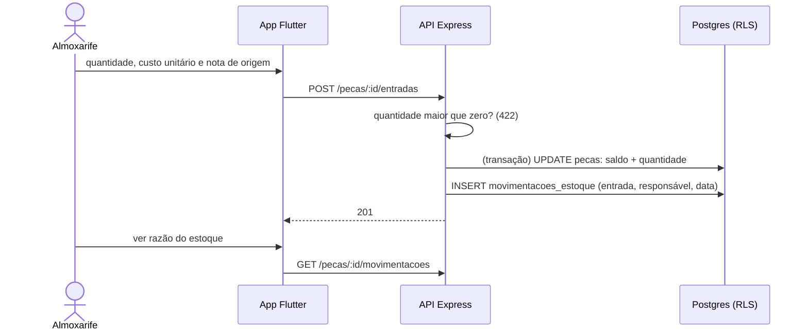

# 018 — Dar entrada no estoque

## Objetivo

Entregar **UC18 — Dar entrada no estoque** para o ator **Almoxarife**. Fluxo completo (principal, alternativos e exceções) em [[Casos de uso]], seção UC18.

## Diagrama

Esboço do comportamento (diagrama de sequência), antes de codar. Tudo vem de [[Casos de uso]], [[Modelo de dados]] e [[Endpoints]]; o que é ⚠️ continua a confirmar.

### Impacto no sistema

- **Escreve:** `pecas` (saldo) e `movimentacoes_estoque`.
- **Impacto real:** é a única forma de aumentar saldo; sem ela a baixa da 013 esbarra em saldo zero. Por isso a 013 depende desta.
- **Cuidado:** feature deduzida (⚠️, decisão 004).
- **Quem depende desta:** [[013 - Registrar peças usadas]].

## Referências

| Item | Valor |
|---|---|
| Fase | F4 — Catálogos e estoque |
| Caso de uso | UC18 |
| Histórias | US19 |
| Requisitos | RF18 |
| Ator | Almoxarife |
| Regras de negócio | RN07 |
| Tabelas | pecas, movimentacoes_estoque |
| Especificação | [[Casos de uso]], [[Histórias de usuário]], [[Requisitos]], [[Modelo de dados]] |

## Critérios de aceitação

| # | Critério | Status |
|---|---|---|
| CA01 | Registrar quantidade, custo unitário e nota de origem soma ao saldo ⚠️ | 🔲 Pendente |
| CA02 | A entrada fica registrada com data e responsável ⚠️ | 🔲 Pendente |
| CA03 | Quantidade menor ou igual a zero é recusada ⚠️ | 🔲 Pendente |
| CA04 | Peça não cadastrada leva o almoxarife ao cadastro (UC04) ⚠️ | 🔲 Pendente |

Legenda: 🔲 Pendente · 🔄 Em progresso · ✅ Concluído · ❌ Descartado. ⚠️ = fluxo deduzido, conferir com o documento oficial.

## API

| Método | Caminho (`/api/v1`) | Perfis | O que faz |
|---|---|---|---|
| POST | `/pecas/:id/entradas` | Almoxarife | Entrada: quantidade, custo e nota |
| GET | `/pecas/:id/movimentacoes` | Almoxarife | Razão do estoque |

Contrato completo em [[Endpoints]].

## Telas

- **T12 Entrada no estoque** — `/pecas/:id/entrada` (Almoxarife)

Catálogo completo em [[Mapa de telas]].

## Dependências

- [[004 - Gerir peças]]

## Tarefas

As tarefas desta feature ficam no [[CHECKLIST]], na seção da fase.

## Notas técnicas

UC18 foi deduzido dos papéis; conferir com o documento oficial.
