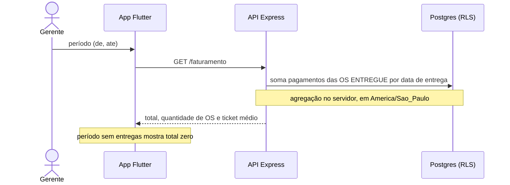

# 019 — Ver faturamento

## Objetivo

Entregar **UC19 — Ver faturamento** para o ator **Gerente**. Fluxo completo (principal, alternativos e exceções) em [[Casos de uso]], seção UC19.

## Diagrama

Esboço do comportamento (diagrama de sequência), antes de codar. Tudo vem de [[Casos de uso]], [[Modelo de dados]] e [[Endpoints]]; o que é ⚠️ continua a confirmar.

### Impacto no sistema

- **Escreve:** nada.
- **Impacto real:** é só uma leitura sobre o que a 015 gravou; se os pagamentos estiverem certos, o faturamento está certo.
- **Cuidado:** feature deduzida (⚠️, decisão 004).
- **Quem depende desta:** [[020 - Acabamento e entrega final]].

## Referências

| Item | Valor |
|---|---|
| Fase | F8 — Consulta, histórico e faturamento |
| Caso de uso | UC19 |
| Histórias | US20 |
| Requisitos | RF19 |
| Ator | Gerente |
| Regras de negócio | — |
| Tabelas | pagamentos, ordens_servico |
| Especificação | [[Casos de uso]], [[Histórias de usuário]], [[Requisitos]], [[Modelo de dados]] |

## Critérios de aceitação

| # | Critério | Status |
|---|---|---|
| CA01 | O total soma os pagamentos de OS `ENTREGUE` no período, pela data de entrega; a agregação roda no servidor ⚠️ | 🔲 Pendente |
| CA02 | Mostra quantidade de OS e ticket médio ⚠️ | 🔲 Pendente |
| CA03 | Período sem OS entregues mostra total zero ⚠️ | 🔲 Pendente |
| CA04 | Detalhar por forma de pagamento, mecânico ou serviço ⚠️ | 🔲 Pendente |

Legenda: 🔲 Pendente · 🔄 Em progresso · ✅ Concluído · ❌ Descartado. ⚠️ = fluxo deduzido, conferir com o documento oficial.

## API

| Método | Caminho (`/api/v1`) | Perfis | O que faz |
|---|---|---|---|
| GET | `/faturamento` | Gerente | Total, quantidade e ticket médio no período (`de`, `ate`) |

Contrato completo em [[Endpoints]].

## Telas

- **T23 Faturamento** — `/faturamento` (Gerente)

Catálogo completo em [[Mapa de telas]].

## Dependências

- [[015 - Entregar e registrar pagamento]]

## Tarefas

As tarefas desta feature ficam no [[CHECKLIST]], na seção da fase.

## Notas técnicas

UC19 foi deduzido dos papéis; conferir com o documento oficial.
