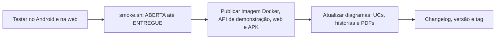

# 020 — Acabamento e entrega final

## Objetivo

Android, integração, documentos e release.

## Diagrama

Esboço da estrutura e do fluxo desta feature, antes de codar.

### Impacto no sistema

- **Escreve:** nada de negócio.
- **Impacto real:** prova o sistema inteiro de ponta a ponta e fecha as entregas (R6); só começa com tudo antes disso ✅.

## Referências

| Item | Valor |
|---|---|
| Fase | F9 — Acabamento e entrega final |
| Caso de uso | — |
| Histórias | — |
| Requisitos | — |
| Ator | Time de desenvolvimento |
| Regras de negócio | — |
| Tabelas | — |
| Especificação | [[Casos de uso]], [[Histórias de usuário]], [[Requisitos]], [[Modelo de dados]] |

## Critérios de aceitação

| # | Critério | Status |
|---|---|---|
| CA01 | App testado em dispositivo Android e layout ajustado para telas pequenas | 🔲 Pendente |
| CA02 | Layout web responsivo conferido | 🔲 Pendente |
| CA03 | Teste de integração (smoke.sh) cobre o fluxo completo `ABERTA` até `ENTREGUE` contra o Supabase de dev | 🔲 Pendente |
| CA04 | Imagem Docker do backend publicada e API de demonstração no ar; web publicado e APK gerado | 🔲 Pendente |
| CA05 | Diagramas, casos de uso, histórias e PDFs atualizados com o que mudou | 🔲 Pendente |
| CA06 | Changelog, versão e tag criados | 🔲 Pendente |

Legenda: 🔲 Pendente · 🔄 Em progresso · ✅ Concluído · ❌ Descartado. ⚠️ = fluxo deduzido, conferir com o documento oficial.

## API

Sem endpoint próprio.

## Telas

Sem tela própria.

## Dependências

- [[019 - Ver faturamento]]

## Tarefas

As tarefas desta feature ficam no [[CHECKLIST]], na seção da fase.
