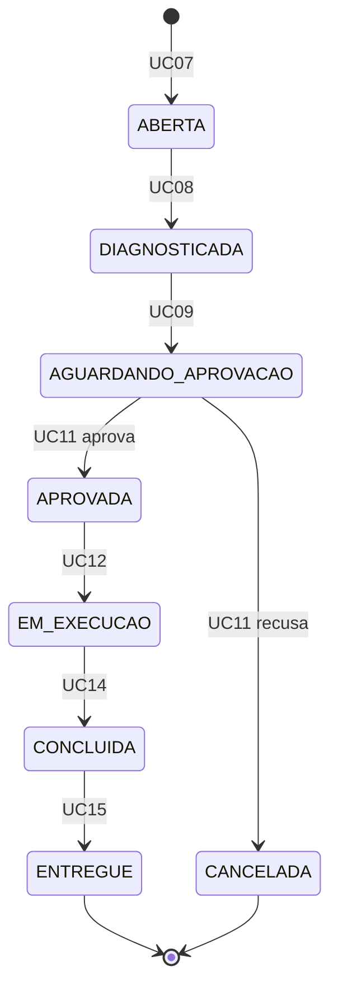
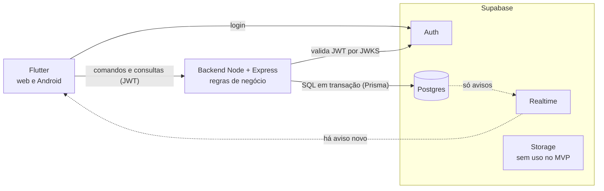

<p align="center">
  
</p>

<h1 align="center">OficinaFácil</h1>

<p align="center">
  Gestão de ordens de serviço para oficina mecânica, da entrada do veículo até a entrega e o pagamento.<br>
  Flutter (web e Android) · Node.js/TypeScript · Supabase
</p>

---

## Sumário

1. [Sobre](#1-sobre)
2. [Estado atual](#2-estado-atual)
3. [Perfis de usuário](#3-perfis-de-usuário)
4. [Funcionalidades](#4-funcionalidades)
5. [Ciclo de vida da OS](#5-ciclo-de-vida-da-os)
6. [Regras de negócio](#6-regras-de-negócio)
7. [Arquitetura](#7-arquitetura)
8. [Tecnologias](#8-tecnologias)
9. [Estrutura do repositório](#9-estrutura-do-repositório)
10. [Como rodar](#10-como-rodar)
11. [Qualidade e testes](#11-qualidade-e-testes)
12. [Roadmap](#12-roadmap)
13. [Identidade visual](#13-identidade-visual)
14. [Documentação](#14-documentação)
15. [Convenções](#15-convenções)
16. [Contexto acadêmico](#16-contexto-acadêmico)

---

## 1. Sobre

O **OficinaFácil** organiza o trabalho de uma oficina mecânica em torno da **ordem de serviço (OS)**. Cada
veículo que entra gera uma OS, que passa por diagnóstico, orçamento, aprovação do cliente, execução,
conclusão e entrega com pagamento. Quatro perfis de usuário participam, cada um com as funções que lhe cabem.

O que o sistema resolve:

- **Rastreio:** em que etapa cada veículo está, quem fez o quê e quando.
- **Orçamento controlado:** serviços e peças somados, com desconto acima de 10% só com autorização do gerente.
- **Estoque consistente:** peça usada na OS baixa o saldo; entrada de mercadoria o aumenta; nunca fica negativo.
- **Visão gerencial:** consulta de OS e faturamento por período.

**Em construção:** vai funcionar em **web e Android**, com dados compartilhados entre os aparelhos (o atendente no
navegador verá o que o mecânico atualizou no celular). Hoje já existem a API base, o banco com segurança por linha, o
login com menu por perfil e a gestão de usuários; os demais casos de uso ainda não foram construídos.

## 2. Estado atual

A **Entrega 1** está concluída, a análise e o planejamento estão prontos e a construção começou: a fundação técnica
(F1) está feita no essencial e a F2 (acesso e usuários) está em andamento.

| Área | Situação |
|---|---|
| App Flutter (web e Android) com tema, rotas, login, menu por perfil e telas de usuários | ✅ |
| `StatusOrdemServico` no domínio, com testes | ✅ |
| Logo, nome e ícones (web e Android) | ✅ |
| Requisitos, casos de uso, histórias, modelo de dados, arquitetura, decisões | ✅ |
| Checklist e roadmap de desenvolvimento | ✅ |
| Backend (Node/TypeScript), projeto Supabase de desenvolvimento, migration inicial com RLS, CI | ✅ |
| UC01 (autenticar) e UC06 (gerir usuários) | 🔄 código pronto; falta a prova com conta real |
| Testes de integração, de concorrência e de RLS | ⏳ dependem do projeto Supabase de teste |
| Os demais casos de uso (UC02 a UC05, UC07 a UC19) | ⏳ |
| Teste em dispositivo Android | ⏳ |

Das 12 decisões, 5 estão aceitas (persistência, autenticação, conferência com o enunciado, backend e estrutura do
repositório), 4 propostas (regras de desconto, estoque, pagamento e avisos) e 3 abertas (ajuste do orçamento, recorte
de entrega e UML formal). UC18 e UC19 foram deduzidos (o resumo oficial descreve 17 casos de uso).

## 3. Perfis de usuário

| Perfil | O que faz |
|---|---|
| **Atendente** | Cadastra clientes e veículos, abre a OS, monta o orçamento, registra a resposta do cliente, recebe o pagamento e entrega o veículo, consulta e cancela OS |
| **Mecânico** | Registra o diagnóstico, executa o serviço, lança as peças usadas e conclui; vê a fila de OS da sua etapa |
| **Almoxarife** | Mantém o catálogo de peças e registra a entrada de mercadoria no estoque |
| **Gerente** | Gerencia usuários e serviços, autoriza descontos acima de 10%, consulta e cancela OS, vê o faturamento |

## 4. Funcionalidades

Os 19 casos de uso, agrupados:

| Módulo | Casos de uso |
|---|---|
| **Acesso e cadastros** | UC01 Autenticar · UC02 Gerir clientes · UC03 Gerir veículos · UC04 Gerir peças · UC05 Gerir serviços · UC06 Gerir usuários |
| **Ciclo da OS** | UC07 Abrir OS · UC08 Registrar diagnóstico · UC09 Montar orçamento · UC10 Autorizar desconto · UC11 Registrar aprovação do cliente · UC12 Executar serviço · UC13 Registrar peças usadas · UC14 Concluir OS · UC15 Entregar e registrar pagamento · UC16 Consultar OS · UC17 Cancelar OS |
| **Estoque e gestão** | UC18 Dar entrada no estoque · UC19 Ver faturamento |

Relações: UC12 **inclui** UC13; UC10 **estende** UC09; UC17 **estende** UC16.
Fluxos completos, pré e pós-condições e exceções ficam no vault (nota **Casos de uso**).

## 5. Ciclo de vida da OS



`CANCELADA` também é alcançável de qualquer estado anterior a `ENTREGUE` (UC17). `ENTREGUE` e `CANCELADA` são
terminais. Já implementado e testado em `mobile/lib/features/ordem_servico/domain/entities/status_ordem_servico.dart`.

## 6. Regras de negócio

Nove regras (RN01 a RN09) governam o sistema. As principais, em resumo:

- A OS avança **um estado por vez** e só entra em execução depois de aprovada pelo cliente.
- **Desconto acima de 10%** do subtotal exige autorização do gerente.
- **Peça usada baixa o estoque** e o saldo nunca fica negativo, nem com requisições simultâneas.
- A entrega exige OS concluída e **pagamentos que somem exatamente o total**.
- **Cancelar** vale em qualquer estado antes da entrega; só atendente e gerente cancelam.
- Cada perfil só vê e faz o que a matriz de casos de uso permite.

O texto completo de cada regra está na nota **Casos de uso** do vault (seção 1.2).

## 7. Arquitetura



Princípios:

- **Toda escrita e toda leitura de dados de negócio passam pelo backend.** O Realtime só publica a tabela de avisos.
- **A regra de negócio mora no backend**, em transação por caso de uso: estado da OS, desconto, estoque, pagamento.
- **RLS em todas as tabelas, sem política de escrita nem de leitura para o app** (exceto os próprios avisos): mesmo um app adulterado não pula as regras.
- **O Supabase só guarda e autentica:** Auth emite o JWT; o backend o valida por JWKS e lê o perfil da tabela `perfis`.
- **Dinheiro em centavos inteiros**; estado da OS em `UPPER_SNAKE` na API e no banco.
- **Clean Architecture por feature** no app; **módulos que só se falam pelo `index.ts`** no backend.

## 8. Tecnologias

| Camada | Tecnologia |
|---|---|
| App | Flutter 3.44, Dart 3.12, Riverpod 3, go_router, `dio`, `supabase_flutter`, Material 3 |
| Backend | Node 22, Express 5, TypeScript, Zod, Prisma, Pino, Helmet, rate limit, Vitest |
| Contrato da API | OpenAPI gerado dos schemas Zod (Swagger em `/docs`) |
| Banco, Auth, Realtime | Supabase (Postgres com RLS). Storage disponível, sem uso no MVP |
| Empacotamento | Docker, só para o backend; o banco nunca roda em container |
| Diagramas | Mermaid |

**Por que essa stack:** quatro perfis em dispositivos diferentes precisam enxergar os mesmos dados, então
banco local não serve. Um backend próprio executa as regras com testes e transação; o Supabase entrega banco,
login e tempo real sem infraestrutura própria. Foi baseada em outro projeto do autor (Confia), sem fila,
gateway de pagamento, mapas nem painel admin.

## 9. Estrutura do repositório

Monorepo com app, backend e documentação no mesmo repositório:

```
oficina_facil/
├── mobile/                       app Flutter (web e Android)
│   ├── lib/
│   │   ├── main.dart · app.dart
│   │   ├── core/                 tema e roteamento
│   │   └── features/
│   │       ├── autenticacao/             login e sessão
│   │       ├── inicio/                   tela inicial e menu por perfil
│   │       ├── usuarios/                 gestão de usuários
│   │       └── ordem_servico/domain/     StatusOrdemServico
│   ├── test/                     testes de domínio, de dados e de widget
│   ├── android/ · web/ · assets/
│   └── pubspec.yaml
├── backend/                      API Node/TypeScript (src/modules, prisma, test, Dockerfile)
├── CLAUDE.md                     regras do projeto
├── README.md
└── OficinaFacilSecondBrain/      documentação (vault), versionado junto com o código
```

Novas features seguem `mobile/lib/features/<feature>/{domain,data,presentation}`. O backend seguirá
`backend/src/modules/<modulo>/{index,routes,service,repository,schemas}.ts`.

## 10. Como rodar

**Pré-requisitos:** Flutter 3.44 (Dart 3.12), Chrome para o web e, para Android, o SDK e um celular com
depuração USB ou emulador.

```bash
git clone git@github.com:eltobsjr/oficina-facil.git
cd oficina-facil/mobile
flutter pub get
```

| Alvo | Comando (dentro de `mobile/`) |
|---|---|
| Web | `flutter run -d chrome` |
| Android | `flutter run -d android` |
| Build web | `flutter build web` |
| APK de depuração | `flutter build apk --debug` |
| Dispositivos | `flutter devices` |

Backend (dentro de `backend/`): `npm install`, `npm run dev` (API na porta 3000, Swagger em `/docs`) e
`bash scripts/smoke.sh`. Segredos ficam em `backend/.env` e `mobile/env.json`, ambos ignorados pelo git.

## 11. Qualidade e testes

Antes de qualquer commit, na parte alterada:

| Parte | Comandos |
|---|---|
| App (`mobile/`) | `dart format --output=none --set-exit-if-changed lib test`, `flutter analyze`, `flutter test`, `flutter build web`, `flutter build apk --debug` |
| Backend (`backend/`) | `npm run lint && npm run format:check && npm run typecheck && npm test` e `bash scripts/smoke.sh` |

Hoje: 216 testes no app e 79 no backend passando (26 de integração do backend ficam ignorados até existir o projeto Supabase de teste).

## 12. Roadmap

| Fase | Entrega | Casos de uso |
|---|---|---|
| F0 | Entrega 1 e base de documentação | ✅ concluída |
| F1 | Fundação: Supabase, backend base, banco com RLS, app ligado ao backend, CI | ✅ no essencial |
| F2 | Acesso e usuários | UC01, UC06 (🔄 em andamento) |
| F3 | Clientes e veículos | UC02, UC03 |
| F4 | Catálogos e estoque | UC05, UC04, UC18 |
| F5 | Abrir, diagnosticar e orçar | UC07 a UC10 |
| F6 | Aprovação e execução | UC11 a UC13 |
| F7 | Concluir, entregar e cancelar | UC14, UC15, UC17 |
| F8 | Consulta, histórico e faturamento | UC16, UC19 |
| F9 | Acabamento, Android, entrega final | — |

Marcos: **M1** login com 4 perfis (F2) · **M2** cadastros e estoque (F4) · **M3** OS orçada (F5) ·
**M4** ciclo completo até a entrega (F7) · **M5** sistema completo em web e Android (F9).
Cada feature segue as mesmas 9 tarefas (modelo, API, testes da API, contrato, app em dois blocos, testes do app,
verificação, documentação). O acompanhamento é feito num quadro do Trello, que é uma vista do vault; a lista mestra é o CHECKLIST.

## 13. Identidade visual

| Item | Valor |
|---|---|
| Nome | OficinaFácil |
| Símbolo | Porca sextavada com marca de check vazada |
| Cor da marca | `#1F4E79` |

A porca remete à oficina; o check, à tarefa concluída. O kit completo (SVGs, PNGs, favicon, ícones) está no vault.

## 14. Documentação

Toda a documentação fica no vault `OficinaFacilSecondBrain/`, **versionado neste mesmo repositório**. Ponto de partida:
nota `00 - Índice`. Principais notas:

| Nota | Conteúdo |
|---|---|
| Requisitos | Requisitos funcionais e não funcionais, glossário |
| Casos de uso | Atores, regras RN01 a RN09, diagramas e os 19 fluxos |
| Histórias de usuário | 23 histórias com critérios |
| Arquitetura | Stack, responsabilidades, autenticação, segurança, ambientes |
| Modelo de dados | Diagrama ER, enums, restrições, RLS |
| Endpoints | Contrato da API por caso de uso |
| Roadmap | Fases, dependências, marcos e riscos |
| CHECKLIST | Lista mestra marcável do que construir |
| `decisions/` | 12 decisões, uma por arquivo (5 aceitas, 4 propostas, 3 abertas) |
| `features/` | Uma especificação por feature, com critérios de aceitação |

Os PDFs para entrega ao professor são gerados em `OficinaFacilSecondBrain/entregas/`.

## 15. Convenções

- Commits em português, sem linha de coautoria, um por feature concluída ou fase de construção. Push só quando o usuário pedir.
- Código limpo: sem arquivo, dependência ou código sem uso.
- `domain` do app sem importar Flutter, `data` nem `presentation`; módulos do backend só se falam por `index.ts`.
- Dinheiro em centavos inteiros; regras de negócio no backend; segredos fora do git.
- Todas as regras, incluindo as inegociáveis, estão no `CLAUDE.md`.

## 16. Contexto acadêmico

Projeto da disciplina **Análise e Projeto de Sistemas**. O professor (Anthony) pede uma entrega por semana, cada uma
com diagrama UML e código correspondente. Os atores, a OS de 8 estados e os casos de uso UC01 a UC17 vêm do enunciado;
UC18, UC19 e as histórias de usuário foram deduzidos; o professor não entregou documento oficial, e a decisão 004
registra que a conferência fica pendente até ele pedir.

Repositório: `github.com/eltobsjr/oficina-facil`
