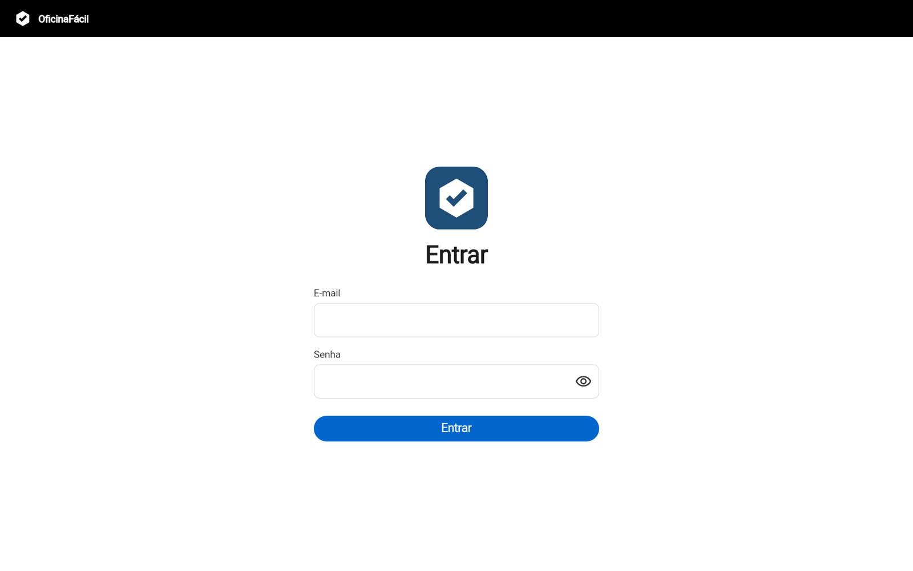
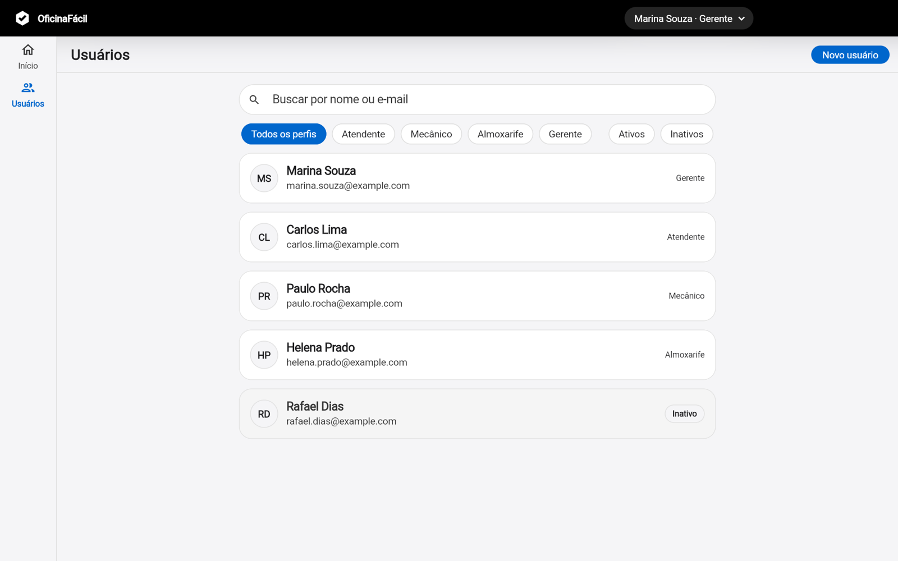
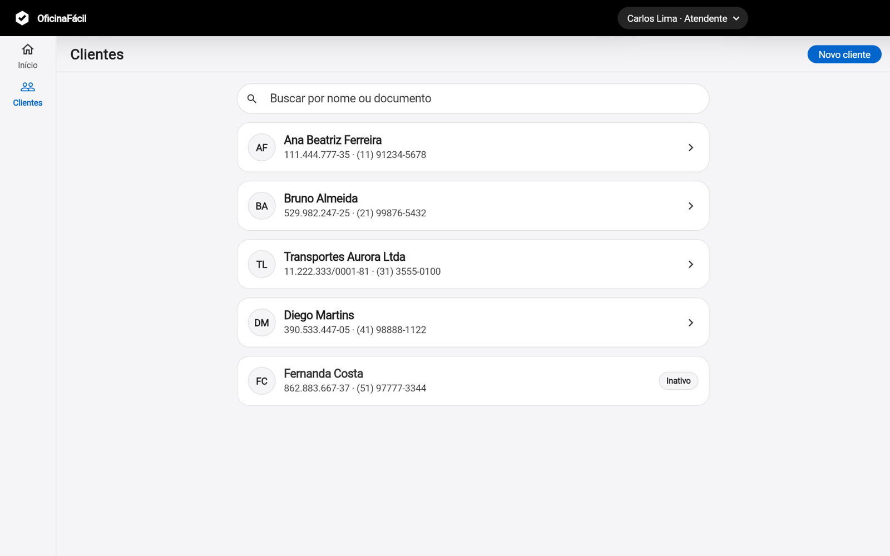
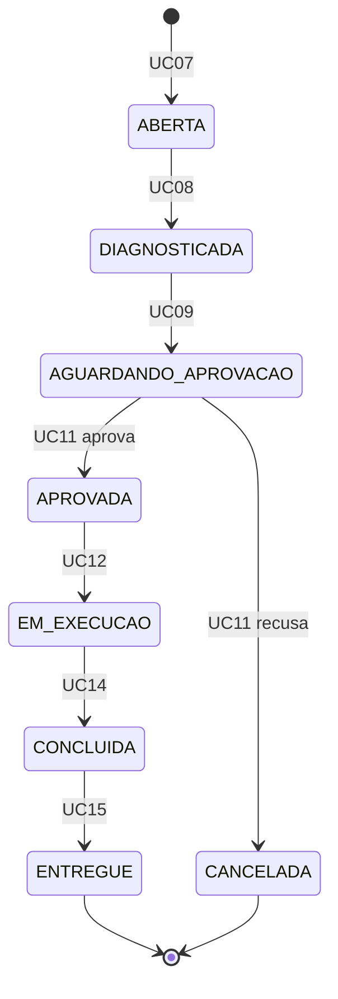
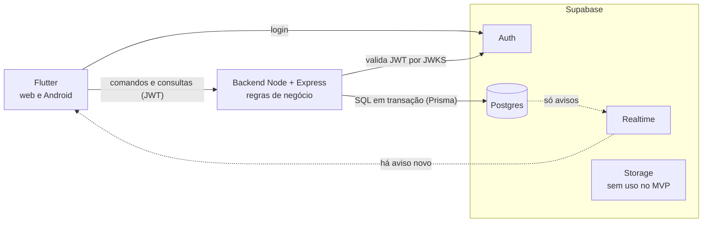
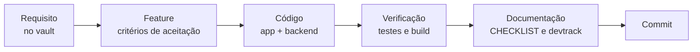

<p align="center">
  
</p>

<h1 align="center">OficinaFácil</h1>

<p align="center">
  Gestão de ordens de serviço para oficina mecânica, da entrada do veículo até a entrega e o pagamento.<br>
  Flutter (web e Android) · Node.js/TypeScript · Supabase
</p>

<p align="center">
  
  
  
  
  
</p>

<p align="center">
  
  
  
  
</p>

<p align="center">
  Projeto da disciplina de Análise e Projeto de Sistemas · Professor: Anthony
</p>

<p align="center">
  <a href="https://github.com/eltobsjr/oficina-facil">Repositório</a> ·
  <a href="https://oficina-facil.onrender.com/health">API no ar</a> ·
  <a href="https://trello.com/b/M2YYMwOu/kanban-quadro-modelo">Quadro do Trello</a> ·
  <a href="OficinaFacilSecondBrain/00%20-%20%C3%8Dndice.md">Documentação (vault)</a> ·
  <a href="OficinaFacilSecondBrain/Roadmap.md">Roadmap</a> ·
  <a href="#15-glossário">Glossário</a>
</p>

---

## Sumário

1. [Sobre](#1-sobre)
2. [Estado atual](#2-estado-atual)
3. [Perfis de usuário](#3-perfis-de-usuário)
4. [Funcionalidades](#4-funcionalidades)
5. [Ciclo de vida da OS](#5-ciclo-de-vida-da-os)
6. [Regras de negócio](#6-regras-de-negócio)
7. [Arquitetura](#7-arquitetura)
8. [Tecnologias](#8-tecnologias)
9. [Estrutura do repositório](#9-estrutura-do-repositório)
10. [Como rodar](#10-como-rodar)
11. [Qualidade e testes](#11-qualidade-e-testes)
12. [Roadmap](#12-roadmap)
13. [Identidade visual](#13-identidade-visual)
14. [Documentação](#14-documentação)
15. [Glossário](#15-glossário)
16. [Fluxo de trabalho](#16-fluxo-de-trabalho)
17. [Claude neste projeto](#17-claude-neste-projeto)
18. [Convenções](#18-convenções)
19. [Equipe e contexto acadêmico](#19-equipe-e-contexto-acadêmico)

---

## 1. Sobre

O **OficinaFácil** organiza o trabalho de uma oficina mecânica em torno da **ordem de serviço (OS)**. Cada
veículo que entra gera uma OS, que passa por diagnóstico, orçamento, aprovação do cliente, execução,
conclusão e entrega com pagamento. Quatro perfis de usuário participam, cada um com as funções que lhe cabem.

O que o sistema resolve:

- **Rastreio:** em que etapa cada veículo está, quem fez o quê e quando.
- **Orçamento controlado:** serviços e peças somados, com desconto acima de 10% só com autorização do gerente.
- **Estoque consistente:** peça usada na OS baixa o saldo; entrada de mercadoria o aumenta; nunca fica negativo.
- **Visão gerencial:** consulta de OS e faturamento por período.

**Em construção:** vai funcionar em **web e Android**, com dados compartilhados entre os aparelhos (o atendente no
navegador verá o que o mecânico atualizou no celular). Já estão prontos o login com menu por perfil, a gestão de
usuários, clientes e veículos, e a API está publicada para demonstração; as ordens de serviço e o estoque vêm nas
próximas fases.

## 2. Estado atual

A análise e o planejamento estão prontos, e as fases **F1 (fundação), F2 (acesso e usuários) e F3 (clientes e
veículos) estão concluídas**, com os critérios de aceitação provados no banco real. A próxima é a **F4** (serviços,
peças e entrada de estoque). O andamento por feature está no CHECKLIST e a linha do tempo no Roadmap, ambos no vault.

| Área | Situação |
|---|---|
| Requisitos, casos de uso, histórias, modelo de dados, arquitetura, decisões | ✅ |
| Fundação: app Flutter, backend Node/TypeScript, Supabase com RLS, CI | ✅ |
| UC01 autenticar e UC06 gerir usuários | ✅ |
| UC02 gerir clientes e UC03 gerir veículos | ✅ |
| Design system "OficinaFácil" aplicado às telas existentes | ✅ |
| API publicada no Render e APK de demonstração | ✅ |
| UC05 serviços, UC04 peças e UC18 entrada de estoque (F4) | ⏳ próxima |
| Demais casos de uso (UC07 a UC17 e UC19) | ⏳ |
| Teste em dispositivo Android | ⏳ |

UC18 e UC19 foram deduzidos (o resumo oficial descreve 17 casos de uso). A lista das decisões, com o estado de cada
uma (aceita, proposta ou aberta), está em `decisions/` no vault.

## 3. Perfis de usuário

| Perfil | O que faz |
|---|---|
| **Atendente** | Cadastra clientes e veículos, abre a OS, monta o orçamento, registra a resposta do cliente, recebe o pagamento e entrega o veículo, consulta e cancela OS |
| **Mecânico** | Registra o diagnóstico, executa o serviço, lança as peças usadas e conclui; vê a fila de OS da sua etapa |
| **Almoxarife** | Mantém o catálogo de peças e registra a entrada de mercadoria no estoque |
| **Gerente** | Gerencia usuários e serviços, autoriza descontos acima de 10%, consulta e cancela OS, vê o faturamento |

## 4. Funcionalidades

Os 19 casos de uso, agrupados:

| Módulo | Casos de uso |
|---|---|
| **Acesso e cadastros** | UC01 Autenticar · UC02 Gerir clientes · UC03 Gerir veículos · UC04 Gerir peças · UC05 Gerir serviços · UC06 Gerir usuários |
| **Ciclo da OS** | UC07 Abrir OS · UC08 Registrar diagnóstico · UC09 Montar orçamento · UC10 Autorizar desconto · UC11 Registrar aprovação do cliente · UC12 Executar serviço · UC13 Registrar peças usadas · UC14 Concluir OS · UC15 Entregar e registrar pagamento · UC16 Consultar OS · UC17 Cancelar OS |
| **Estoque e gestão** | UC18 Dar entrada no estoque · UC19 Ver faturamento |

Relações: UC12 **inclui** UC13; UC10 **estende** UC09; UC17 **estende** UC16.
Fluxos completos, pré e pós-condições e exceções ficam no vault, na nota [Casos de uso](OficinaFacilSecondBrain/requisitos/Casos%20de%20uso.md).

### Telas já prontas

Prints do app real (dados fictícios). O mapa completo das 26 telas está em [Mapa de telas](OficinaFacilSecondBrain/telas/Mapa%20de%20telas.md).

<p align="center">
  
  
  
</p>

Diagramas de pacotes, classes, sequência e atividades por semana: [diagramas/](OficinaFacilSecondBrain/diagramas/00%20-%20%C3%8Dndice%20de%20diagramas.md).

## 5. Ciclo de vida da OS



`CANCELADA` também é alcançável de qualquer estado anterior a `ENTREGUE` (UC17). `ENTREGUE` e `CANCELADA` são
terminais. Já implementado e testado em `mobile/lib/features/ordem_servico/domain/entities/status_ordem_servico.dart`.

## 6. Regras de negócio

Nove regras (RN01 a RN09) governam o sistema. As principais, em resumo:

- A OS avança **um estado por vez** e só entra em execução depois de aprovada pelo cliente.
- **Desconto acima de 10%** do subtotal exige autorização do gerente.
- **Peça usada baixa o estoque** e o saldo nunca fica negativo, nem com requisições simultâneas.
- A entrega exige OS concluída e **pagamentos que somem exatamente o total**.
- **Cancelar** vale em qualquer estado antes da entrega; só atendente e gerente cancelam.
- Cada perfil só vê e faz o que a matriz de casos de uso permite.

O texto completo de cada regra está em [Casos de uso](OficinaFacilSecondBrain/requisitos/Casos%20de%20uso.md), seção 1.2.

## 7. Arquitetura



Princípios:

- **Toda escrita e toda leitura de dados de negócio passam pelo backend.** O Realtime só publica a tabela de avisos.
- **A regra de negócio mora no backend**, em transação por caso de uso: estado da OS, desconto, estoque, pagamento.
- **RLS em todas as tabelas, sem política de escrita nem de leitura para o app** (exceto os próprios avisos): mesmo um app adulterado não pula as regras.
- **O Supabase só guarda e autentica:** Auth emite o JWT; o backend o valida por JWKS e lê o perfil da tabela `perfis`.
- **Dinheiro em centavos inteiros**; estado da OS em `UPPER_SNAKE` na API e no banco.
- **Clean Architecture por feature** no app; **módulos que só se falam pelo `index.ts`** no backend.

## 8. Tecnologias

| Camada | Tecnologia |
|---|---|
| App | Flutter 3.44, Dart 3.12, Riverpod 3, go_router, `dio`, `supabase_flutter`, Material 3 |
| Backend | Node 22, Express 5, TypeScript, Zod, Prisma, Pino, Helmet, rate limit, Vitest |
| Contrato da API | OpenAPI gerado dos schemas Zod (Swagger em `/docs`) |
| Banco, Auth, Realtime | Supabase (Postgres com RLS). Storage disponível, sem uso no MVP |
| Empacotamento | Docker, só para o backend; o banco nunca roda em container |
| Diagramas | Mermaid |

**Por que essa stack:** quatro perfis em dispositivos diferentes precisam enxergar os mesmos dados, então
banco local não serve. Um backend próprio executa as regras com testes e transação; o Supabase entrega banco,
login e tempo real sem infraestrutura própria. Foi baseada em outro projeto do autor (Confia), sem fila,
gateway de pagamento, mapas nem painel admin.

## 9. Estrutura do repositório

Monorepo com app, backend e documentação no mesmo repositório:

```
oficina_facil/
├── mobile/                       app Flutter (web e Android)
│   ├── lib/
│   │   ├── main.dart · app.dart
│   │   ├── core/                 tema e roteamento
│   │   └── features/
│   │       ├── autenticacao/             login e sessão
│   │       ├── inicio/                   tela inicial e menu por perfil
│   │       ├── usuarios/                 gestão de usuários
│   │       └── ordem_servico/domain/     StatusOrdemServico
│   ├── test/                     testes de domínio, de dados e de widget
│   ├── android/ · web/ · assets/
│   └── pubspec.yaml
├── backend/                      API Node/TypeScript (src/modules, prisma, test, Dockerfile)
├── CLAUDE.md                     regras do projeto
├── README.md
└── OficinaFacilSecondBrain/      documentação (vault), versionado junto com o código
```

Novas features seguem `mobile/lib/features/<feature>/{domain,data,presentation}`. O backend seguirá
`backend/src/modules/<modulo>/{index,routes,service,repository,schemas}.ts`.

## 10. Como rodar

**Pré-requisitos:** Flutter 3.44 (Dart 3.12), Chrome para o web e, para Android, o SDK e um celular com
depuração USB ou emulador.

```bash
git clone git@github.com:eltobsjr/oficina-facil.git
cd oficina-facil/mobile
flutter pub get
```

| Alvo | Comando (dentro de `mobile/`) |
|---|---|
| Web | `flutter run -d chrome` |
| Android | `flutter run -d android` |
| Build web | `flutter build web` |
| APK de depuração | `flutter build apk --debug` |
| Dispositivos | `flutter devices` |

Backend (dentro de `backend/`): `npm install`, `npm run dev` (API na porta 3000, Swagger em `/docs`) e
`bash scripts/smoke.sh`. Segredos ficam em `backend/.env` e `mobile/env.json`, ambos ignorados pelo git.

## 11. Qualidade e testes

Antes de qualquer commit, na parte alterada:

| Parte | Comandos |
|---|---|
| App (`mobile/`) | `dart format --output=none --set-exit-if-changed lib test`, `flutter analyze`, `flutter test`, `flutter build web`, `flutter build apk --debug` |
| Backend (`backend/`) | `npm run lint && npm run format:check && npm run typecheck && npm test` e `bash scripts/smoke.sh` |

Hoje: 351 testes no app e 179 no backend passando; 31 testes de integração do backend só rodam com o banco de desenvolvimento liberado (um único projeto Supabase, sem dado real).

## 12. Roadmap

| Fase | Entrega | Casos de uso |
|---|---|---|
| F0 | Entrega 1 e base de documentação | ✅ concluída |
| F1 | Fundação: Supabase, backend base, banco com RLS, app ligado ao backend, CI | ✅ concluída |
| F2 | Acesso e usuários | UC01, UC06 ✅ |
| F3 | Clientes e veículos | UC02, UC03 ✅ |
| F4 | Catálogos e estoque | UC05, UC04, UC18 |
| F5 | Abrir, diagnosticar e orçar | UC07 a UC10 |
| F6 | Aprovação e execução | UC11 a UC13 |
| F7 | Concluir, entregar e cancelar | UC14, UC15, UC17 |
| F8 | Consulta, histórico e faturamento | UC16, UC19 |
| F9 | Acabamento, Android, entrega final | — |

Marcos: **M1** login com 4 perfis (F2) · **M2** cadastros e estoque (F4) · **M3** OS orçada (F5) ·
**M4** ciclo completo até a entrega (F7) · **M5** sistema completo em web e Android (F9).
Cada feature segue as mesmas 9 tarefas (modelo, API, testes da API, contrato, app em dois blocos, testes do app,
verificação, documentação). O acompanhamento é feito num quadro do Trello, que é uma vista do vault; a lista mestra é o CHECKLIST. Calendário e peso de cada fase: nota Roadmap.

## 13. Identidade visual

| Item | Valor |
|---|---|
| Nome | OficinaFácil |
| Símbolo | Porca sextavada com marca de check vazada |
| Cor da marca | `#1F4E79` |

A porca remete à oficina; o check, à tarefa concluída. O kit completo (SVGs, PNGs, favicon, ícones) está no vault.

## 14. Documentação

Toda a documentação fica no vault `OficinaFacilSecondBrain/`, **versionado neste mesmo repositório**. Ponto de partida: [00 - Índice](OficinaFacilSecondBrain/00%20-%20%C3%8Dndice.md).

| Documento | O que responde |
|---|---|
| [Visão geral](OficinaFacilSecondBrain/OficinaF%C3%A1cil%20%E2%80%94%20Vis%C3%A3o%20Geral.md) | Que problema resolvemos e para quem |
| [Requisitos](OficinaFacilSecondBrain/requisitos/Requisitos.md) | RF, RNF e o glossário completo |
| [Casos de uso](OficinaFacilSecondBrain/requisitos/Casos%20de%20uso.md) | Atores, regras RN01 a RN09 e os 19 fluxos |
| [Histórias de usuário](OficinaFacilSecondBrain/requisitos/Hist%C3%B3rias%20de%20usu%C3%A1rio.md) | 23 histórias com critérios |
| [Rastreabilidade](OficinaFacilSecondBrain/requisitos/Rastreabilidade.md) | Do requisito até a tela e a tabela |
| [Arquitetura](OficinaFacilSecondBrain/arquitetura/Arquitetura.md) | Stack, camadas, autenticação, segurança e ambientes |
| [Modelo de dados](OficinaFacilSecondBrain/arquitetura/Modelo%20de%20dados.md) | Diagrama ER, enums, restrições e RLS |
| [Diagramas](OficinaFacilSecondBrain/diagramas/00%20-%20%C3%8Dndice%20de%20diagramas.md) | Pacotes, classes, sequência e atividades, por semana |
| [Endpoints](OficinaFacilSecondBrain/api/Endpoints.md) | Contrato da API por caso de uso |
| [Mapa de telas](OficinaFacilSecondBrain/telas/Mapa%20de%20telas.md) | As 26 telas e quem acessa cada uma |
| [Roadmap](OficinaFacilSecondBrain/Roadmap.md) | As 15 semanas, os marcos e os riscos |
| [CHECKLIST](OficinaFacilSecondBrain/CHECKLIST.md) | Lista mestra do que construir |
| [Features](OficinaFacilSecondBrain/features/) | Uma especificação por feature, com critérios e diagrama |
| [Decisões](OficinaFacilSecondBrain/decisions/00%20-%20%C3%8Dndice%20de%20decis%C3%B5es.md) | 14 decisões, uma por arquivo, com o estado de cada uma |
| [Devtrack](OficinaFacilSecondBrain/devtrack/) | Um registro por sessão de trabalho |
| [Artefatos](OficinaFacilSecondBrain/artefatos/00%20-%20%C3%8Dndice%20de%20artefatos.md) | Design das telas, design system e slides |
| [Convenções](OficinaFacilSecondBrain/Conven%C3%A7%C3%B5es.md) | Onde cada coisa vive no vault |

Os PDFs para entrega ao professor são gerados em [entregas/](OficinaFacilSecondBrain/entregas/).

## 15. Glossário

Os termos que mais aparecem. O glossário completo está em [Requisitos](OficinaFacilSecondBrain/requisitos/Requisitos.md), seção 3.

| Termo | Significado |
|---|---|
| **OS** | Ordem de serviço: o registro que acompanha um veículo na oficina |
| **OS ativa** | OS em qualquer estado, exceto `ENTREGUE` e `CANCELADA` |
| **Estado** | Posição da OS no ciclo (`ABERTA`, `DIAGNOSTICADA`, `AGUARDANDO_APROVACAO`, `APROVADA`, `EM_EXECUCAO`, `CONCLUIDA`, `ENTREGUE`, `CANCELADA`) |
| **Perfil** | Papel do usuário: atendente, mecânico, almoxarife ou gerente |
| **Diagnóstico** | Parecer técnico do mecânico sobre o defeito |
| **Orçamento** | Serviços e peças com valores e desconto, montado depois do diagnóstico |
| **Autorização de desconto** | Pedido do atendente, decidido pelo gerente, para desconto acima de 10% do subtotal |
| **Peça usada** | Peça consumida numa OS; baixa o estoque |
| **Saldo e estoque mínimo** | Quantidade em estoque e o limite abaixo do qual a peça é destacada |
| **Movimentação de estoque** | Entrada, baixa ou estorno; o saldo resulta delas |
| **Estorno** | Devolução ao estoque de uma peça lançada |
| **Aviso** | Notificação dentro do app (OS concluída, saldo insuficiente, desconto pendente) |
| **Faturamento** | Soma dos pagamentos das OS entregues no período |
| **Centavos** | Unidade em que todo valor monetário é guardado, sempre inteiro |
| **RLS** | Segurança por linha do Postgres: decide quem lê e escreve cada linha |
| **JWT / JWKS** | Token de sessão do Supabase e as chaves públicas que o backend usa para conferi-lo |

## 16. Fluxo de trabalho

O trabalho segue uma **feature por vez, na ordem do CHECKLIST**, e só começa quando as dependências da feature estão concluídas.



| Ferramenta | Papel |
|---|---|
| Vault `OficinaFacilSecondBrain/` | Fonte única: requisitos, critérios, decisões, CHECKLIST e logs de sessão |
| [Trello](https://trello.com/b/M2YYMwOu/kanban-quadro-modelo) | Vista do vault em Kanban: em que etapa cada feature está. O quadro é espelho; em divergência vale o vault |
| GitHub | Código, CI e o vault versionado, direto na `main`, um commit por feature ou fase |

Regras que sustentam o fluxo: mudança de comportamento atualiza primeiro os critérios e as notas do vault e só
então o código; nada de requisito, tela ou endpoint fora do vault sem aprovação; commit só com a verificação
passando. Cada feature tem o seu diagrama (sequência, classes ou atividades) no próprio arquivo em `features/`.

## 17. Claude neste projeto

O projeto é desenvolvido com apoio do Claude Code, com o contexto guardado no próprio repositório:

| Arquivo | Papel |
|---|---|
| `CLAUDE.md` | Regras invioláveis do projeto: documentação só no vault, sem inventar requisito, verificar antes de afirmar, segredos fora do git |
| `OficinaFacilSecondBrain/devtrack/` | Log de cada sessão: o que foi feito, arquivos, decisões e pendências |
| `OficinaFacilSecondBrain/prioridade/atual.md` | A próxima ação, para retomar de onde parou |

Mudanças só são commitadas ao fim de uma feature ou fase, em português e sem linha de coautoria; push só sob pedido.

## 18. Convenções

- Commits em português, sem linha de coautoria, um por feature concluída ou fase de construção. Push só quando o usuário pedir.
- Código limpo: sem arquivo, dependência ou código sem uso.
- `domain` do app sem importar Flutter, `data` nem `presentation`; módulos do backend só se falam por `index.ts`.
- Dinheiro em centavos inteiros; regras de negócio no backend; segredos fora do git.
- Todas as regras, incluindo as inegociáveis, estão no `CLAUDE.md`.

## 19. Equipe e contexto acadêmico

| Integrante |
|---|
| Elto |
| Evillyn |
| Roberto |
| Pedro |

Projeto da disciplina **Análise e Projeto de Sistemas**. O professor (Anthony) pede uma entrega por semana, cada uma
com diagrama UML e código correspondente. Os atores, a OS de 8 estados e os casos de uso UC01 a UC17 vêm do enunciado;
UC18, UC19 e as histórias de usuário foram deduzidos; o professor não entregou documento oficial, e a decisão 004
registra que a conferência fica pendente até ele pedir.

Repositório: `github.com/eltobsjr/oficina-facil`

---

<p align="center"><strong>OficinaFácil</strong> · Análise e Projeto de Sistemas · 2026<br><em>Projeto acadêmico, sem fins comerciais.</em></p>
