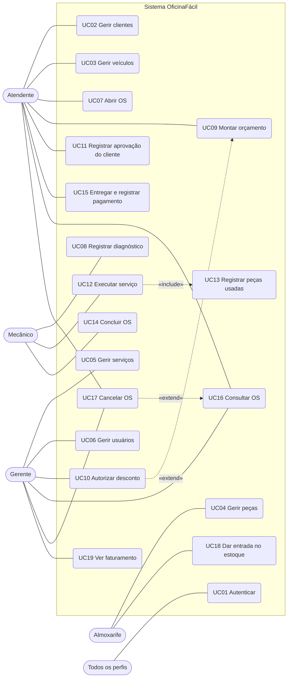
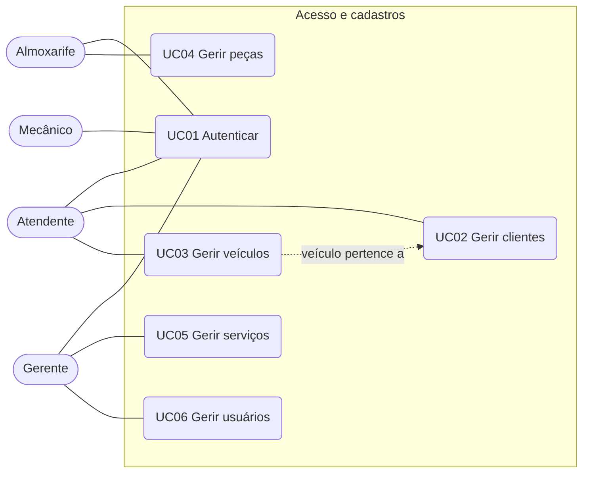
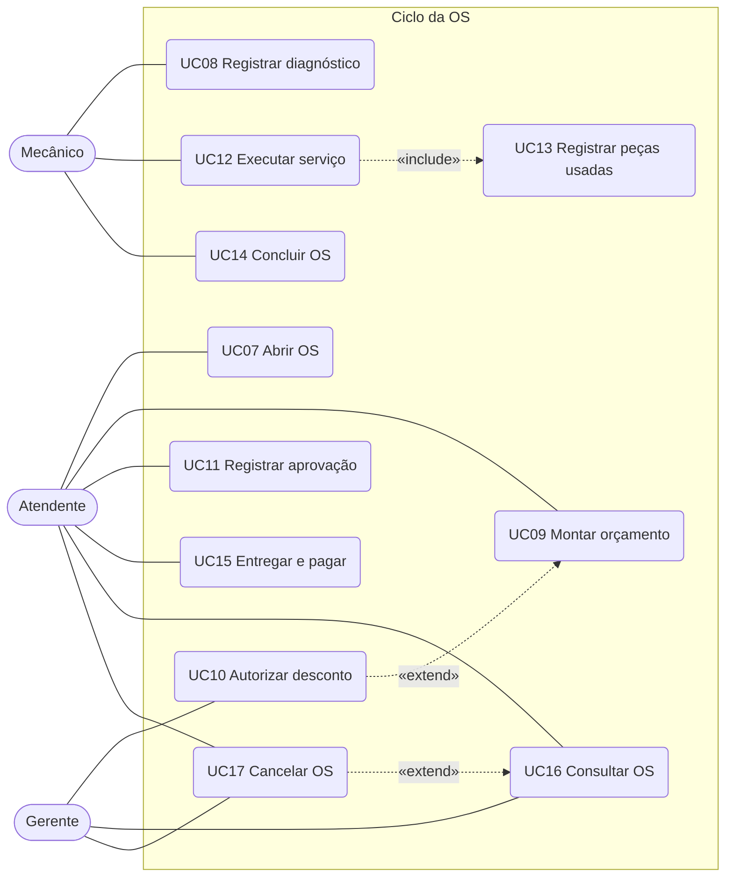
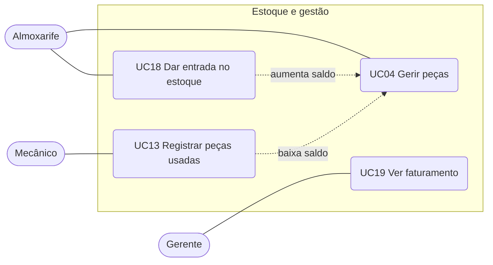
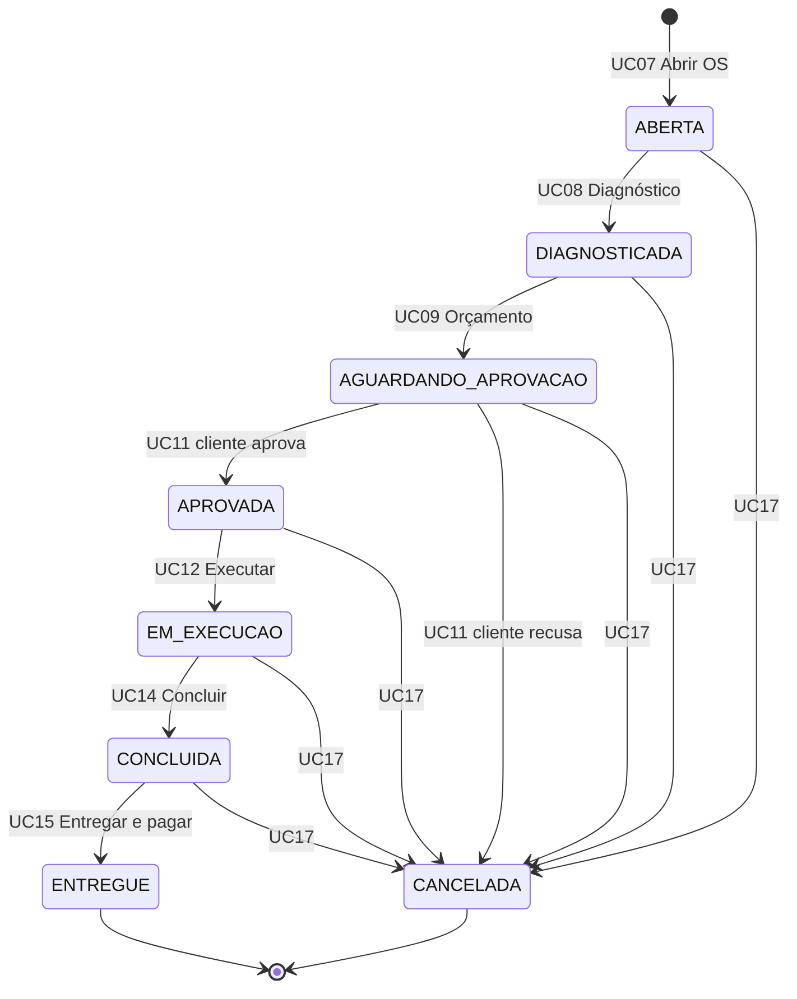
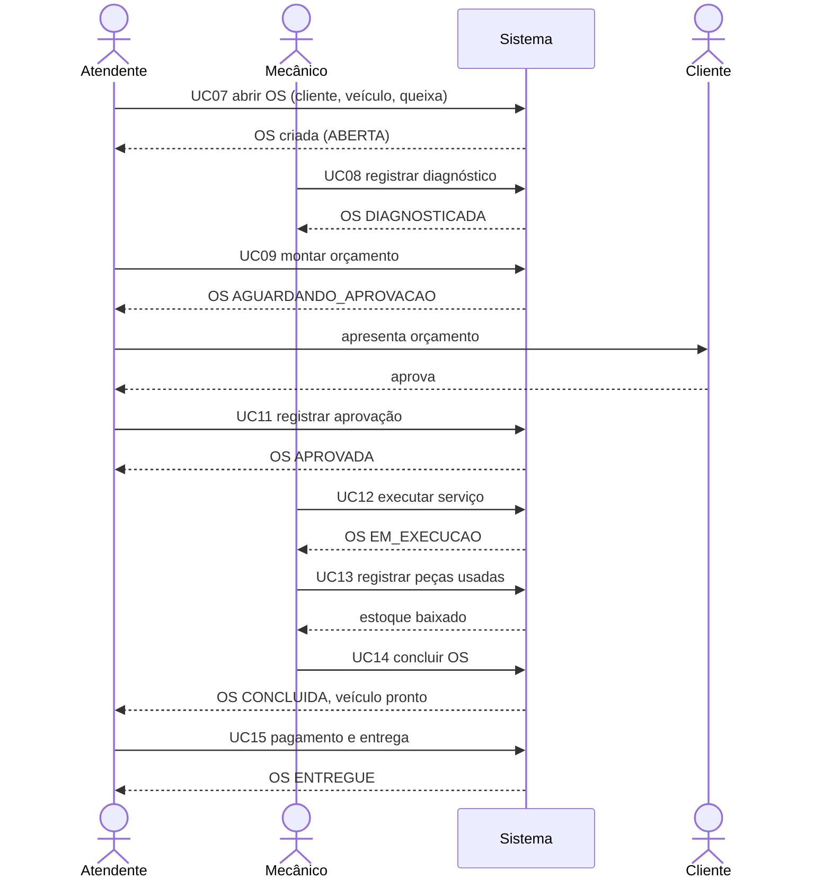
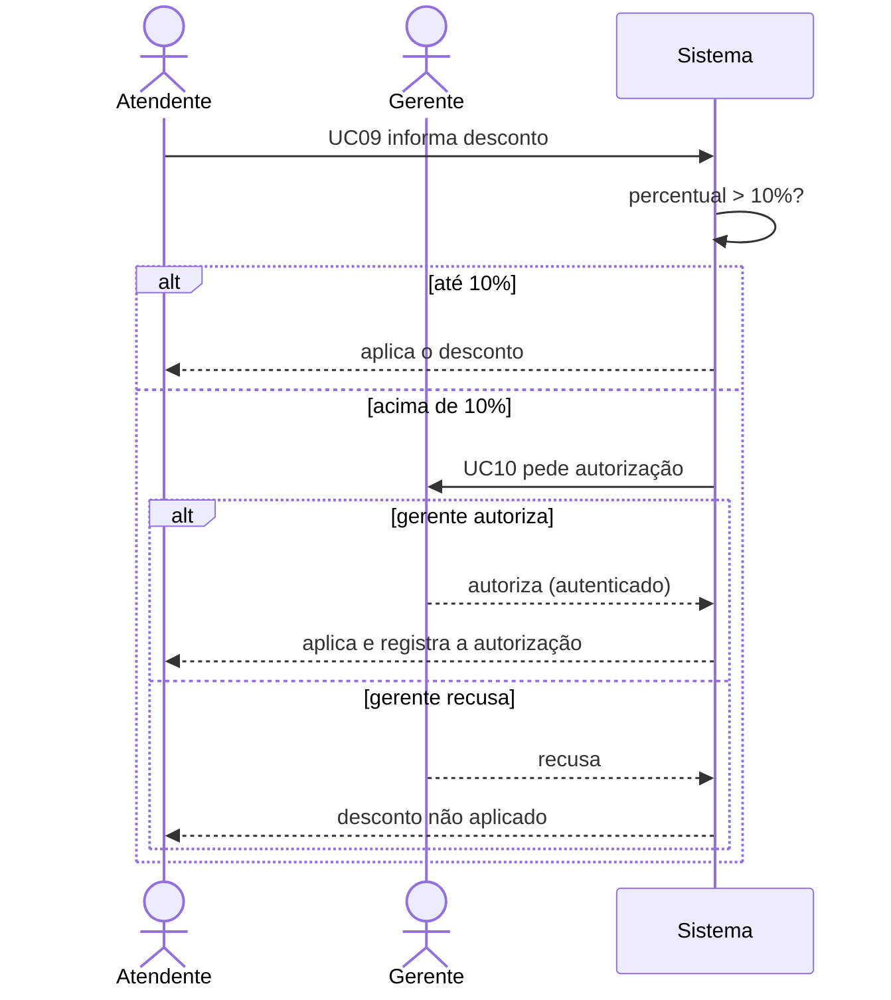
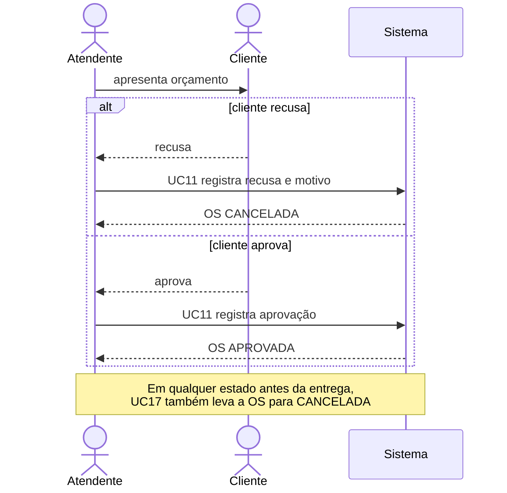

# Casos de uso — OficinaFácil

Documento de casos de uso do sistema de gestão de ordens de serviço (OS) de uma oficina mecânica.
Diagramas em Mermaid. O diagrama de estados e a arquitetura estão em [`diagramas.md`](diagramas.md).

> **Pontos assumidos.** O resumo da Entrega 1 só descreve até o UC17. Os itens abaixo foram
> deduzidos dos papéis e devem ser conferidos com o documento oficial:
> UC18 (entrada no estoque), UC19 (faturamento) e os detalhes marcados com ⚠️.

## 1. Visão geral

O sistema acompanha o veículo da entrada na oficina até a entrega e o pagamento. Cada OS passa por
um ciclo de vida de 8 estados e envolve 4 perfis de usuário.

### 1.1 Atores

| Ator | Responsabilidade | Casos de uso |
|---|---|---|
| **Atendente** | Recepção: cadastra clientes e veículos, abre a OS, monta o orçamento, registra a resposta do cliente e entrega o veículo | UC01, 02, 03, 07, 09, 11, 15, 16, 17 |
| **Mecânico** | Técnico: diagnostica, executa o serviço, registra peças usadas e conclui | UC01, 08, 12, 13, 14 |
| **Almoxarife** | Estoque: cadastra peças e dá entrada de mercadoria | UC01, 04, 18 |
| **Gerente** | Administração: usuários, serviços, descontos, cancelamentos e faturamento | UC01, 05, 06, 10, 16, 17, 19 |

Todos os atores herdam UC01 (Autenticar). Nenhum caso de uso, exceto UC01, é acessível sem login.

### 1.2 Regras de negócio

| ID | Regra |
|---|---|
| RN01 | Toda OS nasce no estado `ABERTA` e só avança pelo fluxo `ABERTA → DIAGNOSTICADA → AGUARDANDO_APROVACAO → APROVADA → EM_EXECUCAO → CONCLUIDA → ENTREGUE`. |
| RN02 | Desconto de até 10% do orçamento é concedido pelo atendente. Acima de 10% exige autorização do gerente (UC10). |
| RN03 | A OS só entra em execução depois de aprovada pelo cliente. |
| RN04 | Se o cliente recusar o orçamento, a OS vai para `CANCELADA`. |
| RN05 | Cancelar é permitido em qualquer estado antes da entrega. `ENTREGUE` e `CANCELADA` são estados terminais. |
| RN06 | Só o atendente e o gerente cancelam uma OS (UC17). |
| RN07 | Peça usada numa OS baixa o estoque; não é possível usar mais do que o saldo disponível. ⚠️ |
| RN08 | A entrega (UC15) exige o pagamento registrado e a OS em `CONCLUIDA`. |
| RN09 | Cada perfil só enxerga e executa o que a matriz da seção 2 permite. |

### 1.3 Glossário

| Termo | Significado |
|---|---|
| OS | Ordem de serviço: registro que acompanha um veículo na oficina |
| Orçamento | Lista de serviços e peças com valor, montada depois do diagnóstico |
| Diagnóstico | Parecer técnico do mecânico sobre o defeito |
| Almoxarifado | Estoque de peças |

## 2. Matriz ator × caso de uso

| UC | Caso de uso | Atendente | Mecânico | Almoxarife | Gerente |
|---|---|:-:|:-:|:-:|:-:|
| UC01 | Autenticar | ✔ | ✔ | ✔ | ✔ |
| UC02 | Gerir clientes | ✔ | | | |
| UC03 | Gerir veículos | ✔ | | | |
| UC04 | Gerir peças | | | ✔ | |
| UC05 | Gerir serviços | | | | ✔ |
| UC06 | Gerir usuários | | | | ✔ |
| UC07 | Abrir OS | ✔ | | | |
| UC08 | Registrar diagnóstico | | ✔ | | |
| UC09 | Montar orçamento | ✔ | | | |
| UC10 | Autorizar desconto | | | | ✔ |
| UC11 | Registrar aprovação do cliente | ✔ | | | |
| UC12 | Executar serviço | | ✔ | | |
| UC13 | Registrar peças usadas | | ✔ | | |
| UC14 | Concluir OS | | ✔ | | |
| UC15 | Entregar e registrar pagamento | ✔ | | | |
| UC16 | Consultar OS | ✔ | | | ✔ |
| UC17 | Cancelar OS | ✔ | | | ✔ |
| UC18 | Dar entrada no estoque ⚠️ | | | ✔ | |
| UC19 | Ver faturamento ⚠️ | | | | ✔ |

## 3. Diagrama geral

Mermaid não tem diagrama de casos de uso nativo; usamos `flowchart`.
Linha sólida = associação; tracejada = `include` / `extend` (a seta aponta para o caso de uso base no
`extend` e para o incluído no `include`).

## 4. Diagramas por módulo

### 4.1 Acesso e cadastros

### 4.2 Ciclo da ordem de serviço

### 4.3 Estoque e gestão

## 5. Ciclo de vida da OS e casos de uso

Detalhe do diagrama de estados em [`diagramas.md`](diagramas.md), com o caso de uso que provoca
cada transição. Implementado em `lib/features/ordem_servico/domain/entities/status_ordem_servico.dart`.

## 6. Especificação dos casos de uso

Convenções: **Pré** = pré-condição; **Pós** = pós-condição; **FP** = fluxo principal;
**FA** = fluxo alternativo; **FE** = fluxo de exceção.

---

### Módulo A — Acesso e cadastros

#### UC01 — Autenticar

| Campo | Descrição |
|---|---|
| Atores | Atendente, Mecânico, Almoxarife, Gerente |
| Objetivo | Identificar o usuário e liberar as funções do seu perfil |
| Pré | Usuário cadastrado e ativo (UC06) |
| Pós | Sessão aberta com o perfil do usuário; menu limitado ao que o perfil permite (RN09) |
| Regras | RN09 |

**FP**
1. O usuário informa login e senha.
2. O sistema valida as credenciais.
3. O sistema abre a sessão e exibe a tela inicial do perfil.

**FA1 — Encerrar sessão.** Em qualquer tela o usuário escolhe "Sair"; o sistema encerra a sessão e volta ao login.

**FE1 — Credenciais inválidas.** No passo 2 o sistema recusa o acesso e mostra mensagem genérica, sem dizer se o erro foi no login ou na senha.
**FE2 — Usuário inativo.** No passo 2 o sistema informa que o usuário está desativado.

---

#### UC02 — Gerir clientes

| Campo | Descrição |
|---|---|
| Ator | Atendente |
| Objetivo | Cadastrar, consultar, alterar e inativar clientes |
| Pré | Atendente autenticado |
| Pós | Cadastro de clientes atualizado |
| Dados | Nome, documento (CPF/CNPJ), telefone, e-mail, endereço ⚠️ |

**FP (cadastrar)**
1. O atendente escolhe "Novo cliente".
2. Informa os dados do cliente.
3. O sistema valida os dados e confere se o documento já existe.
4. O sistema salva o cliente.

**FA1 — Consultar/alterar.** O atendente busca por nome ou documento, abre o cadastro e altera os dados; o sistema valida e salva.
**FA2 — Inativar.** O atendente inativa um cliente; o histórico de OS é mantido. Cliente com OS em aberto não pode ser inativado.

**FE1 — Documento duplicado.** No passo 3 o sistema recusa e mostra o cadastro existente.
**FE2 — Dados obrigatórios ausentes.** O sistema destaca os campos e não salva.

---

#### UC03 — Gerir veículos

| Campo | Descrição |
|---|---|
| Ator | Atendente |
| Objetivo | Cadastrar, consultar, alterar e inativar veículos dos clientes |
| Pré | Atendente autenticado; cliente existente (UC02) |
| Pós | Veículo vinculado a um cliente |
| Dados | Placa, marca, modelo, ano, cor, quilometragem ⚠️ |

**FP (cadastrar)**
1. O atendente escolhe o cliente e "Novo veículo".
2. Informa os dados do veículo.
3. O sistema valida a placa e confere duplicidade.
4. O sistema salva e vincula o veículo ao cliente.

**FA1 — Consultar/alterar.** Busca por placa ou cliente; altera os dados e salva.
**FA2 — Transferir de dono.** O atendente muda o cliente vinculado; o histórico de OS permanece com o dono anterior. ⚠️

**FE1 — Placa duplicada.** No passo 3 o sistema recusa e exibe o veículo existente.
**FE2 — Placa inválida.** O sistema recusa o formato.

---

#### UC04 — Gerir peças

| Campo | Descrição |
|---|---|
| Ator | Almoxarife |
| Objetivo | Cadastrar, consultar, alterar e inativar peças do catálogo |
| Pré | Almoxarife autenticado |
| Pós | Catálogo de peças atualizado |
| Dados | Código, descrição, preço de venda, saldo, estoque mínimo ⚠️ |

**FP (cadastrar)**
1. O almoxarife escolhe "Nova peça".
2. Informa código, descrição, preço e estoque mínimo.
3. O sistema valida e confere se o código já existe.
4. O sistema salva a peça com saldo zero.

**FA1 — Consultar/alterar.** Busca por código ou descrição; altera os dados (o saldo só muda por UC13 e UC18).
**FA2 — Alerta de estoque baixo.** Peças abaixo do mínimo aparecem destacadas na listagem. ⚠️

**FE1 — Código duplicado.** No passo 3 o sistema recusa.
**FE2 — Preço inválido.** Preço negativo ou zero é recusado.

---

#### UC05 — Gerir serviços

| Campo | Descrição |
|---|---|
| Ator | Gerente |
| Objetivo | Manter o catálogo de serviços e seus preços |
| Pré | Gerente autenticado |
| Pós | Catálogo de serviços atualizado |
| Dados | Código, descrição, valor da mão de obra, tempo estimado ⚠️ |

**FP (cadastrar)**
1. O gerente escolhe "Novo serviço".
2. Informa descrição, valor e tempo estimado.
3. O sistema valida e salva.

**FA1 — Alterar preço.** A mudança vale só para orçamentos novos; os orçamentos já montados mantêm o valor.
**FA2 — Inativar.** Serviço inativo não aparece em orçamentos novos.

**FE1 — Valor inválido.** O sistema recusa valores menores ou iguais a zero.

---

#### UC06 — Gerir usuários

| Campo | Descrição |
|---|---|
| Ator | Gerente |
| Objetivo | Criar, alterar, inativar usuários e definir seu perfil |
| Pré | Gerente autenticado |
| Pós | Usuário disponível para UC01 com um dos 4 perfis |
| Dados | Nome, login, senha, perfil (Atendente, Mecânico, Almoxarife, Gerente) |

**FP (criar)**
1. O gerente escolhe "Novo usuário".
2. Informa nome, login, perfil e senha inicial.
3. O sistema valida e confere se o login é único.
4. O sistema salva o usuário.

**FA1 — Trocar perfil.** O gerente altera o perfil; vale no próximo login.
**FA2 — Redefinir senha.** O gerente define uma nova senha.
**FA3 — Inativar.** O usuário não consegue mais autenticar; o histórico de ações é mantido.

**FE1 — Login duplicado.** No passo 3 o sistema recusa.
**FE2 — Gerente inativando a si mesmo.** O sistema impede, para sempre haver ao menos um gerente ativo. ⚠️

---

### Módulo B — Ciclo da ordem de serviço

#### UC07 — Abrir OS

| Campo | Descrição |
|---|---|
| Ator | Atendente |
| Objetivo | Registrar a entrada do veículo e abrir a ordem de serviço |
| Pré | Atendente autenticado; cliente (UC02) e veículo (UC03) cadastrados |
| Pós | OS criada no estado `ABERTA`, com número único e data/hora de abertura |
| Regras | RN01 |

**FP**
1. O atendente escolhe "Abrir OS".
2. Seleciona o cliente e um dos veículos dele.
3. Descreve a queixa do cliente e registra a quilometragem.
4. O sistema confere se o veículo não tem outra OS ativa.
5. O sistema cria a OS em `ABERTA` e exibe o número.

**FA1 — Cliente ou veículo não cadastrado.** O atendente cadastra (UC02/UC03) e retoma o passo 2.

**FE1 — Veículo com OS ativa.** No passo 4 o sistema recusa e mostra a OS existente.
**FE2 — Queixa vazia.** O sistema exige a descrição.

---

#### UC08 — Registrar diagnóstico

| Campo | Descrição |
|---|---|
| Ator | Mecânico |
| Objetivo | Registrar o parecer técnico sobre o defeito |
| Pré | Mecânico autenticado; OS em `ABERTA` |
| Pós | OS em `DIAGNOSTICADA`, com o diagnóstico e o mecânico responsável |
| Regras | RN01 |

**FP**
1. O mecânico abre a lista de OS abertas e escolhe uma.
2. Descreve o diagnóstico e os serviços e peças que considera necessários.
3. O sistema salva o diagnóstico e associa o mecânico à OS.
4. O sistema muda a OS para `DIAGNOSTICADA`.

**FA1 — Salvar rascunho.** O mecânico guarda o diagnóstico sem concluir; a OS continua `ABERTA`. ⚠️

**FE1 — OS fora do estado `ABERTA`.** O sistema impede o registro e informa o estado atual.
**FE2 — Diagnóstico vazio.** O sistema exige o texto.

---

#### UC09 — Montar orçamento

| Campo | Descrição |
|---|---|
| Ator | Atendente |
| Objetivo | Compor o valor a cobrar com serviços, peças e desconto |
| Pré | Atendente autenticado; OS em `DIAGNOSTICADA` |
| Pós | Orçamento salvo; OS em `AGUARDANDO_APROVACAO` |
| Regras | RN01, RN02 |
| Extensão | UC10 (desconto acima de 10%) |

**FP**
1. O atendente abre a OS diagnosticada.
2. Adiciona serviços do catálogo (UC05) e suas quantidades.
3. Adiciona peças do catálogo (UC04) e suas quantidades.
4. Opcionalmente informa um desconto.
5. O sistema calcula subtotal, desconto e total.
6. O atendente confirma; o sistema salva o orçamento e muda a OS para `AGUARDANDO_APROVACAO`.

**FA1 — Desconto até 10%.** O sistema aplica direto (RN02).
**FA2 — Desconto acima de 10%.** O sistema exige autorização do gerente (**UC10**). Sem autorização, o atendente reduz o desconto ou cancela a operação.

**FE1 — Orçamento sem itens.** O sistema exige ao menos um serviço ou peça.
**FE2 — Peça sem saldo.** O sistema avisa, mas permite orçar (a peça pode ser comprada). ⚠️

---

#### UC10 — Autorizar desconto

| Campo | Descrição |
|---|---|
| Ator | Gerente |
| Objetivo | Aprovar ou recusar desconto acima de 10% |
| Pré | Orçamento em montagem com desconto > 10% (UC09) |
| Pós | Desconto autorizado e registrado com o gerente e a data; ou recusado |
| Regras | RN02 |
| Tipo | Extensão de UC09 |

**FP**
1. O sistema pede a autorização ao gerente, mostrando OS, cliente, total e percentual.
2. O gerente confere e autoriza (autenticando-se).
3. O sistema registra a autorização e devolve o controle ao UC09.

**FA1 — Recusa.** O gerente recusa; o atendente ajusta o desconto ou segue sem ele.
**FA2 — Autorização parcial.** O gerente aprova um percentual menor que o pedido. ⚠️

**FE1 — Credencial sem perfil de gerente.** O sistema não aceita a autorização.

---

#### UC11 — Registrar aprovação do cliente

| Campo | Descrição |
|---|---|
| Ator | Atendente |
| Objetivo | Registrar se o cliente aprovou ou recusou o orçamento |
| Pré | Atendente autenticado; OS em `AGUARDANDO_APROVACAO` |
| Pós | OS em `APROVADA` (aprovou) ou `CANCELADA` (recusou) |
| Regras | RN03, RN04 |

**FP (cliente aprova)**
1. O atendente apresenta o orçamento ao cliente.
2. O cliente aprova.
3. O atendente registra a aprovação, com data/hora e forma de contato (balcão, telefone).
4. O sistema muda a OS para `APROVADA`.

**FA1 — Cliente recusa.** O atendente registra a recusa e o motivo; o sistema muda a OS para `CANCELADA` (RN04).
**FA2 — Cliente pede ajuste.** A OS volta para o UC09 para novo orçamento. ⚠️ (o diagrama de estados atual não prevê esta volta)

**FE1 — Orçamento alterado depois de apresentado.** O sistema obriga nova apresentação.

---

#### UC12 — Executar serviço

| Campo | Descrição |
|---|---|
| Ator | Mecânico |
| Objetivo | Realizar o serviço aprovado e acompanhar a execução |
| Pré | Mecânico autenticado; OS em `APROVADA` |
| Pós | OS em `EM_EXECUCAO`, com peças e andamento registrados |
| Regras | RN01, RN03 |
| Inclui | UC13 (registrar peças usadas) |

**FP**
1. O mecânico abre as OS aprovadas e inicia a execução de uma.
2. O sistema muda a OS para `EM_EXECUCAO` e registra a data/hora de início.
3. O mecânico executa os serviços do orçamento.
4. Conforme usa peças, registra o consumo (**UC13**).
5. O mecânico anota observações do andamento.

**FA1 — Serviço extra descoberto.** O mecânico registra a observação; o atendente avalia novo orçamento com o cliente. ⚠️

**FE1 — OS não aprovada.** O sistema impede o início (RN03).

---

#### UC13 — Registrar peças usadas

| Campo | Descrição |
|---|---|
| Ator | Mecânico |
| Objetivo | Registrar as peças consumidas na OS e baixar o estoque |
| Pré | OS em `EM_EXECUCAO` |
| Pós | Peças vinculadas à OS; saldo do estoque reduzido |
| Regras | RN07 |
| Tipo | Incluído por UC12 |

**FP**
1. O mecânico escolhe a peça e a quantidade.
2. O sistema confere o saldo.
3. O sistema vincula a peça à OS e baixa o estoque.

**FA1 — Estorno.** O mecânico remove uma peça lançada por engano; o sistema devolve o saldo. ⚠️

**FE1 — Saldo insuficiente.** No passo 2 o sistema recusa e avisa o almoxarife. ⚠️
**FE2 — Peça fora do orçamento.** O sistema avisa a divergência e pede confirmação. ⚠️

---

#### UC14 — Concluir OS

| Campo | Descrição |
|---|---|
| Ator | Mecânico |
| Objetivo | Declarar o serviço pronto para retirada |
| Pré | OS em `EM_EXECUCAO` |
| Pós | OS em `CONCLUIDA`, com data/hora de conclusão |
| Regras | RN01 |

**FP**
1. O mecânico abre a OS em execução.
2. Confere o que foi feito e as peças lançadas.
3. Marca a OS como concluída.
4. O sistema muda a OS para `CONCLUIDA` e avisa o atendente que o veículo está pronto.

**FE1 — OS fora de execução.** O sistema impede a conclusão.

---

#### UC15 — Entregar e registrar pagamento

| Campo | Descrição |
|---|---|
| Ator | Atendente |
| Objetivo | Receber o pagamento e entregar o veículo ao cliente |
| Pré | Atendente autenticado; OS em `CONCLUIDA` |
| Pós | Pagamento registrado; OS em `ENTREGUE` (terminal) |
| Regras | RN05, RN08 |

**FP**
1. O atendente abre a OS concluída e confere o total com o cliente.
2. Registra a forma de pagamento (dinheiro, cartão, Pix) e o valor.
3. O sistema confere se o valor cobre o total.
4. O sistema muda a OS para `ENTREGUE` e registra data/hora e quem entregou.

**FA1 — Pagamento em mais de uma forma.** O atendente registra vários lançamentos até cobrir o total. ⚠️

**FE1 — Valor insuficiente.** No passo 3 o sistema mantém a OS em `CONCLUIDA`.
**FE2 — OS fora de `CONCLUIDA`.** O sistema impede a entrega.

---

#### UC16 — Consultar OS

| Campo | Descrição |
|---|---|
| Atores | Atendente, Gerente |
| Objetivo | Buscar OS e ver seu andamento e histórico |
| Pré | Usuário autenticado |
| Pós | Nenhuma alteração de dados |
| Extensão | UC17 (cancelar, a partir da consulta) |

**FP**
1. O usuário informa filtros: número, cliente, placa, estado ou período.
2. O sistema lista as OS que atendem aos filtros.
3. O usuário abre uma OS e vê dados, estado atual, orçamento, peças e histórico de transições.

**FA1 — Cancelar a partir da consulta.** O usuário aciona **UC17**.

**FE1 — Nenhum resultado.** O sistema informa que não há OS para os filtros.

---

#### UC17 — Cancelar OS

| Campo | Descrição |
|---|---|
| Atores | Atendente, Gerente |
| Objetivo | Encerrar uma OS que não vai seguir |
| Pré | Usuário autenticado; OS em qualquer estado antes de `ENTREGUE` |
| Pós | OS em `CANCELADA` (terminal), com motivo, autor e data/hora |
| Regras | RN05, RN06 |
| Tipo | Extensão de UC16 |

**FP**
1. O usuário abre a OS (UC16) e escolhe "Cancelar".
2. Informa o motivo.
3. O sistema pede confirmação.
4. O sistema muda a OS para `CANCELADA` e registra autor e motivo.

**FA1 — Peças já baixadas.** Se houver peças lançadas (UC13), o sistema devolve o saldo ao estoque. ⚠️
**FA2 — Cancelamento por recusa do orçamento.** Ocorre automaticamente em UC11/FA1, sem passar por este caso de uso.

**FE1 — OS entregue ou já cancelada.** O sistema impede (estado terminal).
**FE2 — Motivo vazio.** O sistema exige a justificativa.

---

### Módulo C — Estoque e gestão (⚠️ assumidos)

#### UC18 — Dar entrada no estoque

| Campo | Descrição |
|---|---|
| Ator | Almoxarife |
| Objetivo | Registrar a chegada de peças e aumentar o saldo |
| Pré | Almoxarife autenticado; peça cadastrada (UC04) |
| Pós | Saldo da peça aumentado; entrada registrada com data e responsável |

**FP**
1. O almoxarife escolhe a peça.
2. Informa quantidade, custo unitário e documento de origem (nota fiscal).
3. O sistema soma a quantidade ao saldo.
4. O sistema registra a movimentação de entrada.

**FA1 — Peça não cadastrada.** O almoxarife cadastra antes (UC04).

**FE1 — Quantidade inválida.** O sistema recusa zero ou negativo.

---

#### UC19 — Ver faturamento

| Campo | Descrição |
|---|---|
| Ator | Gerente |
| Objetivo | Acompanhar o que a oficina faturou |
| Pré | Gerente autenticado |
| Pós | Nenhuma alteração de dados |

**FP**
1. O gerente escolhe o período.
2. O sistema soma os pagamentos das OS `ENTREGUE` no período.
3. O sistema exibe o total, a quantidade de OS e o ticket médio.

**FA1 — Detalhar.** O gerente filtra por forma de pagamento, mecânico ou tipo de serviço e abre as OS do total. ⚠️

**FE1 — Período sem OS entregues.** O sistema mostra total zero.

---

## 7. Fluxos de interação

### 7.1 Caminho feliz: da abertura à entrega

### 7.2 Desconto acima de 10%

### 7.3 Recusa do orçamento e cancelamento

## 8. Rastreabilidade

| UC | Estado de origem → destino | Regras | Entidades principais |
|---|---|---|---|
| UC01 | — | RN09 | Usuário |
| UC02 | — | — | Cliente |
| UC03 | — | — | Veículo, Cliente |
| UC04 | — | RN07 | Peça |
| UC05 | — | — | Serviço |
| UC06 | — | RN09 | Usuário, Perfil |
| UC07 | ∅ → `ABERTA` | RN01 | OS, Cliente, Veículo |
| UC08 | `ABERTA` → `DIAGNOSTICADA` | RN01 | OS, Diagnóstico |
| UC09 | `DIAGNOSTICADA` → `AGUARDANDO_APROVACAO` | RN01, RN02 | OS, Orçamento, Serviço, Peça |
| UC10 | — (dentro de UC09) | RN02 | Autorização de desconto |
| UC11 | `AGUARDANDO_APROVACAO` → `APROVADA` / `CANCELADA` | RN03, RN04 | OS, Aprovação |
| UC12 | `APROVADA` → `EM_EXECUCAO` | RN03 | OS |
| UC13 | — (dentro de UC12) | RN07 | OS, Peça, Movimentação de estoque |
| UC14 | `EM_EXECUCAO` → `CONCLUIDA` | RN01 | OS |
| UC15 | `CONCLUIDA` → `ENTREGUE` | RN05, RN08 | OS, Pagamento |
| UC16 | — | — | OS |
| UC17 | qualquer não terminal → `CANCELADA` | RN05, RN06 | OS |
| UC18 | — | — | Peça, Movimentação de estoque |
| UC19 | — | — | OS, Pagamento |
