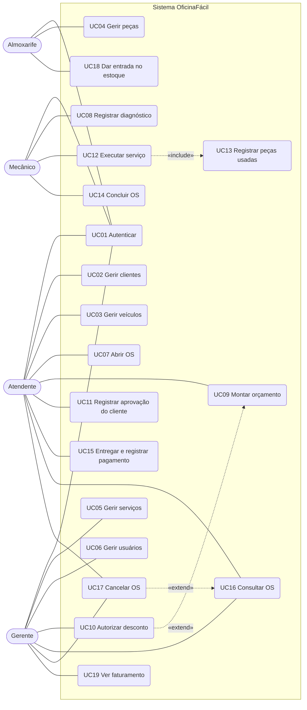
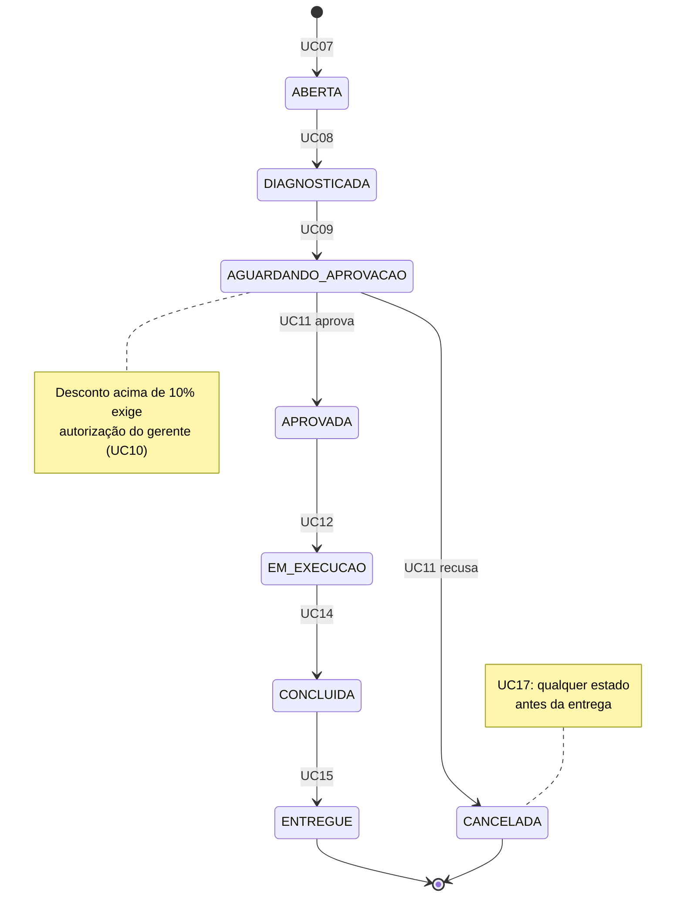
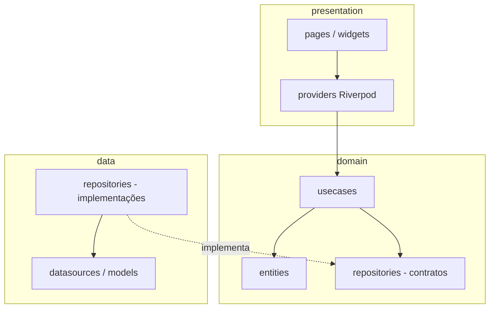
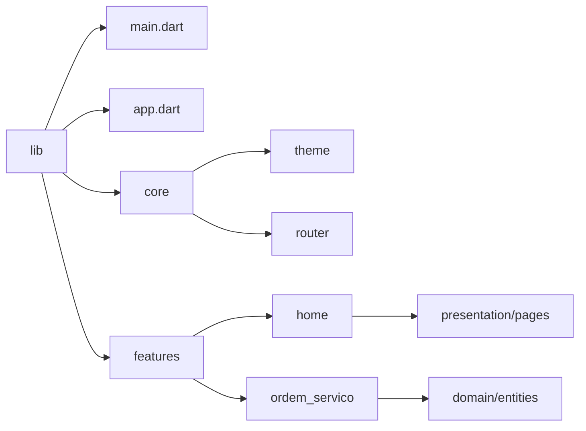

# Diagramas — OficinaFácil

Diagramas em Mermaid. Evoluem junto com o código, a cada entrega.

> UC18 e UC19 não aparecem no resumo da Entrega 1; foram assumidos a partir dos
> papéis (entrada no estoque e faturamento). Conferir com o documento oficial.

## 1. Casos de uso (Entrega 1)

Mermaid não tem diagrama de casos de uso nativo; usamos `flowchart`.
Linha sólida = associação, tracejada = `include` / `extend`.

## 2. Ciclo de vida da ordem de serviço

Implementado em `lib/features/ordem_servico/domain/entities/status_ordem_servico.dart`.

## 3. Arquitetura

Clean Architecture organizada por feature. A dependência aponta sempre para dentro:
`presentation → domain ← data`.

## 4. Estrutura de pastas

Novas features seguem `features/<nome>/{domain,data,presentation}`; as camadas
`data` e `usecases` são criadas quando a primeira regra de negócio exigir.
